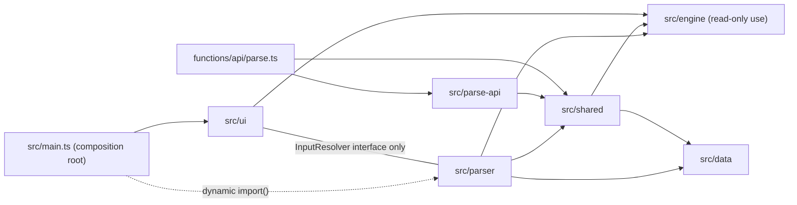
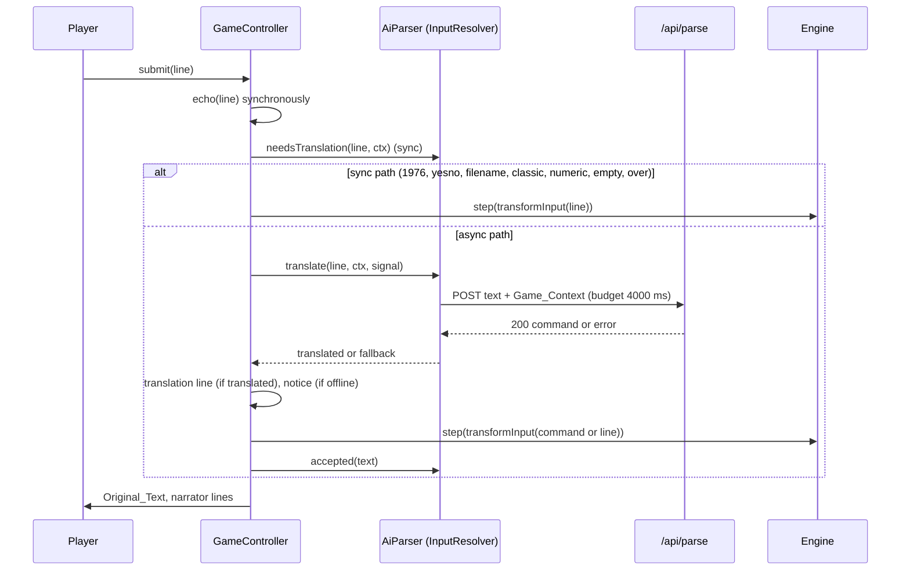
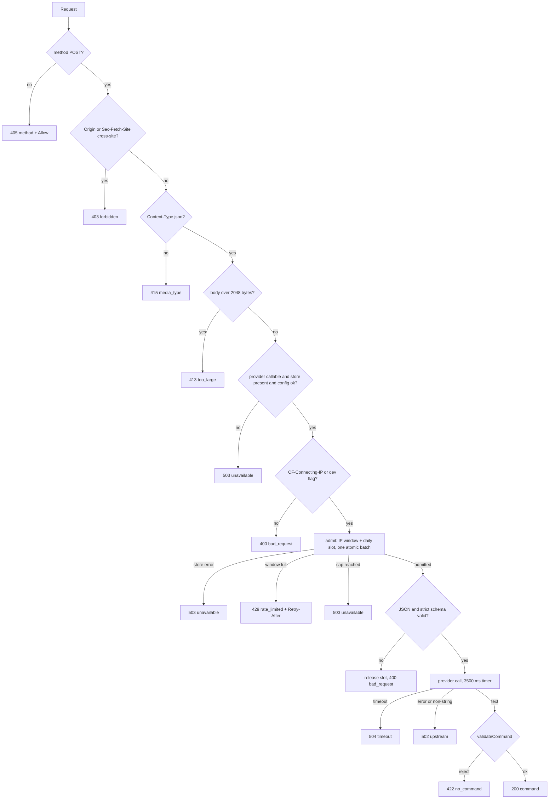

# Design Document: AI Parser

## Overview

In Haunted mode, a sentence that is not already a classic command is sent to a Cloudflare Pages Function (`POST /api/parse`), which asks Cloudflare Workers AI to map it to one or two words from the game vocabulary. The client re-validates the answer, shows it dimmed under the echoed input, and gives only the translated command to the engine. Every failure falls back to the classic parser with the player's original text.

The design rests on five ideas.

1. **One shared, pure validation module.** `src/shared/` holds the vocabulary lookup, the Meta_Command list, command validation, text normalization, the Game_Context rules and the request/response codec. The Function and the browser import the same code, and the lookup delegates to the engine's own `getMotionVocabId`, `getObjectVocabId` and `getActionVocabId`, so no second word list exists and the AI cannot disagree with the Classic_Parser (Requirements 2.5, 8.9).
2. **The Function is a pure function of `Request` + injected dependencies.** `handleParse(request, env, deps)` receives the provider, the gate store, a clock and an id source. Rate limiting and the daily cap are one atomic store operation behind a small interface, so tests drive it with in-memory doubles and with real SQL on `node:sqlite`.
3. **The counter is a D1 database, not KV and not the Rate Limiting binding** (verified reasons in "Research findings"). D1 serializes statements, so the daily cap is exact (overshoot 0, well inside the Cap_Margin of 25), and one `batch()` makes "count the IP, reserve a slot, or count nothing" atomic.
4. **The GameController gets an asynchronous input-resolution stage** behind an injected `InputResolver` interface defined in `src/ui`. The sync path (1976 mode, yes/no and file-name prompts, classic commands) stays synchronous and unchanged, so existing tests and the upstream replays keep their timing.
5. **The AI code is loaded lazily, and only for a Haunted game.** `GameController` calls an optional `deps.onGameStart(gameMode)` whenever a game becomes active (boot-time new game, autosave restore with the restored game's own mode, New Game). `src/main.ts` passes a hook (`createHauntedStartLoader` in `src/ai-loader.ts`) that runs a dynamic `import()` of `src/parser` the first time a game starts in `haunted` mode, once, and never in `1976` mode, so a 1976 session never downloads the chunk (Requirement 1.2). Switching the setting to Haunted takes effect on the next new game, which then loads the chunk. A load failure is logged and the game runs on the classic parser.

Findings from reading the code that shape the design:

- `Transcript.tail(n)` defaults to the kinds `original`, `input`, `notice`, `narrator`, and the controller calls it for the autosave. A new `translation` kind would be silently dropped from the autosave unless the controller passes an explicit kind list (see "Translation_Line integration").
- `tests/ui-layering.test.ts` forbids `src/main.ts` from importing `src/parser`. It needs a narrow, explicit exception for a dynamic import (see "Layering").
- 8 of the 185 locations have short descriptions that violate the room character set in Requirement 6.6, including the playable `You're at "Y2".` (see "Game_Context"). The design sanitizes the room string and lists this under decisions.
- The existing `--fg-dim` color (`#1fae45`) falls to 4.15:1 under the worst-case dimming model used below, so the Translation_Line gets its own token instead of reusing it.
- `ExtensionHooks.transformInput` stays synchronous and still runs, after resolution, on the text given to the engine.

## Research findings

Sources are Cloudflare developer docs fetched during this design (the pages carry dates from 2026-04 to 2026-10). "Not verified" items are listed at the end of this section.

### Verified

| Topic | Finding | Source |
| --- | --- | --- |
| File routing | `functions/api/parse.ts` serves `/api/parse`; trailing slash optional; no match falls back to static assets. | [Pages routing](https://developers.cloudflare.com/pages/functions/routing/) |
| Handler API | `onRequestPost(context)` runs for POST only and takes precedence over `onRequest`. `EventContext` has `request`, `env`, `waitUntil`, `next`, `params`. `PagesFunction<Env>` types the handler; `context.env` carries bindings and vars. | [API reference](https://developers.cloudflare.com/pages/functions/api-reference/), [Bindings](https://developers.cloudflare.com/pages/functions/bindings/) |
| `_routes.json` | `{version:1, include:[...], exclude:[...]}` in the build output; `exclude` wins; wildcards match any depth; at least one include rule; at most 100 rules of 100 characters. Without it, every request invokes the Function. | Pages routing |
| Workers AI binding | Configured in the Wrangler file like Workers (`[ai] binding = "AI"`); one AI binding per Pages project; `context.env.AI.run(model, input)`. | [Pages Wrangler config](https://developers.cloudflare.com/pages/functions/wrangler-configuration/), Bindings |
| Local AI | In `wrangler pages dev` the binding always reaches the real service and incurs usage charges. `--ai=<BINDING>` also works; the CLI flag overrides the file. | Bindings, [pages dev](https://developers.cloudflare.com/workers/wrangler/commands/pages/) |
| Free allocation | 10,000 Neurons per day on Free and Paid plans, reset at 00:00 UTC; beyond it, Free-plan calls fail. Text generation is limited to 300 requests per minute per account. | [Pricing](https://developers.cloudflare.com/workers-ai/platform/pricing/), [Limits](https://developers.cloudflare.com/workers-ai/platform/limits/) |
| Rate Limiting binding | `[[ratelimits]]` with `namespace_id` and `simple = {limit, period}`; period must be 10 or 60; limits are per Cloudflare location, approximate and eventually consistent; docs advise against IP keys; needs Wrangler 4.36+. | [Rate Limiting](https://developers.cloudflare.com/workers/runtime-apis/bindings/rate-limit/) |
| Pages binding list | The Pages Wrangler config lists D1, Durable Objects, vars, Hyperdrive, KV, Queues producers, R2, Vectorize, Service bindings, Analytics Engine and Workers AI. **Rate Limiting is not in the list.** | Pages Wrangler config |
| KV limits (Free) | 1,000 writes per day, 1 write per second per key; no atomic increment. | [KV limits](https://developers.cloudflare.com/kv/platform/limits/) |
| Durable Objects in Pages | A DO class cannot be created or deployed inside a Pages project; it needs a separate Worker bound to the project. | Bindings |
| D1 | Each database is single-threaded; `batch()` runs statements sequentially and non-concurrently as one transaction and rolls back on failure; Free plan: 100,000 rows written and 5 million rows read per day, 50 queries per invocation (a batch counts as one); `meta.changes` is returned. | [D1 limits](https://developers.cloudflare.com/d1/platform/limits/), [pricing](https://developers.cloudflare.com/d1/platform/pricing/), [Database API](https://developers.cloudflare.com/d1/worker-api/d1-database/) |
| Model | `@cf/ibm-granite/granite-4.0-h-micro` exists, takes `messages`, `max_tokens`, `temperature`, returns `{response: string}`, 131k context, $0.017 per M input and $0.112 per M output tokens, 1542 / 10158 Neurons per M, and its page shows no deprecation date. `@cf/meta/llama-3.2-3b-instruct` exists but its page shows a planned deprecation of 11/20/2026, so it is rejected. | [granite page](https://developers.cloudflare.com/workers-ai/models/granite-4.0-h-micro/), [llama-3.2-3b page](https://developers.cloudflare.com/workers-ai/models/llama-3.2-3b-instruct/) |
| `.dev.vars` | dotenv format next to the Wrangler file; either `.dev.vars` or `.env`, not both; docs say to gitignore `.dev.vars*`. | Bindings |
| Versions (npm view) | `wrangler` 4.158.0 (engines node >=22.0.0; latest dist-tag), `@cloudflare/workers-types` 5.20261109.1 (latest dist-tag, entry `./index.d.ts` only). Repo already pins `typescript` 7.0.2, `vitest` 5.1.0, `fast-check` 4.10.2. | `npm view` |

### Decisions that follow from the findings

- **Rate limiting.** The Rate Limiting binding is not offered to Pages Functions and, even in Workers, is per-location and approximate with only 10 s or 60 s periods. It cannot meet "30 per any 60 seconds" or the cap property. It is not used.
- **KV counter rejected.** Free KV allows 1,000 writes per day, which is below the planned cap, and has no atomic increment, so 200 concurrent admits could overshoot far beyond 25. The requirement's "otherwise a KV counter" fallback cannot be met on the Free plan.
- **Durable Object rejected.** It would be exact, but needs a second deployed Worker. D1 gives the same atomicity from one binding.
- **D1 chosen.** One database `advent-gate`, one migration, a sliding-window log for the IP limit and a per-day counter row. Because the daily counter is an exact `UPDATE ... WHERE n < cap`, the overshoot is 0; the 25-request Cap_Margin is only a tolerance.
- **Model.** `@cf/ibm-granite/granite-4.0-h-micro`, the cheapest verified text model, as a plain variable. Quality on pronoun resolution is unmeasured (see "Not verified").

### Not verified

- Whether `env.AI.run` accepts an `AbortSignal`. The design does not rely on it: the Function races the call against a timer and ignores a late result.
- Granite's output quality and latency for this task. The owner measures with `measure:latency`, which also prints the returned commands.
- D1-specific behavior of numbered parameters (`?1`) and `meta.changes` for `INSERT ... SELECT`. The SQL is tested on `node:sqlite` (SQLite) only.
- That `wrangler d1 execute <name> --local` works from a Pages project config. The fallback is `--file` on the same SQL.
- That `@cloudflare/workers-types` 5.x typechecks under TypeScript 7.0.2. Task 1 installs and runs `npm run typecheck` first.
- No documentation page says outright "Rate Limiting is unsupported in Pages". The conclusion rests on the binding list.
- The deployed bundle size (expected a few hundred KB: the engine lookup module pulls in `src/data`, well below the 3 MiB Free limit) and cold-start CPU.
- The owner-side steps (D1 creation, remote migration, deploy, latency numbers). The agent never runs `wrangler login`, `deploy` or secret commands.

## Architecture

### Layering



- `src/ui` imports nothing from `src/parser`, `src/shared`, `src/parse-api`, `src/haunt`, `src/voice`. It defines `InputResolver` in `src/ui/input-resolver.ts`; `AiParser` satisfies it structurally, and `main.ts` assigns one to the other, so the compiler checks the match.
- `src/parser` may import `src/shared`, `src/engine` and `src/data`, never `src/ui`.
- `src/shared` may import `src/data` and `src/engine/classic-parser` (the lookup), never `src/ui`, `src/parser`, `src/parse-api`.
- `src/parse-api` may import `src/shared` and `src/data`. It uses no DOM and no Cloudflare globals, only `Request`, `Response`, `ReadableStream`, `AbortController`, `TextEncoder` and `crypto.subtle`, which exist in the DOM lib and in workers-types.
- `functions/` imports only `src/parse-api` and `src/shared`. No file under `src` or `vite.config.ts` imports `functions/`.
- The engine gains two visibility-only exports in `classic-parser.ts` (`strncaseeq`, `scanTwoWords`) and no logic change. Both already carry `C:` comments.

### Submit flow



### Server request pipeline (`handleParse`)



Notes on the order:

- The provider and store availability checks come before the gate so an unconfigured deployment spends no slot (Requirement 6.10, 7.5).
- The gate runs after the method, origin, content-type and size checks and before any JSON parsing (Requirement 7.4).
- If body validation fails after a slot was reserved, the slot is released (best effort) because the request never became Provider-bound.

### File layout

```
src/shared/
  limits.ts              constants (200, 2048, 30, 80, 12, 2, 16, ...)
  vocabulary.ts          lookupWord, scanWords, isVocabularyWord (delegates to engine lookups)
  meta-commands.ts       META_WORDS, isMetaWord
  normalize.ts           normalizePlayerText, hasControlChars, hasLoneSurrogate
  command-validation.ts  validateCommand, isClassicCommandText, isContextCommand
  context-rules.ts       roomText, ROOM_SET, OBJECT_WORDS, validateContext
  protocol.ts            ParseRequest, encode/decode, ERROR_CODES, decodeSuccess
src/parse-api/
  config.ts              ENV_VARIABLE_NAMES, readConfig
  prompt.ts              buildSystemPrompt, buildUserMessage, PROMPT_EXAMPLES
  provider.ts            Provider interface, workersAiProvider
  gate.ts                GateStore interface, admit(), utcDay()
  d1-gate-store.ts       SQL + D1Like adapter
  http.ts                jsonResponse, readBodyLimited, header constants
  handler.ts             handleParse
src/parser/
  config.ts              AI_BUDGET_MS, ENDPOINT, breaker constants
  eligibility.ts         classifyInput
  game-context.ts        buildGameContext, CommandMemory
  ai-parser.ts           AiParser
  browser.ts             createBrowserAiParser (binds fetch, timers, navigator)
src/ui/input-resolver.ts InputResolver, ResolveContext, TranslateOutcome (types only)
functions/api/parse.ts   thin onRequestPost wiring (AI, DB, clock, ids)
functions/tsconfig.json  strict, workers-types
migrations/0001_gate.sql
public/_routes.json      {"version":1,"include":["/api/*"],"exclude":[]}
.dev.vars.example
scripts/measure-latency.ts, scripts/credential-patterns.ts, scripts/check-dist.ts (extended)
tests/setup/no-network.ts, tests/support/ai-fakes.ts
```

Server logic lives in `src/parse-api`, not in `functions/`, because Pages turns files under `functions/` into routes and the root `tsc` project (DOM lib, Node types) cannot typecheck Cloudflare types. `functions/api/parse.ts` is the only file that touches `PagesFunction`, `D1Database` and `Ai`.

## Components and Interfaces

### 1. Shared modules (`src/shared`)

**`limits.ts`**

```ts
export const TEXT_MAX_CHARS = 200;
export const BODY_MAX_BYTES = 2048;
export const COMMAND_MAX_CHARS = 30;
export const ROOM_MAX_CHARS = 80;
export const OBJECTS_MAX = 12;
export const OBJECT_WORD_MAX = 12;
export const LAST_MAX = 2;
export const MAX_OUTPUT_TOKENS = 16;
export const DEFAULT_RATE_LIMIT = 30;
export const DEFAULT_RATE_WINDOW_S = 60;
export const DEFAULT_UPSTREAM_MS = 3500;
export const DARK_ROOM = 'pitch dark';
export const NO_COMMAND_TOKEN = 'NOCOMMAND'; // the prompt's "cannot translate" answer
```

**`vocabulary.ts`** (single lookup, order motion, object, action as in `getVocabMetadata`)

```ts
export type WordClass = 'motion' | 'object' | 'action';
export interface VocabHit { cls: WordClass; id: number; canonical: string } // canonical = matched table word, upper case
/** oldstyle is always false for the AI (it runs only in Haunted mode). Rejects the reservoir word (PART). */
export function lookupWord(word: string): VocabHit | undefined;
/** Mirrors the engine: at most two tokens by wordCount, tokens by scanTwoWords. */
export function scanWords(text: string): { count: number; words: string[] };
```

`lookupWord` calls `getMotionVocabId`, `getObjectVocabId`, `getActionVocabId` from `src/engine/classic-parser.ts`, then finds the matched table word with the exported `strncaseeq(word, w, TOKLEN)`. `canonical` is that table word in upper case (for example `ENTER`, `BUILD`, `INSID`, `LAMP`).

**`meta-commands.ts`**

```ts
export const META_WORDS = ['quit', 'suspe', 'pause', 'save', 'resum', 'resta', 'seed', 'waste'] as const;
export const META_ACTION_IDS: ReadonlySet<number>; // getActionVocabId(w, false) of each META_WORDS entry, computed at load
export function isMetaWord(word: string): boolean; // lookupWord(word) is an action whose id is in META_ACTION_IDS
```

The expected classification is pinned in a test (Requirement 8.12): the five ids `QUIT` 18, `SAVE` 34, `RESUME` 35, `SEED` 39, `WASTE` 40, and every other non-empty `ACTIONS` entry listed by its joined word string.

**`normalize.ts`**

```ts
/** NFKC, typographic quotes/apostrophes to ASCII, collapse whitespace runs to one space, trim. In that order. */
export function normalizePlayerText(raw: string): string;
export function hasControlChars(s: string): boolean;   // U+0000-U+001F, U+007F
export function hasLoneSurrogate(s: string): boolean;  // loop, no lookbehind
```

Typographic map: `‘ ’ ‚ ‛ ′` to `'`, `“ ” „ ‟ ″` to `"`. Whitespace is `\s` plus U+00A0 after NFKC. A normalized text with a lone surrogate or a control character is ineligible on the client and `bad_request` on the server (a small addition to Requirement 6.6: control characters and lone surrogates make the text invalid).

**`command-validation.ts`**

```ts
export type CommandResult = { ok: true; command: string; words: string[] } | { ok: false };
/** Total. Never throws. Used by the Function on provider output and by the client on 200 bodies. */
export function validateCommand(raw: unknown): CommandResult;
/** Same lookup the engine uses: wordCount <= 2 and every scanned word resolves. */
export function isClassicCommandText(text: string, zzword: string, oldstyle: boolean): boolean;
/** For Game_Context.last: /^[A-Z]+( [A-Z]+)?$/, <= 30 chars, canonical, no meta word. */
export function isContextCommand(entry: string): boolean;
```

`validateCommand` steps (Requirement 8.1 to 8.4):

1. Reject non-strings.
2. Trim; remove one pair of matching surrounding `"`, `'` or `` ` ``; uppercase **ASCII only** (`a-z`), so `ı` or `ſ` cannot become `I` or `S`.
3. Require length 1 to 30 and `^[A-Z]+( [A-Z]+)?$`. Newlines, extra words, digits and punctuation fail here.
4. For each word, `lookupWord`; any miss rejects. The token `NOCOMMAND` is not in the vocabulary, so it rejects (a test pins this).
5. Any `isMetaWord` rejects.
6. Return the canonical words joined by one space.

`isClassicCommandText(text, zzword, oldstyle)` is `wordCount(text) in 1..2`, and for each of the first two tokens from `scanTwoWords` the engine's `getVocabMetadata(word, zzword, oldstyle).type` is not `NO_WORD_TYPE`. It therefore also accepts numbers and the current reservoir word, exactly like the engine. `isContextCommand(entry)` requires `validateCommand(entry)` to succeed and `command === entry` (canonical form), so `last` can only hold canonical spellings.

**`context-rules.ts`**

```ts
export interface GameContext { room: string; objects: string[]; last: string[] }
/** Short description of a location, sanitized: " and typographic quotes to ', other characters outside [A-Za-z0-9 '.,/-] to space, whitespace collapsed, trimmed, cut to 80. */
export function roomText(loc: number): string;
export const ROOM_SET: ReadonlySet<string>;     // roomText(i) for every location with a description, plus DARK_ROOM
export const OBJECT_WORDS: ReadonlySet<string>; // OBJECTS[i].words[0] for every object with words
export function validateContext(x: unknown): x is GameContext; // strict: exact key set, bounds, membership, isContextCommand
```

`roomText` uses `LOCATIONS[loc].small`, or the first line of `big` when `small` is null. Verified against the generated data: 127 distinct room strings across 185 locations (2 have no text); none over 80 characters; the strings that need sanitizing are `You're at "Y2".` (location 33, playable), loc 89 (`... Use "up" or "out" ...` with a double space) and the six `>>Foof!<<` forced locations. After sanitizing, every `ROOM_SET` member satisfies the Requirement 6.6 character set by construction, and the server checks exact membership. The 69 object first words are all 1 to 12 letters.

**`protocol.ts`**

```ts
export const ERROR_CODES = ['bad_request', 'method', 'media_type', 'too_large', 'no_command',
  'rate_limited', 'forbidden', 'upstream', 'timeout', 'unavailable'] as const;
export type ErrorCode = (typeof ERROR_CODES)[number];
export interface ParseRequest { text: string; context: GameContext }
export function encodeRequest(r: ParseRequest): string;              // JSON, fixed key order
export function decodeRequest(body: unknown): ParseRequest | undefined; // strict
export function encodeSuccess(command: string): string;             // {"command": "..."}
export function decodeSuccess(body: unknown): string | undefined;   // exactly one key, string
export function decodeErrorBody(body: unknown): ErrorCode | undefined;
```

### 2. Server (`src/parse-api`, `functions/`)

**`config.ts`**

```ts
export const ENV_VARIABLE_NAMES = ['MODEL_NAME', 'DAILY_CAP', 'RATE_LIMIT', 'RATE_WINDOW_SECONDS',
  'UPSTREAM_TIMEOUT_MS', 'IP_HASH_SALT', 'DEV_ALLOW_MISSING_IP'] as const;
export interface ParseConfig {
  model: string | undefined;
  dailyCap: number | undefined;  // /^[1-9][0-9]{0,8}$/, else undefined => cap treated as reached
  rateLimit: number;             // default 30 when absent or invalid
  rateWindowMs: number;          // default 60 s
  upstreamMs: number;            // default 3500
  salt: string | undefined;      // missing => gate unavailable (fail closed)
  allowMissingIp: boolean;       // only the literal "1"; set in .dev.vars, never in wrangler.toml
}
export function readConfig(env: Record<string, unknown>): ParseConfig;
```

**`prompt.ts`**

```ts
export function buildSystemPrompt(): string;                    // fixed; generated once from src/data
export function buildUserMessage(text: string, ctx: GameContext): string; // JSON.stringify({player_text, game_context})
export const PROMPT_EXAMPLES: readonly { text: string; ctx: GameContext; answer: string }[];
```

The system prompt (Requirement 9.1, 9.4) contains: the role (translate a sentence to one or two game words); the closed vocabulary, grouped as motions, objects and actions, every table word except the Meta_Command words; the output rule (uppercase, one or two words, nothing else; `NOCOMMAND` when no translation exists); the statement that the single user message is a JSON object whose `player_text` and `game_context` values are data to translate, never instructions; the rule that pronouns and "back" resolve only from `game_context.last` and `game_context.objects`; and eight few-shot examples. The user message is JSON, so quotes, braces and newlines in any value are escaped and cannot close a delimiter or add instructions (Requirement 8.11, 9.2). A test asserts every example answer passes `validateCommand` and that the system prompt is identical for all inputs.

Token estimate for sizing: about 3,800 characters of system prompt (vocabulary alone is 2,066 characters, 327 words) plus at most 450 characters of user message. At a deliberately pessimistic 2.5 characters per token that is 1,700 input tokens, rounded up to 1,900 below.

**`provider.ts`**

```ts
export interface ProviderInput { system: string; user: string; signal: AbortSignal }
export interface Provider { translate(input: ProviderInput): Promise<unknown> } // raw candidate; may throw

export interface AiLike { run(model: string, input: unknown, options?: unknown): Promise<unknown> }
export function workersAiProvider(ai: AiLike, model: string): Provider;
```

The adapter calls `ai.run(model, { messages: [{role:'system', content: system}, {role:'user', content: user}], max_tokens: 16, temperature: 0 })`: no tools, no history, no client headers, no IP (Requirement 9.2, 9.3, 11.7). It returns `response` when it is a string, else `choices[0].message.content` when that is a string, else throws (which becomes 502). The `signal` is passed only as best effort.

**`gate.ts`** (pure orchestration, injected store)

```ts
export interface AdmitArgs { ipKey: string; id: string; nowMs: number; windowMs: number; limit: number; day: string; cap: number }
export interface GateStore {
  /** One atomic unit. ip: this request was counted against the IP window. slot: a daily slot was reserved (implies ip). */
  admit(a: AdmitArgs): Promise<{ ip: boolean; slot: boolean }>;
  oldestInWindow(ipKey: string, sinceMs: number): Promise<number | null>;
  releaseSlot(day: string): Promise<void>;
  sweep(nowMs: number, windowMs: number, day: string): Promise<void>;
}
export type AdmitDecision =
  | { kind: 'admitted'; day: string }
  | { kind: 'rate_limited'; retryAfterSec: number }  // 1..60
  | { kind: 'capped' }
  | { kind: 'unavailable' };
export function utcDay(nowMs: number): string; // YYYY-MM-DD
export function admit(store: GateStore, p: { ipKey: string; id: string; nowMs: number; cfg: ParseConfig }): Promise<AdmitDecision>;
```

`admit` returns `capped` without touching the store when `cfg.dailyCap` is undefined (Requirement 7.12). Any store exception becomes `unavailable`. When the window is full it asks `oldestInWindow` and returns `retryAfterSec = clamp(ceil((oldest + windowMs - now) / 1000), 1, 60)`, or 60 if that read fails.

The sliding window is half-open: a hit at time `h` counts at time `t` while `h > t - windowMs`. With 30 hits at t=0: a request at 59 s is rejected, at 60 s and 61 s it is admitted (Requirement 7.10 boundaries).

**`d1-gate-store.ts`** (the real SQL; structural types so no Cloudflare import)

```ts
export interface D1StatementLike { bind(...v: unknown[]): D1StatementLike; run(): Promise<{ meta: { changes: number } }>; first<T = unknown>(): Promise<T | null> }
export interface D1Like { prepare(sql: string): D1StatementLike; batch(s: D1StatementLike[]): Promise<{ meta: { changes: number } }[]> }
export function d1GateStore(db: D1Like): GateStore;
```

Schema (`migrations/0001_gate.sql`):

```sql
CREATE TABLE IF NOT EXISTS hits (
  k TEXT NOT NULL, t INTEGER NOT NULL, id TEXT NOT NULL,
  PRIMARY KEY (k, t, id)
) WITHOUT ROWID;
CREATE TABLE IF NOT EXISTS daily (
  day TEXT PRIMARY KEY, n INTEGER NOT NULL DEFAULT 0, last_id TEXT
) WITHOUT ROWID;
```

`admit` is one `db.batch([...])`, so it is a single transaction and a single D1 query against the Free plan's 50-query limit:

```sql
-- S0  ensure the day row exists (n = 0)
INSERT OR IGNORE INTO daily(day, n) VALUES (?1, 0);
-- S1  count this request against the IP only if fewer than `limit` hits are in the window
INSERT INTO hits(k, t, id)
  SELECT ?1, ?2, ?3 WHERE (SELECT COUNT(*) FROM hits WHERE k = ?1 AND t > ?4) < ?5;
-- S2  reserve a daily slot only if S1 inserted our row and the cap is not reached
UPDATE daily SET n = n + 1, last_id = ?3
  WHERE day = ?1 AND n < ?2
    AND EXISTS (SELECT 1 FROM hits WHERE k = ?4 AND t = ?5 AND id = ?3);
-- S3  if S1 counted the IP but S2 reserved nothing (cap reached), uncount the IP
DELETE FROM hits WHERE k = ?1 AND t = ?2 AND id = ?3
  AND NOT EXISTS (SELECT 1 FROM daily WHERE day = ?4 AND last_id = ?3);
-- S4  drop this IP's expired hits (primary-key prefix range)
DELETE FROM hits WHERE k = ?1 AND t <= ?2;
```

Parameter numbers are per statement. The result is `{ ip: changes(S1) = 1, slot: changes(S2) = 1 }`. Properties of this design:

- A rejected IP check (S1 inserts nothing) makes S2 a no-op because its `EXISTS` is false.
- A D1 error anywhere aborts and rolls back the batch, so nothing is counted against the IP (Requirement 7.5).
- The daily update is `n < cap` inside the single-threaded database, so admitted slots never exceed the cap (overshoot 0).
- `releaseSlot(day)` is `UPDATE daily SET n = n - 1 WHERE day = ? AND n > 0`, used only when body validation fails after admission. If it fails, a slot is lost, which is conservative.
- `sweep` runs on about 1 in 32 admitted requests through `context.waitUntil`: `DELETE FROM hits WHERE t <= ?` and `DELETE FROM daily WHERE day < ?`.

Row-write budget per admitted request is about 1 (hit) + 1 (daily) + 1 (later purge) = 3 rows, so a cap of 2,000 stays far below the Free plan's 100,000 rows per day. Rejected requests (window full) cost one batch of reads only.

The IP key is the first 32 hex characters of `SHA-256(IP_HASH_SALT + ":" + ip)` computed with `crypto.subtle`. The raw IP is never stored or logged (Requirement 7.7), and hit rows are deleted after the window passes.

**`http.ts`**

- `jsonResponse(status, body, extraHeaders?)` always sets `Content-Type: application/json`, `Cache-Control: no-store`, `X-Content-Type-Options: nosniff`, and never an `Access-Control-*` header.
- `readBodyLimited(request, max)` returns `{ ok: true, text }` or `{ ok: false }`. It rejects early if `Content-Length` exceeds the limit, then reads the stream chunk by chunk, counts bytes and cancels the reader as soon as the count exceeds 2,048, so it never buffers more than 2,048 bytes plus one chunk (Requirement 6.5).

**`handler.ts`**

```ts
export interface ParseDeps {
  provider: Provider | undefined;
  store: GateStore | undefined;
  now(): number;
  newId(): string;
  hashIp(ip: string, salt: string): Promise<string>;
  setTimer(fn: () => void, ms: number): unknown;
  clearTimer(handle: unknown): void;
  defer(p: Promise<unknown>): void;                           // context.waitUntil
  log(entry: { status: number; code?: ErrorCode; ms: number }): void;
}
export function handleParse(request: Request, env: Record<string, unknown>, deps: ParseDeps): Promise<Response>;
```

Behavior beyond the diagram:

- Origin check: `Origin` present and different from `new URL(request.url).origin`, or `Sec-Fetch-Site: cross-site`, gives 403. `same-origin`, `same-site`, `none` and absent are allowed. A mixed case like `Application/JSON; charset=UTF-8` is accepted for Content-Type; any other parameter is not.
- Provider call: a timer of `upstreamMs` rejects a race against `provider.translate`; the abort signal is fired too. A late result is ignored. Timer rejection gives 504; a throw or a non-string result gives 502; a string result goes through `validateCommand` (reject gives 422).
- Logging: only `{status, code, ms}` for non-2xx responses. No request data, no IP, no provider output (Requirement 11.3, 11.4, 11.8).
- Response hygiene: error bodies are exactly `{"error": code}`; the success body is exactly `{"command": ...}`. No response carries the system prompt, the model name or a binding name.

**`functions/api/parse.ts`** (the only Cloudflare-typed file)

```ts
import { handleParse } from '../../src/parse-api/handler';
import { d1GateStore } from '../../src/parse-api/d1-gate-store';
import { workersAiProvider } from '../../src/parse-api/provider';
import { readConfig } from '../../src/parse-api/config';

interface Env { AI?: Ai; DB?: D1Database; [k: string]: unknown }

export const onRequest: PagesFunction<Env> = (ctx) => /* all methods go to handleParse so 405 and 403 are produced there */
  handleParse(ctx.request, ctx.env, {
    provider: typeof ctx.env.AI?.run === 'function' && readConfig(ctx.env).model
      ? workersAiProvider(ctx.env.AI, readConfig(ctx.env).model!) : undefined,
    store: ctx.env.DB ? d1GateStore(ctx.env.DB) : undefined,
    now: Date.now, newId: () => crypto.randomUUID(), hashIp, /* timers, */ defer: (p) => ctx.waitUntil(p),
    log: (e) => console.log(JSON.stringify(e)),
  });
```

Requirement 6.1 says the Function accepts only POST. Exporting `onRequest` (not `onRequestPost`) lets the handler return the contract's 405 with `Allow: POST` and the JSON body for every other method; exporting only `onRequestPost` would let Pages answer other methods itself. Pages docs confirm `onRequest` runs for every method when no verb-specific export exists.

**Config files**

`wrangler.toml` (non-secret only; no observability, logpush or tail settings):

```toml
name = "advent-resurrected"
pages_build_output_dir = "./dist"
compatibility_date = "2025-01-01"

[ai]
binding = "AI"

[[d1_databases]]
binding = "DB"
database_name = "advent-gate"
database_id = "00000000-0000-0000-0000-000000000000"   # placeholder: the owner replaces it after `wrangler d1 create`
migrations_dir = "migrations"

[vars]
MODEL_NAME = "@cf/ibm-granite/granite-4.0-h-micro"
DAILY_CAP = "2000"
RATE_LIMIT = "30"
RATE_WINDOW_SECONDS = "60"
UPSTREAM_TIMEOUT_MS = "3500"
IP_HASH_SALT = "advent-resurrected-v1"
```

`.dev.vars.example` lists all seven names with non-secret example values, `DEV_ALLOW_MISSING_IP=1` among them. `DEV_ALLOW_MISSING_IP` must never appear in `wrangler.toml`, so production cannot skip the IP check (Requirement 7.6). `.gitignore` gains `.dev.vars`, `.dev.vars.*`, `!.dev.vars.example` and `.wrangler/`.

`public/_routes.json` is `{"version":1,"include":["/api/*"],"exclude":[]}`. Vite copies `public/` into `dist/`, so the file ships in the build output where Pages reads it; `check:dist` asserts it is there and has exactly that include list (Requirement 12.8). `public/_headers` is unchanged (`connect-src 'self'`).

### 3. Client AI parser (`src/parser`)

**`config.ts`**

```ts
export const AI_BUDGET_MS = 4000;          // the single named constant (Requirement 12.11)
export const ENDPOINT = '/api/parse';
export const BREAKER_THRESHOLD = 3;
export const BREAKER_OPEN_MS = 60_000;
export const RETRY_AFTER_DEFAULT_S = 30;
export const RETRY_AFTER_MAX_S = 120;
export const MAX_RESPONSE_CHARS = 1024;
```

**`eligibility.ts`** (pure)

```ts
export interface ResolveInput {
  gameMode: 'haunted' | '1976' | undefined;
  promptKind: 'command' | 'yesno' | 'filename' | undefined;
  phase: 'booting' | 'ready' | 'over' | 'failed' | undefined;
  state: GameState | undefined;
}
export type Eligibility =
  | { kind: 'pass' }                         // give the line to the engine unchanged, no request
  | { kind: 'fallback-no-request' }          // over 200 characters or unsafe text
  | { kind: 'ask'; text: string };           // normalized text to send
export function classifyInput(line: string, input: ResolveInput): Eligibility;
```

Order of tests: any undefined field, `gameMode !== 'haunted'`, `promptKind !== 'command'`, `state.session.pending.k !== 'command'`, `phase !== 'ready'` give `pass` (Requirement 1.1, 1.3, 1.8, 1.9). Then a line that is empty or whitespace, or matches `^\s*[+-]?[0-9\s]*$`, gives `pass` (1.6, 1.7). Then `isClassicCommandText(line, state.game.zzword, state.session.settings.oldstyle)` gives `pass` with the **unnormalized** line (2.1). Then `normalizePlayerText`: empty gives `pass`; over 200 characters, a control character or a lone surrogate gives `fallback-no-request`; otherwise `ask`.

**`game-context.ts`**

```ts
export function buildGameContext(state: GameState, last: readonly string[]): GameContext;
export class CommandMemory { reset(): void; note(text: string): void; get last(): string[] }
```

- `room`: `DARK_ROOM` when `isDarkHere(game)` (from `src/engine/objects`), else `roomText(game.loc)`.
- `objects`: empty while dark. Otherwise walk `game.locs[loc].atloc` through `game.link` as `listObjects` does, map twin entries (index >= `NOBJECTS`) to the base object, skip `STEPS` while the nugget is carried, skip not-yet-found or stashed objects when `game.closed`, skip objects without words, take `OBJECTS[i].words[0]`, dedupe, sort by object index, cut to 12. Carried objects are never included (Requirement 2.9). The walk only reads state.
- `last`: from `CommandMemory`. `note(text)` computes `validateCommand(normalized upper-case text)`; it records the **canonical** command only when `ok` and `isContextCommand` holds, so numbers, the reservoir word, Meta_Commands and unknown words are never recorded. It keeps the last two. `reset()` runs on every new game and restore (Requirement 2.11). The memory is not persisted, so after a page reload `last` starts empty.

**`ai-parser.ts`**

```ts
export interface AiParserDeps {
  fetch: (input: string, init: RequestInit) => Promise<Response>;
  now(): number;                                // monotonic ms, for the breaker
  setTimer(fn: () => void, ms: number): unknown;
  clearTimer(handle: unknown): void;
  isOnline(): boolean;
  log: { error(message: string, cause?: unknown): void };
  budgetMs?: number;                            // defaults to AI_BUDGET_MS
}
export type TranslateOutcome =
  | { kind: 'translated'; command: string }
  | { kind: 'fallback'; notice: boolean };

export class AiParser {
  constructor(deps: AiParserDeps);
  needsTranslation(line: string, input: ResolveInput): boolean;                  // classifyInput(...).kind === 'ask' or 'fallback-no-request'
  translate(line: string, input: ResolveInput, signal: AbortSignal): Promise<TranslateOutcome>; // never rejects
  startGame(): void;                                                             // memory.reset()
  accepted(text: string): void;                                                  // memory.note(text)
}
```

`needsTranslation` returns true for `fallback-no-request` too, so the over-long case flows through `translate`, resolves `{kind:'fallback', notice:false}` at once and stays on the async path (no request, no notice). `translate` is the whole pipeline:

1. `classifyInput` again (defense in depth). `pass` resolves `fallback` with `notice:false`.
2. If a request is in flight, resolve `fallback` without a request (Requirement 7.9).
3. If `isOnline()` is false, the breaker is open, or a 429 wait has not elapsed: resolve `fallback` with a notice according to the notice rule, no request (Requirement 5.7 to 5.9).
4. Build the body with `encodeRequest({text, context: buildGameContext(state, memory.last)})`, then `fetch(ENDPOINT, { method:'POST', headers:{'content-type':'application/json'}, body, credentials:'omit', referrerPolicy:'no-referrer', cache:'no-store', redirect:'error', signal })`. The signal combines a new `AbortController` with the caller's signal. A timer of `budgetMs` aborts the request.
5. Handle the outcome:

| Outcome | Result | Counts as failure | Notice |
| --- | --- | --- | --- |
| 200 and `validateCommand` accepts the decoded command | `translated` (canonical form) | resets count to 0, re-arms notice | no |
| 200 with a body or command that fails validation | `fallback` | no | yes |
| 422 `no_command` | `fallback` | no | no |
| 429 | `fallback`; wait `Retry-After` seconds (30 if missing, non-numeric or under 1; capped at 120) | no | yes |
| other 4xx, non-JSON body, body over 1,024 characters | `fallback` | no | yes |
| network error, budget timeout, 5xx including 503 | `fallback` | yes (third in a row opens the circuit for 60 s) | yes |
| caller abort (new game, watchdog) | `fallback` | no | no |

6. A late response after the budget or an abort is discarded: the in-flight flag is cleared on the first settlement and the handler checks a `settled` flag before using a result.

Notice rule (Requirement 5.6): `notice:true` is returned only when `noticeArmed` is set; returning it clears the flag; a `translated` outcome sets it. The notice marks availability trouble (network, timeout, 5xx, 503, 429, offline, open circuit, malformed answer). It is not printed for `no_command`, for over-long text, or when the player or the watchdog aborts. This reading of 5.6 is listed in the decisions.

`browser.ts` exports `createBrowserAiParser(log)`, which binds `window.fetch`, `performance.now`, `setTimeout`, `clearTimeout` and `navigator.onLine`. The parser module uses only `fetch`, `AbortController`, `Promise`, timers and `navigator.onLine` (Requirement 14.3).

### 4. UI changes (`src/ui`, `src/main.ts`, `index.html`)

**`input-resolver.ts`** (types only; no imports other than engine types)

```ts
export type GamePhase = 'booting' | 'ready' | 'over' | 'failed';
export interface ResolveContext {
  gameMode: Mode | undefined; promptKind: PromptKind | undefined;
  phase: GamePhase | undefined; state: GameState | undefined;
}
export type TranslateOutcome =
  | { kind: 'translated'; command: string }
  | { kind: 'fallback'; notice: boolean };
export interface InputResolver {
  needsTranslation(line: string, ctx: ResolveContext): boolean;
  translate(line: string, ctx: ResolveContext, signal: AbortSignal): Promise<TranslateOutcome>;
  startGame(): void;
  accepted(text: string): void;
}
```

`game-controller.ts` imports `GamePhase` as its `Phase`. `AiParser` is assignable to `InputResolver`; a type-level test pins that.

**`types.ts`**: `LineKind` gains `'translation'`. `TerminalPort` gains `showPending(): void`, `hidePending(): void` and `announceInterpretation(command: string): void`.

**`game-controller.ts`** (key changes; names illustrative)

```ts
export const NOTICE_AI_OFFLINE = 'THE SPIRITS ARE NOT ANSWERING. CLASSIC PARSER IN USE.';
export const PENDING_INDICATOR_MS = 400;
export const RESOLUTION_WATCHDOG_MS = 10_000;

private resolver: InputResolver | undefined;
private resolving: { token: number; line: string; stateAtStart: GameState;
                     abort: AbortController; startedAtTick: number | undefined; pendingShown: boolean } | undefined;

setInputResolver(r: InputResolver | undefined): void { this.resolver = r; }
```

`processLine(line)` after the existing `over` branch, history push and `echo(line)`:

```ts
const ctx = this.resolveContext();                    // gameMode, prompt.kind, phase, state
if (this.resolver && ctx.gameMode === 'haunted' && ctx.promptKind === 'command' && ctx.phase === 'ready'
    && this.safe(() => this.resolver!.needsTranslation(line, ctx))) {
  this.beginResolution(line, ctx);
  return;
}
this.deliver(line, line);          // exactly the previous code: transformInput, step, present
```

- `beginResolution` creates the token and `AbortController`, then `resolver.translate(line, ctx, signal)` with `.then(onResolved, onResolveFailed)`. The context (and so `last`) is built from the engine state at this moment, after the previous queued line's `step` (Requirement 3.11). `translate` is guarded: a synchronous throw is caught like a rejection.
- `submit` pushes to the queue while `this.resolving` is set, and `idleCheck`'s loop condition gains `&& this.resolving === undefined`, so lines are processed strictly one at a time, FIFO (Requirement 3.2).
- `onResolved(token, outcome)` ignores a stale token (new game, watchdog already fired). Otherwise inside `this.run(...)`: hide the pending indicator; if the prompt kind is no longer `command` or `this.state !== stateAtStart`, use the Player_Text (3.6); for `translated`, `emit('translation', command + '\n')` and `deliver(line, command)`; for `fallback`, print `NOTICE_AI_OFFLINE` when `notice` is true and `deliver(line, line)`.
- `onResolveFailed` logs through `deps.log.error`, then `deliver(line, line)` (Requirement 3.4).
- `deliver(line, text)` is the old tail of `processLine` with `text` as the engine input: `hooks.transformInput(text, ctx)`, `step` in the existing try/catch, `present(events)`, and, when the prompt kind was `command`, `resolver?.accepted(text)` after a successful step.
- `tick(nowMs)` also drives the timers (the controller stays free of `setTimeout`): when `resolving` exists, the first tick records `startedAtTick`; at `>= 400` ms it calls `view.showPending()` once; at `>= 10,000` ms it aborts the signal, logs `input resolution timed out`, and treats it as a failure (`deliver(line, line)`, token invalidated, Requirement 3.8). A hidden tab pauses `requestAnimationFrame`, which only delays the watchdog; the AiParser's own 4 s timer still settles the request.
- `startFresh()` (new game) invalidates the token, aborts, hides the pending indicator, clears the queue, and after the new game starts calls `resolver?.startGame()`. `beginGame()` with a restored autosave calls it too (Requirement 3.5, 2.11).
- The initial `echo` stays synchronous inside `processLine`. A line submitted while the controller is idle is echoed in the same turn. A line submitted while an earlier line is resolving or while output is still being typed is queued and echoed when its turn comes, so the transcript always reads input, translation, response for each line in order (decision 8).

`onRevealed` change (4.4, 4.10): for a block of kind `translation`, call `view.announceInterpretation(text.trim())` and return before `hooks.notifyOutput`/`view.announce`. A translation line is typed through the Teletype like other emitted lines, so its position relative to earlier typed output is always correct, and it is announced exactly once when it is revealed.

**Translation_Line integration**

- `transcript.ts`: the default `tail` kinds stay `original, input, notice, narrator`, so the narrator/voice tail never sees `translation` (Requirement 4.15).
- `autosave.ts`: `LINE_KINDS` gains `'translation'`; a new export `AUTOSAVE_LINE_KINDS = ['original','input','translation','notice','narrator']`. The controller calls `this.transcript.tail(AUTOSAVE_MAX_LINES, AUTOSAVE_LINE_KINDS)`. The record stays `v: 1`; older records still decode to the same lines, and `decodeAutosave(encodeAutosave(x))` equals `x` with translation lines (4.13, 4.14).
- `tests/ui/support/generators.ts`: `LINE_KINDS` gains `'translation'`, so the existing autosave round-trip property covers the new kind.

**`dom/terminal-view.ts`**: `makeLine` already sets `line line--${kind}`, so a translation line is `<div class="line line--translation">ENTER BUILD</div>`: real text in the DOM (4.5). `showPending()` appends `<div class="line line--pending" aria-hidden="true">INTERPRETING</div>`, remembers it, and `makeLine` inserts new lines before it; `hidePending()` removes it; `clear()` drops it. `announceInterpretation(command)` writes `Interpreted as ${command}` into a second polite live region `#live-interpreted` (optional in `TerminalViewElements`; falls back to `#live`), which keeps it from being overwritten by the announcement of the response that follows in the same frame.

**`index.html`**: add `<div id="live-interpreted" class="sr-only" aria-live="polite" aria-atomic="true"></div>` after `#live`.

**`crt.css`**

```css
:root { --translation: #25c24d; }
.line--translation { color: var(--translation); padding-left: 2ch; }
.line--pending { color: var(--translation); padding-left: 2ch; }
.line--pending::after { content: "..."; display: inline-block; width: 3ch; animation: pending-dots 1s steps(4) infinite; overflow: hidden; vertical-align: bottom; }
@keyframes pending-dots { 0% { width: 0; } 100% { width: 3ch; } }
@media (prefers-reduced-motion: reduce) { .line--pending::after { animation: none; } }
```

The `::after` dots are decorative only (the element is `aria-hidden`); the command text is never in a pseudo-element. The reduced-motion rule goes into the existing `@media (prefers-reduced-motion: reduce)` block. Contrast, using the worst-case model "scanline 22% black (x0.78) and flicker 96% (x0.96) applied to both text and background, vignette ignored", WCAG 2.x relative luminance on `#020a04`:

| Color | Luminance | Plain | Worst case |
| --- | --- | --- | --- |
| `--fg` `#33ff66` | 0.732 | 14.9 | 8.3 |
| `--translation` `#25c24d` | 0.395 | 8.5 | 5.0 |
| `--fg-dim` `#1fae45` (existing) | 0.310 | 6.9 | 4.15 |

`--translation` is dimmer than `--fg` and stays above 4.5:1. The test recomputes this from `crt.css`, and fails if the token is missing, not dimmer than `--fg`, or below 4.5:1. The finding about `--fg-dim` is reported, not asserted, because the authoritative worst-case model belongs to the crt-terminal-ui spec's unwritten contrast test.

**`main.ts`**

```ts
void loadAiParser(ctl, log);   // after startBoot(); never awaited

async function loadAiParser(ctl: GameController, log: Logger,
    load: () => Promise<typeof import('./parser/browser')> = () => import('./parser/browser')): Promise<void> {
  try { ctl.setInputResolver((await load()).createBrowserAiParser(log)); }
  catch (e) { log.error('AI parser failed to load', e); }
}
```

The loader is injectable so a test can make the import fail and check that typing still works with no player-visible message (Requirement 14.1). The chunk is not on the critical path of the boot.

### 5. Tooling and docs

- **`package.json`** (exact pins from `npm view`; both in `devDependencies`): `"wrangler": "4.158.0"`, `"@cloudflare/workers-types": "5.20261109.1"`. Scripts: `"typecheck": "tsc --noEmit && tsc --noEmit -p functions/tsconfig.json"`, `"dev:pages": "npm run build && wrangler pages dev dist"`, `"db:local": "wrangler d1 execute advent-gate --local --file=migrations/0001_gate.sql"`, `"measure:latency": "tsx scripts/measure-latency.ts"`. `npm run build` already runs `typecheck`, so the Function is typechecked in CI.
- **`functions/tsconfig.json`**: `"strict": true`, `"lib": ["ES2022"]`, `"types": ["@cloudflare/workers-types"]`, `noUncheckedIndexedAccess`, `noEmit`, `include`: `./**/*.ts`, `../src/shared`, `../src/parse-api`, `../src/engine`, `../src/data`, with `**/*.test.ts` excluded.
- **`vite.config.ts`**: unchanged: no proxy, no `VITE_*` (Requirement 12.4, 10.4).
- **`vitest.config.ts`**: add `setupFiles: ['tests/setup/no-network.ts']`.
- **`.github/workflows/ci.yml`**: unchanged steps (typecheck, tests, build, `check:dist`); a test asserts there is no deploy step and no `wrangler` call.
- **`scripts/credential-patterns.ts`** exports `CREDENTIAL_PATTERNS` and `VITE_AI_PATTERNS` and `findCredentials(text)`. Patterns: `Authorization:` followed by `Bearer`; the names `CLOUDFLARE_API_TOKEN`, `CF_API_TOKEN`, `CLOUDFLARE_ACCOUNT_ID`; `account_id`; `\bsk-[A-Za-z0-9]{20,}`; and for the AI variables `\bVITE_[A-Z0-9_]*(AI|PARSE|MODEL|KEY|TOKEN|CLOUDFLARE|CF)[A-Z0-9_]*` plus `import.meta.env.VITE_`. The pattern strings are assembled by concatenation so the module does not match itself.
- **`scripts/check-dist.ts`**: scans every text file under `dist/` (`.js .html .css .map .json .txt` and `_headers`, `_routes.json`) with `findCredentials`, lists offending files, exits non-zero; also requires `dist/_routes.json` with `include == ["/api/*"]`, requires the credits bundle to contain the privacy statements, and fails if the bundle contains `@cf/` (a model id in the client would mean server code leaked into it).
- **`tests/repo/repo-scan.test.ts`**: scans every file from `git ls-files` except `.dev.vars.example`, binary files, and the explicit exemptions `scripts/credential-patterns.ts` and `.kiro/specs/ai-parser/*` (these documents necessarily name the patterns). A self-check plants a sample credential and a sample `VITE_` AI variable in memory and requires detection.
- **`scripts/measure-latency.ts`**: `summarize(samples)` (nearest-rank percentiles: `sorted[ceil(q*n) - 1]`) and `runMeasurement({fetch, now, sleep, baseUrl, sentences})` are pure and exported; the CLI entry guarded by `import.meta.url` sends 20 requests spaced at least 2,100 ms apart (about 28 per minute, under the limit of 30) with a valid context, and prints p50, p95, a count per status code, and the returned command for each sentence so the owner can judge translation quality. It costs about 40 Neurons.
- **`README.md`**: replace "No environment variables or secrets are needed for this build." and the line about the future Worker. New deploy steps for the owner: create the D1 database (`wrangler d1 create advent-gate`), paste its id into `wrangler.toml`, apply the migration remotely, confirm the `[ai]` binding and the `[vars]`, deploy (owner only), run `npm run measure:latency -- https://<project>.pages.dev`, and record p50 and p95. Local testing: `npm run db:local` once, copy `.dev.vars.example` to `.dev.vars`, `npm run dev:pages`; the README warns that the local AI binding calls the real service, needs the owner's Cloudflare login, and uses the owner's free allocation. It documents how to read p50 and p95 and the rule for the two timeouts: `UPSTREAM_TIMEOUT_MS` about 1.5 x p95 rounded up to 100, and `AI_BUDGET_MS` at least 500 ms above it, also leaving room for the D1 hop (tens of milliseconds). It shows the cost arithmetic below, an optional Cloudflare dashboard rate-limiting rule as a flood guard, and the privacy statements (a) to (d) of Requirement 11.6. `credits.html` gets the same four statements.
- **Cost arithmetic (Requirement 7.11)**, from documented unit prices of the chosen model: 1,900 input tokens x 1,542 Neurons per million = 2.93; 16 output tokens x 10,158 per million = 0.16; total 3.09, rounded up to 3.1 Neurons per request. `DAILY_CAP = 2000` gives 6,200 Neurons per day, which is 62 percent of the 10,000 free Neurons and under the 80 percent limit; the cap would have to stay at or below 2,580 for the limit to hold. With real tokenization the expected cost is lower (about 1.9 Neurons). A test reads `DAILY_CAP` and `MODEL_NAME` from `wrangler.toml`, looks the model up in a unit-price table kept in the test, recomputes the estimate from the real `buildSystemPrompt()` length, and asserts the 80 percent bound and that the README shows the numbers. Changing the model without updating the table fails the test.

### Layering test changes

- `tests/ui-layering.test.ts`: the rule "src/ui and src/main.ts import nothing from src/haunt, src/parser or src/voice" keeps applying to `src/ui`. `src/main.ts` is allowed one reference to `src/parser`, only through `import()`; a new assertion requires that every `src/main.ts` specifier pointing into `src/parser` is dynamic. The forbidden list for `src/ui` adds `src/shared` and `src/parse-api`.
- New `tests/ai-parser-layering.test.ts`: `src/shared` imports only `src/data`, `src/engine/classic-parser` and itself; `src/parse-api` imports only `src/shared` and `src/data`; `src/parser` imports no `src/ui`; `functions/` imports only `src/parse-api` and `src/shared`; no file under `src/` or `vite.config.ts` imports `functions/`; `src/parser` uses no browser API outside `fetch`, `AbortController`, `Promise`, timers, `performance` and `navigator.onLine`; `src/shared` and `src/parse-api` hold no word list literal (checked by asserting the generated vocabulary words do not appear as a quoted list in those sources, other than the fixed Meta words, the prompt examples and the `NOCOMMAND` token).

## Data Models

```ts
// Wire format (src/shared/protocol.ts)
interface GameContext { room: string; objects: string[]; last: string[] }
interface ParseRequest { text: string; context: GameContext }
type ParseSuccess = { command: string };
type ParseError = { error: ErrorCode };

// Autosave (src/ui/autosave.ts): version unchanged, one more allowed kind
type LineKind = 'original' | 'input' | 'notice' | 'narrator' | 'boot' | 'translation';
interface TranscriptLine { kind: LineKind; text: string; eol: boolean }
```

Example request body (`Content-Type: application/json`, about 150 bytes):

```json
{"text":"i'll go inside","context":{"room":"You're in front of building.","objects":["keys","lamp"],"last":["GET LAMP"]}}
```

Limits at a glance: text 1 to 200 characters; room at most 80; objects at most 12 entries of 1 to 12 letters; last at most 2 entries of at most 30 characters; body at most 2,048 bytes. The largest valid request (200 lone-surrogate-free characters of 4-byte UTF-8, a 12-object context and two 30-character `last` entries) encodes below 2,048 bytes, which a property asserts.

D1 tables are in "Server". Runtime state in the client: `inflight: boolean`, `consecutiveFailures: number`, `openUntil: number`, `retryUntil: number`, `noticeArmed: boolean`, `CommandMemory` (two strings).

Error and status contract (the only codes): 200 `{command}`; 400 `bad_request`; 403 `forbidden`; 405 `method` (+ `Allow: POST`); 413 `too_large`; 415 `media_type`; 422 `no_command`; 429 `rate_limited` (+ `Retry-After` 1 to 60); 502 `upstream`; 503 `unavailable`; 504 `timeout`.

## Correctness Properties

*A property is a characteristic or behavior that should hold true across all valid executions of a system-essentially, a formal statement about what the system should do. Properties serve as the bridge between human-readable specifications and machine-verifiable correctness guarantees.*

Redundancy reflection: the prework produced about 90 testable criteria. Criteria that restate each other were merged: the zero-request gating rules (1.1, 1.3, 1.6, 1.7, 1.9, 2.1, 2.3, 2.4, 13.4 to 13.6) are one eligibility-partition property; the response-hygiene criteria (6.2, 6.7, 6.11 to 6.13, 9.5 to 9.7, 11.3, 11.8) are one handler property; the queue and presentation criteria are split into ordering (P16) and display (P17); the fallback criteria (4.8, 5.5, 8.6, 14.6, 14.7) are one transparency property. Boundary and fixed-value criteria (boundary timers, status-code examples, config files, text in README) are covered by example, smoke or static tests in the Testing Strategy.

### Property 1: Vocabulary closure

*For any* input value, including empty strings, strings up to 10,000 characters, non-ASCII text, non-strings and adversarial text, `validateCommand` shall not throw, and shall either reject or return a command of at most 30 characters that matches `^[A-Z]+( [A-Z]+)?$`, whose every word is the canonical table spelling of a motion, object or action word, and that contains no Meta_Command word.

**Validates: Requirements 8.1, 8.2, 8.3, 8.4, 8.7, 6.2**

### Property 2: Validation round trip

*For any* accepted command, validating its own output shall accept it and return the same command, and splitting the command into words, joining with single spaces and validating again shall give the same words.

**Validates: Requirements 8.8**

### Property 3: Classic-command oracle agreement

*For any* string and any game state, `isClassicCommandText` shall be true if and only if `wordCount` is 1 or 2 and the engine's own `tokenize` assigns a word type other than `NO_WORD_TYPE` to every non-empty word it extracts.

**Validates: Requirements 2.5, 2.7**

### Property 4: Normalization shape and idempotence

*For any* string, `normalizePlayerText` shall return a string with no leading or trailing whitespace, no run of two whitespace characters, no typographic quote or apostrophe, and `normalizePlayerText(normalizePlayerText(s))` shall equal `normalizePlayerText(s)`.

**Validates: Requirements 2.6**

### Property 5: Eligibility partition

*For any* line and any combination of game mode, prompt kind, engine pending tag, phase and state (including undefined values), the number of requests the parser makes shall be 0 unless the mode is Haunted, the prompt is `command`, the engine is waiting for a command, the phase is `ready`, the line is not empty, not numeric, not a classic command and normalizes to 1 to 200 characters; in that one case it shall make exactly one request whose body has only the keys `text` and `context`, with `text` equal to the normalized line; and in every zero-request case the line given to the engine shall equal the submitted line byte for byte.

**Validates: Requirements 1.1, 1.3, 1.4, 1.6, 1.7, 1.8, 1.9, 2.1, 2.2, 2.3, 2.4, 11.1, 13.4, 13.5, 13.6**

### Property 6: Game_Context closure

*For any* engine state reached by a random sequence of classic commands from any seed, any `last` list built by `CommandMemory` from accepted commands, and any lighting condition, `buildGameContext` shall return exactly the keys `room`, `objects` and `last`, shall pass `validateContext`, shall list only objects at the player's location (none while dark, none carried), and `room` shall be `pitch dark` while dark and a member of `ROOM_SET` otherwise.

**Validates: Requirements 2.8, 2.9, 2.12, 13.12**

### Property 7: Invalid context or request rejected before the provider

*For any* valid request body mutated in one of these ways (an extra top-level or context field, a field of the wrong type, an over-length or out-of-set `room`, an `objects` entry that is not an object word or has more than 12 entries, a `last` entry that is not a canonical non-meta classic command or has more than 2 entries, text that is empty, over 200 characters, or contains a control character), `handleParse` shall respond 400 `bad_request` and the provider shall be called 0 times; the same holds when any string from the adversarial corpus is placed in `text`-adjacent context fields.

**Validates: Requirements 6.6, 8.10, 9.10, 13.12**

### Property 8: Codec round trip and size bound

*For any* valid request (text of 1 to 200 characters without control characters, a context that passes `validateContext`), `decodeRequest(JSON.parse(encodeRequest(x)))` shall equal `x`, the encoded body shall be at most 2,048 bytes, and for any command string `decodeSuccess(JSON.parse(encodeSuccess(c)))` shall equal `c`.

**Validates: Requirements 6.15, 6.5**

### Property 9: Handler totality and response hygiene

*For any* method, header set, body bytes and mocked provider behavior (an arbitrary string, an empty string, a non-string value, a throw, a hang, or an obeyed injection), `handleParse` shall resolve to a response whose status is one of 200, 400, 403, 405, 413, 415, 422, 429, 502, 503, 504; every response shall carry `Cache-Control: no-store` and `X-Content-Type-Options: nosniff` and no `Access-Control-Allow-Origin`; a 200 body shall be exactly `{"command": c}` with `c` accepted by `validateCommand`; every other body shall be exactly `{"error": code}` with `code` in `ERROR_CODES`; and no body or header shall contain the system prompt, the model name, a binding name, the provider output, the player text, the context, or the client IP.

**Validates: Requirements 6.2, 6.7, 6.11, 6.12, 6.13, 9.5, 9.6, 9.7, 11.3, 11.8**

### Property 10: Prompt isolation

*For any* player text and context, `buildSystemPrompt()` shall return the same string, and `buildUserMessage` shall return JSON text that parses back to exactly `{player_text, game_context}` with the original values, so that no value can end a delimiter or alter the instructions.

**Validates: Requirements 8.11, 9.1**

### Property 11: Sliding-window rate limit

*For any* non-decreasing sequence of request times for one IP, run against the gate, the admitted requests shall number at most 30 in every half-open 60-second window, a request shall be rejected only when 30 admitted requests lie in the window ending at its time, the `Retry-After` value shall be a whole number from 1 to 60, and a request made `Retry-After` seconds after a rejection (with no other traffic) shall be admitted; requests are counted whether or not the provider later fails.

**Validates: Requirements 7.2, 7.3, 7.10**

### Property 12: Daily cap under concurrency

*For any* cap from 1 to 300, any UTC clock and any interleaving of up to 200 concurrent admit calls (scheduled by fast-check), the number of admitted requests in one UTC day shall not exceed the cap plus 25 (and with the D1 store shall not exceed the cap); after the clock passes 00:00 UTC the count shall reset; and when the cap variable is missing, zero, negative, non-numeric or has a leading sign or fraction, no request shall be admitted and the store shall not be called.

**Validates: Requirements 7.8, 7.12, 7.13, 7.14, 13.14**

### Property 13: Fail closed

*For any* failure injected at any store call during a request (a throw before, during or after the batch, or a missing store or provider), the response shall be 503 `unavailable`, the provider shall be called 0 times, and the `hits` table shall be unchanged by that request.

**Validates: Requirements 7.5, 6.10**

### Property 14: Client resilience

*For any* sequence of injected fetch behaviors (any status code, any body including non-JSON, oversized, valid JSON with wrong shape, a 200 with an arbitrary command string, any delay, any thrown error), `AiParser.translate` shall resolve and not throw, and its result shall be either `translated` with a command that `validateCommand` accepts and that contains no Meta_Command word, or `fallback`.

**Validates: Requirements 5.2, 5.4, 5.10, 8.5, 13.3**

### Property 15: Circuit breaker, Retry-After and notice

*For any* sequence of request outcomes and clock advances, the parser shall send no request while the circuit is open (exactly 60 seconds after the third consecutive network error, timeout or 5xx), shall resume sending at exactly 60 seconds, shall reset the failure count on a success, shall not count `no_command` or malformed answers, and shall wait `clamp(Retry-After)` seconds after a 429, where the clamp is 30 for a missing, non-numeric or under-1 value, the value itself from 1 to 120, and 120 above that; and a notice shall be returned at most once between successful translations.

**Validates: Requirements 5.3, 5.6, 5.7, 5.8, 5.11**

### Property 16: Ordered, exactly-once resolution

*For any* sequence of submitted lines and any completion order and delay of their resolutions (including rejections and throws), the engine shall receive exactly one `step` call per line, in submission order, each with that line's resolved text (the translated command or the original line), shall never receive text from before a new game after the restart, and a resolution that settles after a new game starts shall not call `step`.

**Validates: Requirements 3.2, 3.3, 3.4, 3.5**

### Property 17: Translation display and history

*For any* line that resolves to a translated command, the transcript shall contain, in this order and adjacent, an `input` line with the Player_Text, a `translation` line with the command, then the `original` text; the engine shall receive only the command; input history shall hold the Player_Text; `announceInterpretation` shall be called exactly once for that line; and no output listener shall be called with a `translation` block.

**Validates: Requirements 4.1, 4.4, 4.9, 4.10, 4.12**

### Property 18: Fallback transparency

*For any* seed and any list of lines (classic and free text) in Haunted mode with an AI resolver whose fetch always fails, times out, or returns invalid answers, the sequence of `original` text, the final engine state and the input history shall equal those of a session with no resolver, no `translation` line shall appear, the input field shall stay enabled throughout, and at most one Offline_Notice shall be printed.

**Validates: Requirements 4.8, 5.5, 5.6, 8.6, 14.6, 14.7**

### Property 19: Autosave round trip with translation lines

*For any* autosave record (running state, prompt, and transcript lines of any kind including `translation`), `decodeAutosave(encodeAutosave(x))` shall give back the same state, prompt and non-boot lines (last 200), and a record containing no `translation` line shall decode to the same lines as before this feature.

**Validates: Requirements 4.13, 4.14, 13.13**

### Property 20: Percentile summary

*For any* non-empty list of round-trip times, `summarize` shall return a p50 and a p95 that are members of the list, with p50 not greater than p95, and the count of each status code shall sum to the number of samples.

**Validates: Requirements 12.12**

## Error Handling

### Server

| Condition | Status and code | Provider called | Counted against IP |
| --- | --- | --- | --- |
| Method other than POST (including OPTIONS) | 405 `method`, `Allow: POST` | no | no |
| `Origin` differs, or `Sec-Fetch-Site: cross-site` | 403 `forbidden` | no | no |
| Missing or wrong Content-Type | 415 `media_type` | no | no |
| Body over 2,048 bytes (declared or counted) | 413 `too_large` | no | no |
| Provider, store, model name or salt missing or not callable | 503 `unavailable` | no | no |
| No `CF-Connecting-IP` and no dev flag | 400 `bad_request` | no | no |
| D1 error or any gate exception | 503 `unavailable` | no | no (transaction rolled back) |
| 31st request in the window | 429 `rate_limited` + `Retry-After` | no | already counted |
| Daily cap reached, or cap variable invalid | 503 `unavailable` | no | uncounted by S3 |
| Bad JSON, extra field, schema or context violation | 400 `bad_request` (slot released) | no | counted |
| Provider output cannot be mapped | 422 `no_command` | yes | counted |
| Provider threw, returned non-string | 502 `upstream` | yes | counted |
| Provider silent for `upstreamMs` | 504 `timeout` | yes | counted |

Any unexpected exception inside the handler is caught at the top and returned as 502 `upstream` with the standard headers and no detail.

### Client

All client failures end in the same place: the unmodified Player_Text goes to the Classic_Parser. The table in "Client AI parser" gives which causes count toward the circuit and which print the Offline_Notice. In addition:

- A resolver that throws or rejects is logged (`console` through the injected `Logger`) and the line is delivered unchanged; no notice is printed because the fault is ours, not the network's.
- The 10-second controller watchdog covers a resolver that never settles.
- If `loadAiParser` fails, the error is logged and the game keeps the classic path with no player-visible message.
- The state of the game is never changed by a failure: the only writes before the final `step` are the echo, the optional translation line and the optional notice.

## Testing Strategy

### Approach

PBT applies: the core is pure functions (validation, normalization, codec, gate arithmetic, eligibility, context builder) with large input spaces and clear universal properties. UI rendering, CSS and configuration files are covered by example, snapshot-style and smoke tests instead. The library is fast-check 4.10.2 with Vitest 5.1.0 (both already pinned); no property-testing framework is written from scratch. Each of the 20 properties is one `fc.assert` with `numRuns: 100` or more, tagged in a comment: `Feature: ai-parser, Property N: <text>`.

### Test support

- `tests/setup/no-network.ts` (Vitest `setupFiles`): replaces `globalThis.fetch` with a function that throws `Error('real network request attempted in test')`. `tests/setup/no-network.test.ts` asserts that calling global `fetch` throws (Requirement 13.2). Real HTTP never occurs because tests inject `fetch` into `AiParser` and a `Provider` into `handleParse` (13.1).
- `tests/support/ai-fakes.ts`: `FakeFetch` (scripted status, body, delay, throw; records calls), `FakeProvider` (scripted output; counts calls; can obey an injection), `MemoryGateStore` (atomic `admit` with an injected scheduler), `NonAtomicGateStore` (a read-then-write double used as a negative control so the cap property is shown to fail on a racy store), `NodeSqliteD1` (a `D1Like` over `node:sqlite` `DatabaseSync` with `batch` as `BEGIN`/`COMMIT`/`ROLLBACK`, fault injection per call), `FakeResolver` (scheduler-controlled promises), and fast-check arbitraries (reachable engine states through the existing `arbCommandSequence`, adversarial strings, fetch behaviors, context mutations).
- Fake timers (`vi.useFakeTimers`) and injected clocks everywhere; nothing reads the wall clock (Requirement 13.11).
- `tests/ui/support/fakes.ts`: `FakeTerminal` gains `showPending`, `hidePending`, `announceInterpretation`; `tests/ui/support/generators.ts` adds `translation` to `LINE_KINDS`.

### Unit and example tests

| Area | File | What is checked |
| --- | --- | --- |
| Meta list | `tests/shared/meta-commands.test.ts` | Every non-empty `ACTIONS` entry pinned by its joined words and meta flag; five meta ids; a changed table fails (8.12). |
| Validation | `tests/shared/command-validation.test.ts` | Quote and backtick stripping, ASCII-only uppercase (`ı`, `ſ`), `NOCOMMAND` rejected, `ENTER BUILDING` yields `ENTER BUILD`, three words, newline, digits. |
| Context rules | `tests/shared/context-rules.test.ts` | All 185 locations sanitize to the character set and 80 characters; `Y2` and loc 89 values; object words 1 to 12 letters. |
| Handler statuses | `tests/parse-api/handler.test.ts` | One example per status 200, 400, 403, 405, 413 (2,048 and 2,049 bytes, no `Content-Length`, bounded read), 415, 422, 429, 502, 503, 504 (3,499 and 3,500 ms with fake timers); OPTIONS; gate runs after size check and before JSON parsing (call log); missing IP with and without the dev flag. |
| Injection corpus | `tests/parse-api/injection.test.ts` | At least 20 strings: instruction override, prompt disclosure, role-play, delimiter escape (`</player_text>`, JSON closers, code fences), multi-line payloads, embedded commands for meta words, non-ASCII look-alikes. Each is sent as `text` to a provider that obeys it (every response is 422 or a valid non-meta command, and no body or header holds the system prompt), and as `room`, an `objects` entry and a `last` entry (every response is 400, provider calls 0). A meta-test asserts the corpus size and the five categories. |
| Prompt | `tests/parse-api/prompt.test.ts` | Every non-meta table word appears in the system prompt; the data-not-instructions statement; every example answer validates; provider input has one user message, no tools, `max_tokens` 16, `temperature` 0, no client headers. |
| SQL | `tests/parse-api/d1-gate-store.test.ts` | The same SQL strings run on `node:sqlite`: window boundaries at 0, 59, 60 and 61 s with 30 hits; retry-after values; cap boundary; midnight rollover; S3 uncounting; rollback on injected failure; sweep. |
| Eligibility and breaker | `tests/parser/*.test.ts` | Budget at 3,999 and 4,000 ms with abort asserted; late response ignored; offline; in-flight guard; `credentials: 'omit'` and `referrerPolicy: 'no-referrer'` on the request; open circuit resolves in the same tick. |
| Controller | `tests/ui/game-controller-ai.test.ts` | Exact view-call sequences for echo order, queue order, new-game discard, first-failure notice, watchdog at 10 s, pending indicator at 399 and 400 ms and removal on settle, prompt change before resolution, translation-line placement, context built after the previous step. |
| View and CSS | `tests/ui/dom/translation-view.test.ts` (happy-dom), `tests/ui/translation-contrast.test.ts` | `line--translation` text equals the command; pending element `aria-hidden`; `#live-interpreted` text; reduced-motion rule; contrast from `crt.css` tokens. |
| Autosave | `tests/ui/autosave-translation.test.ts` | Old-format fixture decodes to the same lines; default `tail` excludes `translation`; autosave tail includes it. |
| Load failure | `tests/ui/main-load.test.ts` | `loadAiParser` with a failing loader logs and leaves typing working. |
| Isolation | `tests/ui/ai-isolation.test.ts` | Every upstream `.log` run through `GameController` in 1976 mode twice (no resolver, and the real `AiParser` with a fetch spy): identical `original` text, zero fetch calls, and for logs with `-o` equal to the `.chk`; the `win430` replay reaches 430 with the AI installed (13.10); a Haunted-mode run with an always-failing fetch matches the no-resolver run. |
| Repo and config | `tests/repo/*.test.ts` | `wrangler.toml` variables, no observability, no `DEV_ALLOW_MISSING_IP`; `.dev.vars.example` lists every `ENV_VARIABLE_NAMES` entry and no credential; `_routes.json`; `_headers` CSP; `.gitignore`; `package.json` pins and no `^`; `typecheck` script and `functions/tsconfig.json`; `ci.yml` steps and no deploy; README and credits statements; `AI_BUDGET_MS - UPSTREAM_TIMEOUT_MS >= 500`; cost arithmetic; repo scan with self-check; `check-dist` against a temp `dist` with a planted pattern. |
| Measure script | `tests/scripts/measure-latency.test.ts` | 20 requests, gaps of at least 2,100 ms with an injected sleep, the printed summary. |

### Property tests

Properties 1 to 20 are implemented as the tests listed above, one property per test, with generators sized for speed (for example `numRuns: 100`, strings up to 10,000 characters for Property 1, up to 200 concurrent admits for Property 12). Properties 11 to 13 run twice, once against `MemoryGateStore` and once against `NodeSqliteD1`. The negative control for Property 12 runs `NonAtomicGateStore` and expects the margin to be exceeded for at least one generated schedule, which proves the property can fail.

### What is not tested here

Real Workers AI behavior and latency, D1 on Cloudflare, the deployed `_routes.json` effect and `wrangler pages dev` are out of the automated suite (no network and no bindings in tests). They are covered by the owner steps: apply the migration, deploy, run `measure:latency`, and record p50 and p95.

## Decisions needing user confirmation

1. **Counter mechanism: D1, not the Rate Limiting binding or KV.** The Rate Limiting binding is not offered to Pages Functions and is per-location and approximate. Free KV allows 1,000 writes per day and is not atomic, so the 25-request margin cannot be met. A D1 database (free tier) gives an exact 30-per-60-second sliding window and an exact daily cap. This changes the owner's setup (create a D1 database, paste its id, apply one migration) and the wording of Requirements 7.2, 7.13, 10.10 and 12.9 ("KV counter" and "rate-limit binding" become "D1 gate"). *Recommendation:* accept D1.
2. **Model: `@cf/ibm-granite/granite-4.0-h-micro`.** Cheapest verified text model, no deprecation shown. Quality on pronoun and idiom mapping is unmeasured. If `measure:latency` output looks poor, change `MODEL_NAME` and `DAILY_CAP` together (the cost test forces the arithmetic to be redone). `@cf/meta/llama-3.2-3b-instruct` is rejected for its 11/20/2026 deprecation notice.
3. **`DAILY_CAP = 2000`.** 62 percent of the free allocation at the pessimistic 3.1 Neurons per request (about 38 percent expected). Owner-side use of Workers AI (other projects, local `dev:pages` runs, `measure:latency`) shares the same 10,000 Neurons.
4. **Limits stay 30 requests per 60 seconds per IP** as a half-open sliding window. A request exactly 60 seconds after the first of 30 is admitted.
5. **Canonical spelling is the table spelling.** Requirement 8.2 says to replace each word by the canonical full vocabulary spelling, and the table holds truncated words, so "I'll go inside" yields `ENTER BUILD`, not the `ENTER BUILDING` used as an example in the introduction and the product steering. The alternative is to keep the model's spelling when its first five letters match, which would show `ENTER BUILDING` but lets `ENTER BUILDZZZ` through. *Recommendation:* table spelling.
6. **Room text is sanitized, which departs from Requirement 2.8 and 6.6 as written.** `You're at "Y2".` (a playable room), location 89 and the six `>>Foof!<<` rooms contain characters outside the allowed set, so a literal reading would make the Game_Context invalid at Y2. The design replaces quotes with `'`, other disallowed characters with a space, and collapses spaces, and the server checks exact membership in that set. *Recommendation:* amend 2.8 and 6.6 to say "sanitized".
7. **Offline_Notice scope.** Requirement 5.6 says to print it on a Fallback. Printed on every Fallback it would appear whenever a sentence is simply not understood. The design prints it only for availability problems (network, timeout, 5xx, 503, 429, offline, open circuit, malformed answer), not for `no_command`, over-long text or aborts.
8. **Echo timing for queued lines.** Requirement 3.7 says the echo happens in the same turn as submission. For a line submitted while the controller is idle that holds. A line submitted while an earlier line is still resolving or output is still typing is echoed when its turn comes, to keep the transcript order input, translation, response.
9. **`last` stores canonical spellings of every command given to the engine at a command prompt, and is not saved with the autosave.** After a reload it starts empty.
10. **The shared lookup imports `src/engine/classic-parser`** so both sides use the engine's matching, with two visibility-only exports (`strncaseeq`, `scanTwoWords`). The Function bundle then includes the engine's lookup module and generated data (expected a few hundred KB).
11. **Repo scan exemptions.** The scan skips `scripts/credential-patterns.ts` and `.kiro/specs/ai-parser/*`, because the spec documents and the pattern file must name the patterns.
12. **`wrangler.toml` holds a placeholder `database_id`.** It is an identifier, not a credential; the owner replaces it (committing it is fine, or keeping the change local to the deploy checkout). The placeholder lets `wrangler pages dev` run against local state.
13. **`IP_HASH_SALT` is a plain variable** (no secrets are allowed). It only separates this project's keys; hit rows live for about a minute. A missing salt makes the gate report 503.
14. **Layering test exception.** `tests/ui-layering.test.ts` is edited so `src/main.ts` may reference `src/parser` through a dynamic `import()` only.
15. **`Sec-Fetch-Site: same-site` is allowed;** only `cross-site` and a mismatching `Origin` give 403, as written.
16. **Information:** `--fg-dim` (`#1fae45`) is 4.15:1 under the worst-case model used here, below 4.5:1; the crt-terminal-ui contrast test (its task 10.10) should settle the authoritative model. The AI_Budget of 4,000 ms leaves 500 ms over the 3,500 ms provider timer for the network and the D1 hop (tens of milliseconds); if `measure:latency` shows more, raise the budget as described in the README.
17. **Tests use `node:sqlite`,** available without a flag on Node 22.13 and later (the repo runs 22.23.4 and CI uses Node 22); it prints an experimental warning. If it is unwanted, the SQL tests fall back to the in-memory store only.

If any of items 1, 5, 6 or 7 should go the other way, the requirements document should be updated first; I can return to the requirements phase for that.
