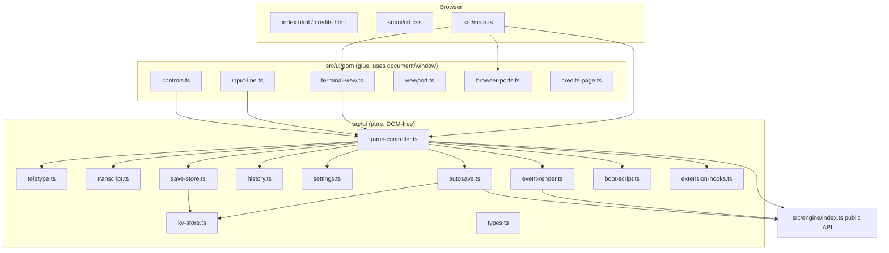
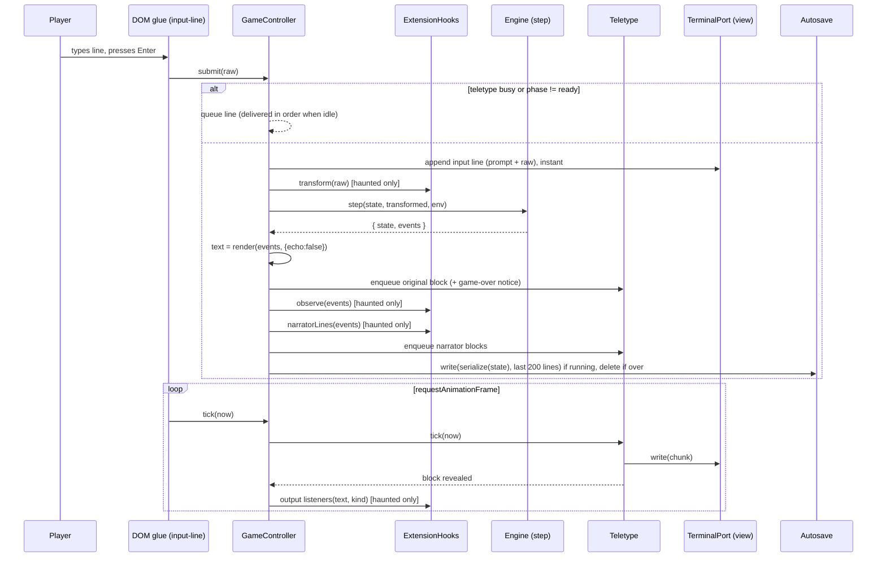

# Design Document

## Overview

This design puts the existing, pure `Game_Engine` (`src/engine`) behind a green-phosphor CRT terminal that runs entirely in the browser and deploys as a static site to Cloudflare Pages. It covers typing only. Voice, AI, narrator and haunting effects arrive in later specs; this spec leaves four typed extension points for them.

The central design decision is a **strict split between pure logic and DOM glue**:

- `src/ui/*.ts` (top level of the folder) holds DOM-free modules. They reach the outside world only through small port interfaces (`KeyValueStore`, `Clock`, `MotionPreference`, `TerminalPort`, `Logger`). Every requirement that can be tested without a browser lives here, which is what makes the Node-environment unit, property and `win430` tests possible (Requirement 15).
- `src/ui/dom/*.ts` holds the thin glue: it builds elements, reads `localStorage`, `matchMedia` and `visualViewport`, and runs the `requestAnimationFrame` loop.
- `src/ui/crt.css`, `index.html` and `credits.html` carry the CRT look. CRT effects are CSS only.
- `src/main.ts` is the entry point that wires the ports to the real browser.

What the engine already gives us (read from `src/engine/index.ts`, `events.ts`, `types.ts`, `render.ts`, `save-resume.ts`, `cli/advent-cli.ts`, `tests/replay-harness.ts`):

- `newGame(seed, { oldstyle })`, `start(state, env, restoreText?)`, `step(state, line, env)`, `endOfInput(state, env)`. Every call is non-mutating and returns `{ state, events }`.
- `render(events, { echo: false })` is the only way the UI turns events into text. The CLI already drives the engine this way, and the UI follows the same pattern.
- `serialize(state): string` and `deserialize(text): { ok: true, state } | { ok: false, reason }`. `deserialize` never throws and rejects texts over `MAX_SAVE_CHARS` (1,000,000).
- `Storage` is synchronous: `read(name): string | undefined`, `write(name, data): boolean`.
- `prompt` events carry `{ kind: 'command' | 'yesno' | 'filename', text }`. The restored state does not carry its prompt text, so the autosave record stores the last prompt event (see Data Models).
- The seed comes from the caller. The CLI uses `Date.now() | 0`; the UI does the same through an injected `Clock`.
- `tsconfig.json` currently has `lib: ["ES2022"]` and `types: ["node"]`; there is no `vite.config.ts`, `index.html`, `public/`, `.github/` or `src/ui/` yet. `vitest.config.ts` runs in the `node` environment and already includes `src/**/*.test.ts` and `tests/**/*.test.ts`.

### Design decisions and rationale

| Decision | Rationale |
|---|---|
| One `GameController` class in pure code owns phase, engine state, transcript, history, autosave and hooks. | The `win430` test (15.4) and all property tests drive the whole UI flow in Node with a fake view, fake clock and in-memory store. |
| The `Teletype` printer is a pure, tick-driven scheduler (no timers). Pauses are data (`pauseAfterMs`), not `setTimeout`. | Deterministic tests with a fake clock; reveal-fidelity, rate and flush properties become testable. |
| Transcript stores *lines with an `eol` flag*, not strings. | `render` output may end without `\n`; the flag lets `originalText()` reproduce the engine bytes exactly (5.8) and lets blank lines survive. |
| The DOM writes text only with `textContent` / `Text` nodes. A lint test forbids `innerHTML`, `outerHTML`, `insertAdjacentHTML` in `src/ui`. | 5.9 (no engine string interpreted as HTML). |
| Block cursor is a separate element positioned from `selectionStart` in `ch` units; the real `<input>` has a transparent caret. | 7.8 and 3.2: a real input keeps the on-screen keyboard and IME working; monospace fonts make positioning exact within one cell. |
| Credits page imports `CREDITS.md`, `original/ATTRIBUTION.md` and `original/COPYING` with Vite `?raw` and writes them with `textContent`. | Single source of truth for license text; nothing duplicated into `public/`; 16.6 and 16.10 are satisfied by construction. |
| The extension registry gates every call on `gameMode === 'haunted'` inside the registry itself. | 11.9 cannot be violated by a caller that forgets the check. |
| Settings/History/Autosave parsers are total (never throw, always return valid values). | 13.3, 8.8, 9.3. |

### Interpretation notes (requirements that need a decision)

1. **Save_Store write failures (10.3) vs. in-memory fallback (9.7).** `SaveStore` itself returns `false` when the `KeyValueStore.set` it is given throws (10.3, unit-tested with a throwing store). In production it is built on `ResilientStore`, which catches the throw, keeps the value in memory, raises the one-time `SAVES WILL NOT SURVIVE A RELOAD` notice and therefore never throws (9.7). The more specific user-facing behaviour (9.7) wins in the shipped app.
2. **15.5 ("existing tests pass without edits") vs. 15.6 ("existing layering lint test SHALL be extended").** `tests/lint.test.ts` already rejects `src/ui`, `src/haunt`, `src/parser` and `src/voice` imports from `src/engine`. It stays untouched; a new `tests/ui-layering.test.ts` adds the UI-side rules (the UI imports only the engine's public API, nothing from haunt/parser/voice, pure UI modules touch no browser globals, no HTML-injecting DOM APIs).
3. **Autosave holds "the last 200 Transcript lines" (9.1).** Lines of kind `boot` are never persisted, because every page load plays its own boot; the 200 lines are the last 200 of kind `original`, `input`, `notice` or `narrator`.
4. **Autosave validity (4.3, 9.3).** A record is valid when its JSON shape is right, `deserialize` accepts the state, *and* `session.status === 'running'`. A record holding a finished game is deleted like an invalid one.
5. **After `game-over` (5.7, 9.6, 10.6).** The engine ignores further input, so the controller enters phase `over`: an empty line, `NEW`, or the New game button starts a new game; any other line only reprints the notice. After a SAVE the notice says to start a new game and then use `RESUME`.
6. **PDP-10 in the boot text (4.4 vs. 4.11).** The product steering requires a fake PDP-10 boot. The name is used only as the historical machine name; the boot data avoids DEC, TOPS-10 and other product names, enforced by a deny-list unit test.
7. **Contrast (2.6).** The 4.5:1 requirement is checked by a unit test that reads the palette variables from `crt.css` and computes WCAG contrast, including the worst-case dimming from the scanline overlay and flicker.

## Architecture

### Layers and dependency direction



Rules enforced by `tests/ui-layering.test.ts`:

- `src/ui/**` and `src/main.ts` import from the engine only through `src/engine/index` (never `src/engine/<other>`), and import nothing from `src/haunt`, `src/parser` or `src/voice` (1.5).
- The engine imports nothing from `src/ui` (1.6; already covered by `tests/lint.test.ts`).
- Files directly in `src/ui/` (not in `src/ui/dom/`) must not mention `document`, `window`, `localStorage`, `sessionStorage`, `navigator`, `matchMedia`, `visualViewport`, `requestAnimationFrame`, `setTimeout`, `setInterval`, `Date` or `Math.random` in code (comments and strings are ignored by the same lexer approach the existing lint test uses) (15.1).
- No `innerHTML`, `outerHTML` or `insertAdjacentHTML` anywhere under `src/ui` (5.9).

### Runtime flow



### Phases

`GameController.phase` is one of:

| Phase | Meaning | Input |
|---|---|---|
| `booting` | Boot_Sequence is being revealed. | Input stays enabled and focused; the first key/tap skips the boot and is swallowed, later keys are kept and queued (4.9, 4.12). |
| `ready` | Engine started; a prompt is pending. | Lines go to `step`. |
| `over` | `session.status === 'over'`. | `NEW`/empty/New game button starts a new game. |
| `failed` | `start` threw (should never happen). | Notice `?SYSTEM ERROR - RELOAD THE PAGE`; input disabled. |

### File layout

```
index.html                  Page shell, lang="en", title "ADVENT: Resurrected"
credits.html                Second Vite entry; script src/ui/dom/credits-page.ts
vite.config.ts              base '/', two HTML inputs, dist/
.node-version               22   (Cloudflare Pages)
wrangler.toml               Pages config only (name, pages_build_output_dir, compatibility_date); no secrets, never run by this spec
CREDITS.md                  VT323 / OFL / Open Adventure credit text
public/
  fonts/VT323-Regular.woff2 Self-hosted, latin subset
  fonts/OFL.txt             SIL OFL text copied verbatim from the font package
  _headers                  Same-origin Content-Security-Policy for Pages
src/
  main.ts                   Wires browser ports to GameController
  ui/
    types.ts                Ports + shared types (Mode, Speed, PromptKind re-export, TranscriptLine ...)
    kv-store.ts             KeyValueStore, MemoryKeyValueStore, ResilientStore
    save-store.ts           SaveStore implements engine Storage; key helpers
    settings.ts             parseSettings / printSettings / defaults / allowed values
    history.ts              Immutable Command_History model + parse/print
    transcript.ts           Transcript model (lines, cap, originalText)
    event-render.ts         originalTextOf, lastPromptOf, ... (wraps render)
    boot-script.ts          FULL_BOOT, SHORT_BOOT data, selectBoot, bootDurationMs
    teletype.ts             Tick-driven character reveal scheduler
    autosave.ts             encodeAutosave / decodeAutosave / load / store / clear
    extension-hooks.ts      Typed registry, gating, error isolation
    game-controller.ts      Orchestration (phase, submit, newGame, setMode, tick ...)
    crt.css                 All styling and CRT effects
    dom/
      browser-ports.ts      localStorage KeyValueStore, Clock, matchMedia, console Logger
      terminal-view.ts      TerminalPort implementation (DOM transcript, live region)
      input-line.ts         <input>, block cursor, history keys, boot skip
      controls.ts           Mode / speed / CRT / New game / Credits
      viewport.ts           visualViewport handling, scroll-follow
      credits-page.ts       ?raw imports, textContent
.github/workflows/ci.yml
scripts/check-dist.ts       Post-build verification (also run in CI)
tests/ui-layering.test.ts   New layering rules
tests/ui/*.test.ts          Unit + property tests (see Testing Strategy)
```

`tsconfig.json` gets `"DOM"` and `"DOM.Iterable"` added to `lib`, `"vite/client"` added to `types` (for `?raw` and CSS imports), and `vite.config.ts` plus `index.html`-free TS roots added to `include`. Purity of the engine and of the pure UI modules is enforced by lint tests, not by the type system. `vitest.config.ts` is not edited for the Node tests; DOM tests opt in with a `// @vitest-environment happy-dom` docblock so engine tests stay in Node (15.7).

### Prerequisite: verification spike (first task, before any UI code)

Two assumptions in this design are cheap to check and expensive to get wrong, so they are verified first. The spike changes no engine file and is throwaway apart from the font files and the recorded results.

**(a) happy-dom docblock with the pinned Vitest.** Install `happy-dom@21.0.4` (exact pin) and add a scratch test `tests/ui/dom/spike.test.ts` that starts with `// @vitest-environment happy-dom`, creates an element, sets `textContent`, and asserts `typeof document` is `'object'`. In the same run, a scratch Node-environment test asserts `typeof document` is `'undefined'`. Run `npx vitest --run` with the pinned Vitest (5.1.0) and check that (1) the DOM test passes, (2) the Node test still sees no `document`, (3) the engine tests are unaffected. Delete the scratch tests after recording the result in the task notes.

Fallback if the docblock is not honoured by Vitest 5.1.0 with this happy-dom (or Vitest warns that it is unsupported), tried in this order:
1. Add a Vitest project (`projects` in `vitest.config.ts`) that selects `tests/ui/dom/**/*.test.ts` with `environment: 'happy-dom'`, next to the existing Node project that covers everything else. This is a config-only change; the existing tests keep their environment and are not edited (15.5, 15.7).
2. If the installed Vitest version still supports the older `environmentMatchGlobs` option, the same glob mapping can be used there instead; the option is not used if the installed version has removed it.
3. If happy-dom itself fails to load under Vitest 5.1.0, pin the fallback DOM library `jsdom` at an exact version and use it the same way (still the only new dev dependency, 15.7, 16.7).
Whichever option works is recorded in the README test notes, and the "DOM tests" section below is updated to say which mechanism is in use.

**(b) VT323 license text, copied verbatim.** The OFL text is taken from the official font source, not typed or paraphrased:
- Preferred source: the Google Fonts repository copy of VT323, `https://github.com/google/fonts/tree/main/ofl/vt323` (file `OFL.txt`, raw URL `https://raw.githubusercontent.com/google/fonts/main/ofl/vt323/OFL.txt`).
- Alternative source: the `OFL.txt`/`LICENSE` file inside the `@fontsource/vt323@5.3.0` package (`npm pack @fontsource/vt323@5.3.0`, unpack, copy).
- The file is downloaded or copied byte for byte into `public/fonts/OFL.txt` (no editing, no re-wrapping, no line-ending conversion), and the chosen source URL (and for the package route, the exact version) is recorded in `CREDITS.md`. If the two sources differ, the Google Fonts file wins, because it is the font's upstream repository.
- Check: the copied file begins with the font's own copyright line and the heading `SIL OPEN FONT LICENSE Version 1.1`, and a byte comparison against a second fetch from the same source matches. If neither source can be reached, the task stops and asks the user rather than reconstructing the text from memory.

### Research notes that shaped the design

- **Mobile keyboard.** On iOS Safari the on-screen keyboard does not shrink the layout viewport, only the *visual* viewport; the `VisualViewport` API (`height`, `offsetTop`, `resize`/`scroll` events) reports it. On Chrome Android the layout viewport may resize too. The design sizes the app container from `visualViewport.height` and `offsetTop` so both behave the same ([MDN: VisualViewport](https://developer.mozilla.org/en-US/docs/Web/API/VisualViewport)). iOS zooms on focus when an input's font size is under 16 px, hence 3.3.
- **Reduced motion.** `matchMedia('(prefers-reduced-motion: reduce)')` is readable in JS and has a `change` event; CSS handles the animations, JS handles teletype and boot ([MDN: prefers-reduced-motion](https://developer.mozilla.org/en-US/docs/Web/CSS/@media/prefers-reduced-motion)).
- **VT323.** Designed by Peter Hull, licensed under the SIL Open Font License 1.1. The `@fontsource/vt323` package (5.3.0, `OFL-1.1`, checked with `npm view`) ships ready-made `woff2` files and the license text. It is used once as a *source of files* (`npm pack`, copy), not added as a dependency (16.7). Content was rephrased for compliance with licensing restrictions.
- **Pages deployment.** Cloudflare Pages reads `.node-version` or the `NODE_VERSION` variable, serves a `_headers` file from the build output, and needs only build command + output directory for a static Vite site.
- **Vite 8.3.6** (already pinned) requires Node `^20.19.0 || >=22.12.0`; the CI and Pages Node version is therefore 22.
- **happy-dom 21.0.4** (verified with `npm view`) is the only new dev dependency, pinned exactly; it is lighter than jsdom 31.0.0 and is enough for attribute/`textContent` checks. Vitest 5.1.0 lists it as an optional peer.
- **GitHub Actions.** Latest releases at design time: `actions/checkout` v7.0.1 and `actions/setup-node` v7.1.0 (GitHub releases API). Both are pinned by exact tag.

## Components and Interfaces

All code below is a design sketch (signatures and contracts), not implementation.

### types.ts: ports and shared types

```ts
import type { OutputEvent, PromptKind } from '../engine/index';   // PromptKind is re-declared locally if not exported

export type Mode = '1976' | 'haunted';
export type Speed = 20 | 60 | 120 | 300 | 'instant';
export type LineKind = 'original' | 'input' | 'notice' | 'narrator' | 'boot';

export interface TranscriptLine { kind: LineKind; text: string; eol: boolean }

export interface KeyValueStore {                 // localStorage-shaped; may throw
  get(key: string): string | null;
  set(key: string, value: string): void;
  remove(key: string): void;
}
export interface Clock { now(): number }          // ms; seed = now() | 0
export interface MotionPreference { reduced(): boolean }
export interface Logger { error(message: string, cause?: unknown): void }
export interface PromptInfo { kind: PromptKind; text: string }
```

`PromptKind` is exported from `events.ts` but not from `index.ts`; the UI derives it as `Extract<OutputEvent, { type: 'prompt' }>['kind']` so it still imports only the public API.

### TerminalPort (what the controller needs from the view)

```ts
export interface TerminalPort {
  appendInstant(lines: readonly TranscriptLine[]): void;      // input echo, restored transcript
  beginBlock(block: BlockMeta): void;                          // Teletype sink
  writeChunk(blockId: number, chunk: string): void;            // Teletype sink
  endBlock(block: BlockMeta): void;                            // Teletype sink
  clear(): void;
  setPrompt(info: PromptInfo): void;
  setInputEnabled(enabled: boolean): void;
  setBusy(busy: boolean): void;                                // toggles aria-hidden on the animated transcript
  announce(text: string): void;                                // aria-live region
  showMode(selected: Mode, game: Mode | undefined): void;
  trimTo(maxLines: number): void;
}
```

Tests supply a `FakeTerminal` that records every call; the real implementation is `dom/terminal-view.ts`.

### event-render.ts

```ts
export function originalTextOf(events: readonly OutputEvent[]): string;      // = render(events, { echo: false })
export function lastPromptOf(events: readonly OutputEvent[]): PromptInfo | undefined;
export function splitIntoLines(text: string, kind: LineKind): TranscriptLine[]; // 'a\nb' -> [{a,eol:true},{b,eol:false}]
```

`splitIntoLines` splits on `\n`; a text ending in `\n` produces no trailing empty partial line; `''` produces `[]`. The inverse used everywhere is `joinLines(lines) = lines.map(l => l.text + (l.eol ? '\n' : '')).join('')`.

### transcript.ts

```ts
export const MAX_TRANSCRIPT_LINES = 2000;
export class Transcript {
  append(lines: readonly TranscriptLine[]): void;      // trims oldest to MAX_TRANSCRIPT_LINES (5.11)
  clear(): void;
  lines(): readonly TranscriptLine[];
  originalText(): string;                              // joinLines(lines of kind 'original')
  tail(n: number, kinds?: readonly LineKind[]): TranscriptLine[];   // autosave: last 200, no 'boot'
}
```

Invariants: `lines().length <= 2000`; the retained lines are always a suffix of everything appended; `originalText()` depends only on `original` lines, so appending `input`, `notice`, `narrator` or `boot` lines never changes it (12.7).

### teletype.ts (pure scheduler)

```ts
export interface BlockMeta { id: number; kind: LineKind; text: string }
export interface TeletypeBlock {
  kind: LineKind; text: string;
  cps?: number | 'instant';          // per-block override (boot uses 30)
  pauseAfterMs?: number;             // honoured only when animating and a block follows
}
export interface TeletypeOptions {
  speed(): Speed;                     // current Typing_Speed (read on every tick)
  reduced(): boolean;                 // Reduced_Motion_Preference
  sink: { begin(b: BlockMeta): void; write(id: number, chunk: string): void; end(b: BlockMeta): void };
  onRevealed(b: BlockMeta): void;     // full text of the block, after the last chunk
  onIdle(): void;                     // queue became empty
}
export class Teletype {
  enqueue(block: TeletypeBlock, nowMs: number): void;
  tick(nowMs: number): void;
  flush(): void;                      // reveal everything pending at once (key press, boot skip)
  get busy(): boolean;
}
```

Behaviour:

- Effective rate for a block = `reduced() ? 'instant' : (block.cps ?? speed())`. Boot blocks pass `cps: 30`, so the Typing_Speed never affects boot (4.6) but Reduced_Motion does (4.10, 6.7).
- `instant`: `enqueue` begins, writes the whole text, ends and calls `onRevealed` before returning (6.6, 6.7), unless an earlier block is still pending, in which case it queues behind it so order is kept.
- Animated: `tick(now)` adds `(now - last) * rate / 1000` to a fractional budget, reveals `floor(budget)` characters across the queue head(s), and keeps the fractional remainder. The count of characters revealed after a total elapsed time therefore does not depend on how the time was divided into ticks (rate is re-read each tick, so a speed change takes effect on the next revealed character, 6.4).
- A pause after a block is consumed from tick time (no timers). `flush()` and instant mode skip pauses.
- `flush()` writes all remaining text in order, finishes each block, calls `onRevealed` for each and then `onIdle` once (6.5). The DOM glue calls it on the first `keydown` while `busy`, so everything is revealed within the same frame.
- The revealed text always equals the block text (6.9): chunks are slices of the original string; surrogate pairs are never split (the scheduler slices by code point).

### boot-script.ts

```ts
export interface BootLine { text: string; pauseAfterMs: number }
export const BOOT_CPS = 30;
export const FULL_BOOT: readonly BootLine[];
export const SHORT_BOOT: readonly BootLine[];
export function selectBoot(hasValidAutosave: boolean): readonly BootLine[];
export function bootDurationMs(script: readonly BootLine[]): number;   // chars incl. newline / BOOT_CPS + pauses
```

Content (data only, no trademarks, no DEC/TOPS-10 names):

```
FULL_BOOT                                         SHORT_BOOT
 PDP-10 CPU 0 ONLINE                              RETRYING AFTER 49 YEARS ...   (pause 150 ms)
 MEMORY CHECK ... 256K WORDS ... OK               RESURRECTING
 MOUNTING TAPE UNIT 0 ... DONE
 LOADING ADVENT ... FAILED          (pause 700 ms)
 RETRYING AFTER 49 YEARS ...        (pause 500 ms)
 RESURRECTING
```

The first three lines are the "fake start-up text" and may be edited freely as long as the unit tests hold: the four mandatory lines appear in order after it (4.4); the Short_Boot has exactly the two mandatory lines (4.5); `bootDurationMs(FULL_BOOT) <= 9000` (budget under the 10 s limit in 4.7) and `1000 <= bootDurationMs(SHORT_BOOT) <= 2000` (4.5). The Short_Boot is about 41 characters (1.37 s) plus 150 ms.

`BootPlayer` is not a separate class: the controller enqueues each line as a `Teletype` block with `cps: BOOT_CPS` and `pauseAfterMs` (the last line has none), then waits for `onIdle`.

### settings.ts

```ts
export interface Settings { mode: Mode; speed: Speed; crt: boolean }
export const DEFAULT_SETTINGS: Settings = { mode: 'haunted', speed: 120, crt: true };
export const SPEED_CHOICES: readonly Speed[] = [20, 60, 120, 300, 'instant'];
export function parseSettings(text: string | null): Settings;     // total, per-field defaults (13.3, 11.5)
export function printSettings(s: Settings): string;               // JSON.stringify of a fixed-key-order object
```

`parseSettings` returns the default for each field that is missing or outside the allowed set, so one bad field never discards the others. Reduced motion is never written into the record (6.7).

### history.ts

```ts
export const MAX_HISTORY = 100;
export const MAX_LINE = 1023;
export interface HistoryState { entries: readonly string[]; pos: number | null; draft: string }
export function emptyHistory(entries?: readonly string[]): HistoryState;
export function pushLine(h: HistoryState, line: string): HistoryState;       // non-empty, not equal to newest; cap 100; pos = null
export function recallUp(h: HistoryState, typed: string): { h: HistoryState; text: string };
export function recallDown(h: HistoryState, typed: string): { h: HistoryState; text: string };
export function parseHistory(text: string | null): string[];                 // [] on anything but a JSON array of strings
export function printHistory(entries: readonly string[]): string;
```

`pos = null` means "not browsing". First `recallUp` stores `draft = typed`. `recallUp` at the oldest entry stays there. `recallDown` past the newest entry returns `draft` and sets `pos = null`. `recallDown` while not browsing is a no-op. The DOM glue moves the caret to the end after either call (8.6).

### kv-store.ts and save-store.ts

```ts
export class MemoryKeyValueStore implements KeyValueStore { /* Map-backed */ }
export class ResilientStore implements KeyValueStore {
  constructor(primary: KeyValueStore | undefined, onDegraded: () => void);
  // set: try primary; on throw (or primary undefined) store in memory, call onDegraded once. Never throws.
  // get: memory overlay first, then primary (swallow throws). remove: both.
}

export const FILE_PREFIX = 'advent:file:';
export const AUTOSAVE_KEY = 'advent:autosave';
export const SETTINGS_KEY = 'advent:settings';
export const HISTORY_KEY  = 'advent:history';
export class SaveStore implements Storage {
  constructor(kv: KeyValueStore);
  read(name: string): string | undefined;         // undefined if absent or get throws (10.4)
  write(name: string, data: string): boolean;     // false if set throws (10.3)
}
```

The three fixed keys do not start with `advent:file:`, so no player-chosen name maps onto them (10.5).

### autosave.ts

```ts
export const AUTOSAVE_MAX_CHARS = 400_000;       // far below localStorage quotas; state is ~10 KB
export const AUTOSAVE_MAX_LINES = 200;
export interface AutosaveRecord { v: 1; state: string; prompt: PromptInfo; lines: TranscriptLine[] }
export interface Restored { state: GameState; prompt: PromptInfo; lines: TranscriptLine[] }
export function encodeAutosave(state: GameState, prompt: PromptInfo, lines: readonly TranscriptLine[], maxChars?: number): string | undefined;
export function decodeAutosave(text: string | null): Restored | undefined;   // total; undefined = invalid
export function loadAutosave(kv: KeyValueStore): Restored | undefined;       // removes the entry when invalid (9.3)
export function storeAutosave(kv: KeyValueStore, ...): void;
export function clearAutosave(kv: KeyValueStore): void;
```

`encodeAutosave` takes the last 200 lines of kinds other than `boot`, serializes, and while the JSON is longer than `maxChars` drops lines oldest-first; if the state alone does not fit it returns `undefined` (nothing written, the previous entry is left). `decodeAutosave` parses JSON, checks the record shape, calls `deserialize(record.state)` and requires `ok` and `session.status === 'running'`.

### extension-hooks.ts

```ts
export interface HookContext { readonly gameMode: Mode; readonly selectedMode: Mode; readonly prompt: PromptKind }
export type InputTransformer   = (line: string, ctx: HookContext) => string;
export type EventObserver      = (events: readonly OutputEvent[], ctx: HookContext) => void;
export type NarratorLineProvider = (events: readonly OutputEvent[], ctx: HookContext) => readonly string[];
export type OutputListener     = (block: { text: string; kind: LineKind }, ctx: HookContext) => void;

export class ExtensionHooks {
  constructor(log: Logger);
  addInputTransformer(fn: InputTransformer): () => void;       // returns unregister
  addEventObserver(fn: EventObserver): () => void;
  addNarratorLineProvider(fn: NarratorLineProvider): () => void;
  addOutputListener(fn: OutputListener): () => void;

  transformInput(line: string, ctx: HookContext): string;
  observeEvents(events: readonly OutputEvent[], ctx: HookContext): void;
  narratorLines(events: readonly OutputEvent[], ctx: HookContext): string[];
  notifyOutput(block: { text: string; kind: LineKind }, ctx: HookContext): void;
}
```

Contract:

- Every method first checks `ctx.gameMode === 'haunted'`; in `1976` mode no handler runs and the inputs are returned unchanged (11.9, 12.8).
- Handlers run in registration order. A handler that throws, or that returns a value of the wrong shape (transformer: non-string; narrator provider: non-array or array with non-strings), is skipped for that call, `log.error` is called, and the previous value flows on (12.6).
- `HookContext` is `Object.freeze`d per call (read-only mode values, 11.11). Handlers receive no reference to the Transcript, so they cannot edit Original_Text (12.7); narrator lines are plain strings the controller wraps as `kind: 'narrator'`.
- `1976` mode `HookContext` is never created for handlers because nothing is called.

### game-controller.ts

```ts
export interface ControllerDeps {
  kv: KeyValueStore;                 // ResilientStore in production
  clock: Clock;
  motion: MotionPreference;
  view: TerminalPort;
  hooks: ExtensionHooks;
  log: Logger;
  confirm?: (message: string) => boolean;     // New game confirmation (9.5); defaults to () => true in tests
  onDegradedStorage?: () => void;
}

export class GameController {
  constructor(deps: ControllerDeps);
  readonly phase: 'booting' | 'ready' | 'over' | 'failed';
  readonly settings: Settings;

  startBoot(): void;                         // chooses Short/Full boot, enqueues it
  skip(): void;                              // flush teletype; ends boot early and begins the game (4.9)
  tick(nowMs: number): void;
  submit(raw: string): void;                 // Enter; queued while busy/booting
  history: { up(typed: string): string; down(typed: string): string; reset(): void };
  requestNewGame(): void;                    // confirm -> delete autosave -> clear -> New_Game_Start (9.5)
  setMode(m: Mode): void;                    // stores setting, prints notice, game unchanged (11.3)
  setSpeed(s: Speed): void;
  setCrt(on: boolean): void;
  get gameMode(): Mode | undefined;          // from state.session.settings.oldstyle
}
```

Key behaviours:

- **Begin game** (when the boot queue goes idle): `loadAutosave(kv)`; if valid, restore state, append restored lines instantly, enqueue `RESUMING SAVED SESSION`, `view.setPrompt(restored.prompt)`; otherwise New_Game_Start: `seed = clock.now() | 0`, `newGame(seed, { oldstyle: settings.mode === '1976' })`, `start(state, env)`, enqueue the Original_Text through the Teletype (4.8). `env = { storage: new SaveStore(kv) }` for every engine call (10.1).
- **submit(raw)** in phase `ready` and not busy: (1) append input line `{ kind: 'input', text: prompt.text + raw }` instantly; (2) `transformed = hooks.transformInput(raw, ctx)` (identity when no hooks or `1976`); (3) `try { step(state, transformed, env) } catch { notice '?SYSTEM ERROR - COMMAND IGNORED'; return }` keeping the old state (5.10); (4) `text = originalTextOf(events)`; enqueue it as an `original` block; (5) for `game-over` events enqueue the notice; (6) `hooks.observeEvents`; (7) `hooks.narratorLines` ??`narrator` blocks after the original block; (8) update prompt from `lastPromptOf(events)`; (9) autosave or clear; (10) push `raw` (not `transformed`) into history. Empty lines are passed to the engine like any other (7.4); history ignores them (8.1).
- **Queueing.** `submit` while `teletype.busy` or phase `booting` stores the line in a FIFO and delivers it from `onIdle` (6.8). Because key presses call `flush()` first, in practice the queue is empty.
- **Non-text events** (`room-entered`, `lamp-level`, `death`, `reincarnation-offered`, `magic-word-used`, `score`) only reach `observeEvents`; the transcript is untouched (5.6).
- **Output listeners** are called from `Teletype.onRevealed` for every block except `boot`, with the block's kind, so a later speech spec can pick `original` (and `narrator`) blocks (12.5). The same callback sends the block text to `view.announce` (6.10).
- **Transcript changes never reach Autosave state or History** except as the saved `lines` array; narrator text does not influence `serialize` output or history entries (12.9).

### DOM glue

- `terminal-view.ts` builds the `<div id="transcript" role="log">` of per-line `<div class="line line--original|line--input|line--notice|line--narrator|line--boot">`. Each line element has exactly one `Text` node; chunks extend it with `appendData` (no HTML parsing). Empty lines get `:empty::before { content: "\200b" }` in CSS so blank lines keep their height without changing `textContent`. The visually hidden `<div aria-live="polite" class="sr-only">` receives whole blocks via `announce`; `setBusy(true)` sets `aria-hidden="true"` on the transcript while animating (6.10).
- `input-line.ts` owns `<input type="text" maxlength="1023" autocapitalize="off" autocorrect="off" autocomplete="off" spellcheck="false" enterkeyhint="send" inputmode="text">`. `keydown` handling: if the boot is running, `skip()` and `preventDefault()` (4.9); else if the teletype is busy, `flush()` (6.5) and continue; `Enter` ??`submit(value)` then clear; `ArrowUp`/`ArrowDown` ??`preventDefault()`, `history.up/down`, caret to end (8.2, 8.3, 8.6). A tap on the Screen focuses the input if the text selection is empty (3.4). The block cursor's `left` is `calc((selectionStart) * 1ch - scrollLeft)` recomputed on `input`, `keyup`, `click`, `select` and `selectionchange` (7.8).
- `viewport.ts` listens to `visualViewport` `resize` and `scroll`. In a `requestAnimationFrame` it sets `--vv-height` and `--vv-top` on the root, and scrolls the transcript to the bottom if it was already at the bottom, keeping the Input_Line visible well inside 300 ms (3.5). It falls back to `window.resize` where `visualViewport` is missing. Scroll-follow uses the pure function `shouldStick({ scrollTop, clientHeight, scrollHeight }, tolerancePx = 4)`: follow only when the player was at the bottom before the append (5.12).
- `controls.ts` renders native controls so keyboard and touch work: a two-button radio-style group for `1976 MODE` / `HAUNTED MODE` (`role="radiogroup"`, `aria-checked`), a `<select>` for Typing_Speed (labels `20`, `60`, `120`, `300`, `INSTANT`), a button with `aria-pressed` for CRT, a `New game` button, and a `Credits` link (`target="_blank" rel="noopener"`). Every control has visible text or `aria-label` (14.1, 14.2).
- `browser-ports.ts` creates the `localStorage`-backed `KeyValueStore` (probing with a try/catch write so `undefined` is passed to `ResilientStore` when storage is blocked), a `Clock` using `Date.now`, a `MotionPreference` over `matchMedia`, and a `Logger` that calls `console.error`.
- `main.ts`: read settings ??apply CRT and Mode to the DOM ??create controller ??`startBoot()` ??run the `requestAnimationFrame` loop calling `controller.tick(performance.now())`. It focuses the input when the boot ends (14.3).

### CSS and CRT effects (`src/ui/crt.css`)

All CRT effects are CSS. Design tokens (custom properties) so tests can read them:

```css
:root {
  --fg: #33ff66;  --bg: #020a04;  --fg-dim: #1fae45;  --focus: #ffd54f;
  --font: "VT323", "Courier New", Courier, monospace;
  --scanline-period: 3px;      /* 2.2: must stay in [2px, 4px] */
  --flicker-opacity: 0.96;     /* 2.4: >= 0.95 so luminance change <= 5% */
  --flicker-duration: 0.5s;    /* 2.4: 2 cycles per second, <= 3 */
  --blink-duration: 1s;        /* 2.5: in [0.8s, 1.2s] */
}
@font-face { font-family: "VT323"; src: url("/fonts/VT323-Regular.woff2") format("woff2"); font-display: swap; }
```

Files in `public/` are copied to `dist/` unchanged and are referenced with root-relative URLs, so the `@font-face` uses `/fonts/VT323-Regular.woff2`. Cloudflare Pages serves the site from the root, so `vite.config.ts` sets `base: '/'` and every built URL is root-relative (16.2).

Effects:

- **Scanlines** (2.2): `.crt::before { background: repeating-linear-gradient(to bottom, rgba(0,0,0,0.22) 0 1px, transparent 1px var(--scanline-period)); pointer-events: none; }`.
- **Curvature and vignette** (2.3, 3.8): the screen container uses `border-radius: 3% / 4%` and an inset `box-shadow` for the bezel; `.crt::after` is a `radial-gradient(ellipse at center, transparent 60%, rgba(0,0,0,0.55) 100%)`. Content padding is `max(1rem, 3%)` so no character falls in the rounded corners. Under `@media (max-width: 599px)` the radius is `1% / 1.5%`, the vignette end alpha is `0.25`, and padding is increased so every character stays visible.
- **Glow** (2.1): `text-shadow: 0 0 4px currentColor, 0 0 10px rgba(51,255,102,0.35)`.
- **Flicker** (2.4): `@keyframes flicker { 0%,100% { opacity: 1 } 50% { opacity: var(--flicker-opacity) } }` on the overlay layer, `animation: flicker var(--flicker-duration) infinite`.
- **Cursor** (2.5): solid block (`background: var(--fg)`, width `1ch`, height `1em`), `animation: blink var(--blink-duration) steps(1) infinite`.
- **Reduced motion** (2.7): `@media (prefers-reduced-motion: reduce) { .crt, .crt::before, .crt::after, .cursor { animation: none !important; transition: none !important; } .cursor { opacity: 1; } }`.
- **CRT off** (2.8, 2.9): `html[data-crt="off"]` removes `::before`/`::after`, `text-shadow`, animation, border-radius and bezel, and sets plain `--bg`.
- **Typography** (2.13, 2.14, 3.3, 3.7): `font-family: var(--font)` on `html`, `input`, `button`, `select`; `font-size: clamp(18px, 2.4vw, 26px)` (VT323 is a small face; this is at least 14 px at 320 px wide, and the input is at least 16 px).
- **Focus** (14.4): `:focus-visible { outline: 2px solid var(--focus); outline-offset: 2px }`; `#ffd54f` against `#020a04` is well above 3:1.
- **Wrapping** (3.1, 5.3): `.line { white-space: pre-wrap; overflow-wrap: anywhere; margin: 0 }`, `html, body { overflow-x: hidden }`. Runs of spaces and blank lines are preserved; nothing is re-wrapped by script.
- **Viewport** (3.5): `.app { position: fixed; inset: 0; top: var(--vv-top, 0); height: var(--vv-height, 100dvh); display: flex; flex-direction: column }`, transcript `flex: 1; overflow-y: auto`, controls and input line are flex items that never scroll away.
- **Contrast** (2.6): `#33ff66` on `#020a04` is about 14:1. Worst case with the scanline overlay (22% black) and the flicker (96%) is still above 7:1, checked in a unit test.
- **Classes** (12.4): original lines use `.line--original`, narrator lines `.line--narrator` (dimmed amber `#e0c060` with a left border), notices `.line--notice`, input echo `.line--input`.

### index.html and credits.html

`index.html` has `<html lang="en">`, `<title>ADVENT: Resurrected</title>`, `<meta name="viewport" content="width=device-width, initial-scale=1, viewport-fit=cover">`, the `.app` shell (controls header, transcript, input line, sr-only live region) and `<script type="module" src="/src/main.ts">`. No visible text uses "Colossal Cave" or "Zork" (2.11). `credits.html` has the same font and a `<pre>` filled by `credits-page.ts` from the three raw files; it may use the historical name. Both pages link only same-origin assets (1.3).

### Build, deployment and CI

`package.json` additions (exact pins; `vite` is already pinned):

```json
"scripts": {
  "dev": "vite",
  "build": "npm run typecheck && vite build",
  "preview": "vite preview",
  "check:dist": "tsx scripts/check-dist.ts"
},
"engines": { "node": ">=22.12.0" },
"devDependencies": { "happy-dom": "21.0.4" }
```

- `build` runs `tsc --noEmit` first; because of `&&`, either failure exits non-zero (16.3). It needs no API key or environment variable (16.4).
- `vite.config.ts`: `build.outDir = 'dist'`, `rollupOptions.input = { main: 'index.html', credits: 'credits.html' }`, `base: '/'`. No `VITE_*` variable is read.
- `scripts/check-dist.ts` (run after `build` in CI and by hand) asserts: `dist/index.html` and `dist/credits.html` exist; every `src`/`href` in them that is local resolves to a file in `dist`; `dist/fonts/VT323-Regular.woff2` and `dist/fonts/OFL.txt` exist (16.9); the credits bundle mentions "VT323" and "SIL Open Font License" (16.10). It fails with a non-zero exit code otherwise.
- `.gitignore` already excludes `node_modules/`, `dist/`, `.env`, `.env.*` (16.8); no change.
- `public/_headers`:
  ```
  /*
    Content-Security-Policy: default-src 'self'; img-src 'self' data:; style-src 'self'; font-src 'self'; connect-src 'self'; frame-ancestors 'none'
    X-Content-Type-Options: nosniff
    Referrer-Policy: no-referrer
  ```
  This enforces the same-origin rule of 1.2/1.3 in production. Later specs that add the Worker proxy or the microphone will widen `connect-src` and add a `Permissions-Policy`; that is called out in the README.
- `README.md` gets a "Deploy to Cloudflare Pages" section that documents the **manual first deploy**, performed by the user, in this order: (1) `npm ci` and `npm run build`, then check `dist/`; (2) `npx wrangler login` (opens a browser, done by the user); (3) create the Pages project and publish with `npx wrangler pages deploy dist --project-name <name>` (or connect the Git repository in the Cloudflare dashboard with framework preset *None*, build command `npm run build`, output directory `dist`, Node version `22` via `.node-version`); (4) open the resulting `*.pages.dev` URL and run the manual checklist; (5) no environment variables or secrets are needed (16.5). These commands appear in the README as instructions only.
- `wrangler.toml` (Pages configuration) is prepared and committed, with only non-secret values: `name`, `pages_build_output_dir = "./dist"` and `compatibility_date`. It contains no account ID, token or secret. Wrangler is not added as a dependency; the README uses `npx wrangler` so the user runs whichever current version they choose.
- **No automated deployment.** The work of this spec only prepares the Cloudflare Pages build (build script, `.node-version`, `wrangler.toml`, `_headers`, README steps). Neither the implementation tasks nor CI run `wrangler login`, `wrangler pages deploy` or any other deploy or publish command, and nothing in the repository holds Cloudflare credentials. The user performs the first deploy manually. An automatic-deploy workflow is out of scope; if the user wants one later it is a separate, documented, not-run optional step.
- `.github/workflows/ci.yml`:
  ```yaml
  name: CI
  on: push
  jobs:
    test:
      runs-on: ubuntu-24.04
      steps:
        - uses: actions/checkout@v7.0.1
        - uses: actions/setup-node@v7.1.0
          with:
            node-version: 22
            cache: npm
        - run: npm ci
        - run: npm run typecheck
        - run: npx vitest --run
        - run: npm run build
        - run: npm run check:dist
  ```
  A failing step fails the job (17.3); there are no `secrets.*` references (17.5); the Node major and both action tags are fixed (17.4). `vitest --run` includes `tests/fidelity.test.ts`, which replays every upstream log except those on the engine's Skip_List (17.6). The two extra build steps go beyond 17.2 and catch build breakage before the user's manual deploy. CI only tests and builds; it never deploys.

### Credits and font licensing

- `public/fonts/OFL.txt` is copied verbatim from the official VT323 source chosen in the verification spike (Google Fonts repository `ofl/vt323/OFL.txt`, or the `@fontsource/vt323@5.3.0` package copy as the alternative); the source URL is recorded in `CREDITS.md`. `public/fonts/VT323-Regular.woff2` is the latin 400 file from `@fontsource/vt323@5.3.0` (`npm pack`, unpack, copy). The package is not a dependency, and the license text is never retyped or paraphrased.
- `CREDITS.md` at the repo root names VT323, its author (Peter Hull), the SIL Open Font License 1.1, states the font file is bundled in `public/fonts/`, records the source URL of the license text, and credits Open Adventure (BSD-2) and the original Crowther/Woods game, pointing to `original/ATTRIBUTION.md` (2.15, 2.16).
- The test suite checks that `CREDITS.md` exists and mentions `VT323` and `SIL Open Font License` or `OFL` (2.17), and that the `woff2` URL named in the `@font-face` rule resolves to a file under `public/` (2.18).

## Data Models

```ts
// Settings_Record (localStorage key 'advent:settings'), one JSON object:
{ "mode": "haunted" | "1976", "speed": 20 | 60 | 120 | 300 | "instant", "crt": true | false }

// Command_History (key 'advent:history'): JSON array of at most 100 non-empty strings.
["get lamp", "enter building", ...]

// Autosave (key 'advent:autosave'): one JSON object.
{
  "v": 1,
  "state": "<string returned by serialize(state)>",
  "prompt": { "kind": "command", "text": "> " },
  "lines": [ { "kind": "original", "text": "You are in a maze ...", "eol": true }, ... ]   // last <= 200, never 'boot'
}

// Player SAVE files (engine Storage): key 'advent:file:' + name -> data string, verbatim.

// Transcript (in memory): TranscriptLine[] with at most 2000 entries.
interface TranscriptLine { kind: 'original' | 'input' | 'notice' | 'narrator' | 'boot'; text: string; eol: boolean }
```

Key namespace (10.5): `advent:file:*` is player-controlled; `advent:autosave`, `advent:settings`, `advent:history` are reserved and cannot be produced by any `advent:file:` + name.

Controller state (in memory only): `phase`, `GameState | undefined`, `PromptInfo`, `HistoryState`, `Settings`, a FIFO of submitted lines, the `Teletype`, the `Transcript`, the pending `RESUMING`/notice flags, and a one-shot `storageNoticeShown` boolean (9.7).

Notice strings (exact text, uppercase to match the terminal style):

| Situation | Text |
|---|---|
| Engine exception (5.10) | `?SYSTEM ERROR - COMMAND IGNORED` |
| Restore (9.2) | `RESUMING SAVED SESSION` |
| Storage degraded (9.7) | `SAVES WILL NOT SURVIVE A RELOAD` |
| Mode change (11.3) | `MODE CHANGE TAKES EFFECT ON THE NEXT NEW GAME` |
| `game-over` (5.7) | `GAME OVER. PRESS ENTER OR CHOOSE NEW GAME TO PLAY AGAIN.` |
| SAVE ended session (10.6; used instead of the `game-over` notice when `session.exitReason === 'suspended'`) | `SESSION SAVED. START A NEW GAME, THEN USE RESUME TO LOAD IT.` |
| `start` failure | `?SYSTEM ERROR - RELOAD THE PAGE` |


## Correctness Properties

*A property is a characteristic or behavior that should hold true across all valid executions of a system-essentially, a formal statement about what the system should do. Properties serve as the bridge between human-readable specifications and machine-verifiable correctness guarantees.*

**Prework reflection.** Of the roughly 170 acceptance criteria, about 25 are testable as universal properties; the rest are CSS/DOM/build checks (example, smoke or integration tests, see Testing Strategy). Redundancies removed during reflection: 5.1, 5.2 and 5.6 are all consequences of the rendering-fidelity property (5.8), and 12.4/12.7 are covered by the same property once the generator interleaves non-original lines; 6.5, 6.6, 6.7 and 4.10 collapse into the single teletype-fidelity property that varies speed, reduced-motion flag, tick schedule and flush point; 8.1, 8.2, 8.4, 8.5 and 8.9 collapse into one history-invariants property; 1.4, 7.2, 7.4, 7.6 and 7.7 collapse into one controller-equals-engine property; 10.2, 10.4, 10.5 and 10.8 collapse into one Save_Store property; 11.6/11.7 and 11.3/11.8 are each one property; 12.2, 12.6, 12.8 and 12.9 collapse into one hook-pipeline property; 11.2, 11.5 and 13.3 collapse into one settings-parse property. The result is 20 properties.

All property tests run in the Node environment against the pure modules (`Transcript`, `Teletype`, `history`, `settings`, `autosave`, `SaveStore`, `ExtensionHooks`, `GameController` with a fake view, fake clock and `MemoryKeyValueStore`).

### Property 1: Rendering fidelity and Original_Text immutability

*For any* sequence of engine calls, each producing any list of `OutputEvent` values (text events on every channel, with and without `blank`, and all non-text event types), and *for any* interleaving of appended `input`, `notice`, `narrator` and `boot` lines, the concatenation of the transcript's `original` lines (each `text` followed by `\n` when `eol`) SHALL equal the concatenation of `render(events, { echo: false })` over those calls, provided no line was trimmed; non-text events SHALL contribute nothing, and the original lines SHALL be identical before and after any non-original append.

**Validates: Requirements 5.1, 5.2, 5.6, 5.8, 12.4, 12.7**

### Property 2: Transcript cap keeps the newest lines

*For any* sequence of line appends of any kind and size, the transcript SHALL never hold more than 2000 lines, and the retained lines SHALL be exactly the last N lines of everything appended, in order (and the retained `original` text SHALL be a suffix of the full Original_Text).

**Validates: Requirements 5.11**

### Property 3: Prompt echo and prompt tracking

*For any* prompt text and *for any* submitted line, the `input` line appended to the transcript SHALL equal the current prompt text followed by the line, and it SHALL appear before every line produced by the engine for that line; and *for any* event list, `lastPromptOf` SHALL return the last `prompt` event (kind and text) or `undefined` when there is none.

**Validates: Requirements 5.4, 5.5**

### Property 4: The controller is transparent to the engine

*For any* sequence of input lines (arbitrary strings up to 1023 characters, including empty, whitespace-only, mixed case and non-ASCII lines) submitted while the pending prompt is of any kind, with no hooks registered, the controller SHALL deliver each line to `step` unchanged and the Original_Text it displays SHALL equal `render(events, { echo: false })` from driving the engine directly with the same seed, options and lines; the controller SHALL never throw.

**Validates: Requirements 1.4, 7.2, 7.4, 7.6, 7.7, 12.8**

### Property 5: Submission order is preserved under pending output

*For any* schedule that interleaves submissions of lines with ticks, key-triggered flushes and booting/busy periods, every submitted line SHALL be delivered to the engine exactly once, in submission order, and never before the engine has started.

**Validates: Requirements 4.12, 6.8**

### Property 6: Teletype reveals exactly the output text

*For any* list of blocks, *for any* Typing_Speed (including `instant`), *for any* Reduced_Motion setting, *for any* monotone sequence of tick times, and *for any* point at which `flush()` is called, the concatenation of all chunks written to the sink SHALL equal the concatenation of the block texts, each block SHALL be ended exactly once, in order, the number of revealed characters SHALL never decrease or exceed the total, and after `flush()` all text SHALL be revealed; when the speed is `instant` or Reduced_Motion is set, all text SHALL be revealed before `enqueue` returns and the stored speed setting SHALL be unchanged.

**Validates: Requirements 4.10, 6.5, 6.6, 6.7, 6.9**

### Property 7: Teletype rate is independent of how time is sliced

*For any* text of length L, *for any* rate r in {20, 60, 120, 300, 30} characters per second and *for any* partition of a total elapsed time T into ticks (no flush, no pauses), the number of characters revealed SHALL equal `min(L, floor(T * r / 1000))`; for boot blocks (`cps: 30`) this SHALL hold whatever the stored Typing_Speed is.

**Validates: Requirements 4.6, 6.1**

### Property 8: Command history invariants

*For any* sequence of operations (push of any string, Up, Down, with arbitrary typed text) applied to any starting history, the entries SHALL number at most 100, SHALL all be non-empty, SHALL contain no two adjacent equal entries, a push SHALL reset the browsing position to "not browsing", and the browsing position SHALL always be either "not browsing" or an index within the entries; Up at the oldest entry SHALL stay on it.

**Validates: Requirements 8.1, 8.2, 8.4, 8.5, 8.9**

### Property 9: History browsing round trip

*For any* non-empty history and *for any* typed draft, pressing Up k times (k from 1 to the number of entries) and then Down k times SHALL return the draft text and the "not browsing" position, and pressing Down while not browsing SHALL change nothing.

**Validates: Requirements 8.3**

### Property 10: History persistence round trip and rejection

*For any* list of at most 100 non-empty strings, `parseHistory(printHistory(list))` SHALL equal the list; and *for any* text that is not a JSON array of strings (or is null, empty, or malformed), `parseHistory` SHALL return the empty list and SHALL NOT throw.

**Validates: Requirements 8.7, 8.8**

### Property 11: Settings round trip

*For any* valid Settings value (mode in {`1976`, `haunted`}, speed in {20, 60, 120, 300, `instant`}, crt boolean), `parseSettings(printSettings(s))` SHALL equal `s`.

**Validates: Requirements 13.4, 13.5**

### Property 12: Settings parsing is total and falls back per field

*For any* text (arbitrary strings, JSON with wrong types, unknown keys, out-of-range values, null), `parseSettings` SHALL return a valid Settings value and SHALL NOT throw; each field that is present and valid SHALL be preserved, and each field that is missing or invalid SHALL take its default (`haunted`, 120, CRT on).

**Validates: Requirements 11.2, 11.5, 13.3**

### Property 13: Mode selects the engine's oldstyle option

*For any* selected Mode and *for any* seed produced by the clock, a New_Game_Start SHALL create a game whose `session.settings.oldstyle` is `true` exactly when the Mode is `1976`, and the controller's Game_Mode SHALL be `1976` exactly when that flag is true.

**Validates: Requirements 11.6, 11.7**

### Property 14: Changing the selected Mode never alters the running game

*For any* sequence of commands interleaved with any sequence of `setMode` calls, the Original_Text produced and the final engine state SHALL be identical to the run of the same commands with no `setMode` calls, the Game_Mode SHALL stay unchanged, and each change SHALL add exactly the notice `MODE CHANGE TAKES EFFECT ON THE NEXT NEW GAME`.

**Validates: Requirements 11.3, 11.8**

### Property 15: Hook pipeline composes valid handlers and isolates faulty ones

*For any* list of input transformers, event observers and narrator providers, each being a well-behaved function, a function that throws, or a function that returns an invalid value, running in `haunted` Game_Mode SHALL give a transformed line equal to the composition, in registration order, of only the well-behaved transformers; the faulty handlers SHALL be skipped and logged; with an empty list the line SHALL be unchanged; the engine state produced for the transformed line, the serialized Autosave state for a given transformed line, and the Command_History SHALL not depend on narrator provider output or on observer behaviour.

**Validates: Requirements 12.2, 12.6, 12.8, 12.9**

### Property 16: No hook runs in 1976 mode

*For any* registered handlers of all four kinds, when the Game_Mode is `1976`, none of them SHALL be invoked and the registry SHALL return its inputs unchanged (the line, no narrator lines).

**Validates: Requirements 11.9**

### Property 17: Save_Store round trip and key namespace

*For any* file name and *for any* data string, `write(name, data)` on a working store SHALL return `true`, a following `read(name)` SHALL return `data`, the key used SHALL start with `advent:file:`, and it SHALL never equal the Autosave, Settings or History key; `read` of a name never written SHALL return `undefined`.

**Validates: Requirements 10.2, 10.4, 10.5, 10.8**

### Property 18: Autosave round trip

*For any* reachable game state (reached by any command sequence from any seed, in either Mode) and *for any* further command sequence, decoding the encoded Autosave and playing the further commands SHALL produce exactly the same Original_Text and the same final serialized state as continuing from the original state; the restored Game_Mode SHALL equal the mode of the saved state; and the saved transcript lines and prompt SHALL be restored unchanged.

**Validates: Requirements 9.2, 9.8**

### Property 19: Autosave respects its size budget

*For any* state, *for any* list of transcript lines of any sizes and *for any* budget large enough to hold the state alone, the encoded record's length SHALL be at most the budget, the stored lines SHALL be a suffix of the last 200 non-`boot` lines (oldest dropped first), and the serialized state SHALL be present unchanged; *for any* budget too small for the state alone, nothing SHALL be written.

**Validates: Requirements 9.1, 9.9**

### Property 20: Autosave decoding is total

*For any* string (random text, truncated valid records, valid JSON of the wrong shape, records with tampered states or `status: 'over'`), `decodeAutosave` SHALL return `undefined` without throwing, and `loadAutosave` SHALL delete the stored entry in that case; for every record produced by `encodeAutosave` from a running state it SHALL return a value.

**Validates: Requirements 9.3**

## Error Handling

| Condition | Handling |
|---|---|
| `step` throws (5.10) | Keep the previous `GameState`, append notice `?SYSTEM ERROR - COMMAND IGNORED`, log via `Logger`, keep the prompt and accept input. History still records the line. |
| `start` or `newGame` throws | Phase `failed`, notice `?SYSTEM ERROR - RELOAD THE PAGE`, input disabled. This should never happen; the engine is total (`tests/properties/p05-totality.test.ts`). |
| Hook handler throws or returns an invalid value (12.6) | Skip that handler for that call, `Logger.error`, continue with the unchanged line/events. |
| Hook handler mutates arrays it was passed | Events are passed as a frozen shallow copy; the transcript is never exposed. |
| `localStorage` missing, blocked, or a write throws (9.7) | `ResilientStore` serves the key from memory for the page's lifetime and shows `SAVES WILL NOT SURVIVE A RELOAD` exactly once. `SaveStore` over a bare throwing store returns `false` (10.3). Reads that throw return `null`/`undefined`. |
| Quota exceeded for Autosave (9.9) | Drop transcript lines oldest-first until the record fits; if the state alone does not fit, skip the write and keep the older entry. |
| Autosave entry invalid or not running (9.3) | Delete it and perform a New_Game_Start; the Full_Boot is chosen only when `loadAutosave` finds nothing valid, so a bad entry is removed before the boot variant is selected. |
| Settings, History entries corrupt (8.8, 13.3) | Per-field defaults / empty history, never an exception. |
| Stored `Mode` unknown (11.5) | `haunted`. |
| `visualViewport` unsupported | Fall back to `window` `resize`; layout still uses `100dvh`. |
| `matchMedia` unsupported | Treat Reduced_Motion as not set. |
| Font fails to load (2.13) | Monospace fallbacks in the Font_Stack; `font-display: swap` avoids invisible text. |
| Player input during boot (4.12) | The input stays enabled and focused (focused at startup). The first key/tap skips the boot and is swallowed; characters typed afterwards, and lines submitted during the boot, are kept and queued until the engine has started, then delivered in order. |
| Input after `game-over` | Only `NEW`/empty/New game starts a new game; other lines reprint the notice. The engine is not called. |
| Input over 1023 characters | `maxlength` blocks it in the browser; the controller truncates programmatic input to 1023 characters so the engine never gets a longer line. |
| Hostile engine text | Only `textContent`/`Text.appendData` writes; no HTML parsing. A lint test forbids HTML-injecting APIs. |
| Credits page raw imports fail | Build fails (they are static imports), caught by `npm run build` and CI. |

## Testing Strategy

### Why PBT applies (and where it does not)

The pure UI modules are parsers, serializers, schedulers and state machines with large input spaces, so they get property tests (fast-check 4.10.2, already pinned). CSS, DOM structure, asset presence, Cloudflare/GitHub configuration and visual effects are not input-varying computations, so they get example, smoke and integration tests, not properties.

### Property tests (fast-check, Node environment)

- Library: `fast-check`, **at least 100 runs per property** (`{ numRuns: 100 }` or higher; the engine-driving properties 4, 14 and 18 use 100 runs with short command sequences to keep the suite fast).
- One test per property in `tests/ui/properties/`, e.g. `p01-rendering-fidelity.test.ts`, each tagged with a comment of the form `// Feature: crt-terminal-ui, Property 1: Rendering fidelity and Original_Text immutability`.
- Generators: `arbOutputEvent` (all nine event types and four text channels, strings with `\n`, empty text, unicode), `arbTranscriptLine`, `arbSettings`, `arbCommandSequence` (reusing `tests/properties/generators.ts` where it fits, plus a vocabulary of real commands such as `get lamp`, `enter`, `xyzzy`, `quit` and arbitrary strings), `arbHookList` (ok / throw / invalid), `arbTickSchedule` (monotone times and flush points).
- Engine-driving properties use `MemoryKeyValueStore`, a fixed `FakeClock`, a `FakeTerminal` and a controller with the Typing_Speed set to `instant` (or explicit ticks for the scheduler properties), so they are deterministic.

### Unit and example tests (Vitest)

| Area | File | Checks |
|---|---|---|
| Event rendering | `tests/ui/event-render.test.ts` | `splitIntoLines`/`joinLines` examples (no trailing newline, blank lines, empty text); game-over and SAVE notices. |
| Transcript | `tests/ui/transcript.test.ts` | Cap at exactly 2000; `tail(200)` excludes `boot`. |
| History / Settings / Save_Store / Autosave | `tests/ui/*.test.ts` | Examples from the requirements: defaults, bad JSON, throwing store returns `false` (10.3), `ResilientStore` fallback and single notice (9.7), key names are outside the file prefix (10.5). |
| Boot data | `tests/ui/boot-script.test.ts` | Mandatory lines and order (4.4, 4.5); `bootDurationMs` bounds (Short 1-2 s, Full at most 9 s); `selectBoot`; deny-list for product names (4.11). |
| Mode mapping | `tests/ui/mode.test.ts` | `1976` -> `oldstyle: true` and no `> ` prompt; `haunted` -> `oldstyle: false` (15.2). |
| Controller flows | `tests/ui/game-controller.test.ts` | Boot then start; skip during boot; `game-over` notice; New game confirm yes/no; autosave written after `step`, deleted at `over`; SAVE then new game then RESUME (10.6, 10.7); engine exception keeps state (5.10); output listeners called on reveal (12.5); observers run after Original_Text (12.3). |
| `win430` | `tests/ui/win430.test.ts` | Reads `reference/open-adventure/tests/win430.log` with `tests/replay-harness.ts` helpers (`readUpstream`, `splitLog`, `parseOptions`, `HARNESS_DEFAULT_SEED`), plays every line through `GameController` with `FakeClock.now() === 0`, speed `instant`, in-memory store and the same options as the upstream harness (`parseOptions(...).oldstyle`, none for this log); asserts that the `score` field of the last `game-over` event is exactly 430 and that the session status is `over`. The `game-over` events are captured with an event observer registered on `ExtensionHooks` (the log runs with `oldstyle` false, so the Game_Mode is `haunted` and observers are called). Intermediate `score` events are deliberately not used: the last `score` event reads 426 because the end-of-game bonuses are only added into the `game-over` score. `computeScore` is not imported. The test also asserts that the Original_Text the fake view captured equals `render(replayLog('win430').events, { echo: false })`. The view captures chunks outside the 2000-line transcript so the cap does not affect the check. |
| Static rules | `tests/ui-layering.test.ts` | UI imports only `src/engine/index`; nothing from haunt/parser/voice; pure UI files touch no browser globals, no `fetch`/`XMLHttpRequest`; no `innerHTML`/`outerHTML`/`insertAdjacentHTML`; no "Colossal Cave"/"Zork" in `index.html`, `src/ui` (except the credits page) or public file names. |
| CSS and assets | `tests/ui/css-assets.test.ts` | Reads `crt.css`: `--scanline-period` in [2px, 4px]; flicker opacity >= 0.95 and duration >= 0.34 s; blink duration in [0.8 s, 1.2 s]; `@font-face` with `font-display: swap`; the file named there exists in `public/`; `--font` list order; reduced-motion block disables each animation; input font size >= 16px; `clamp()` gives >= 14px at 320px; contrast of `--fg` on `--bg` >= 4.5 including the 22% scanline and 96% flicker worst case; focus color vs background >= 3:1. `CREDITS.md` mentions `VT323` and `SIL Open Font License` or `OFL`; `public/fonts/OFL.txt` exists (2.15 to 2.18). |
| HTML | `tests/ui/html.test.ts` | `lang="en"`, title `ADVENT: Resurrected`, viewport meta, no absolute `http(s)` asset URLs. |
| Workflow and package | `tests/ui/ci-config.test.ts` | Parses `.github/workflows/ci.yml` with `yaml`: trigger `push`, steps `npm ci`, `npm run typecheck`, `npx vitest --run`; fixed `node-version`; `uses:` pinned to exact tags; no `secrets.`; no `wrangler` or deploy command anywhere in the workflow (16.11). `wrangler.toml` contains only `name`, `pages_build_output_dir`, `compatibility_date` and no token or account ID. `package.json` `build` script is `npm run typecheck && vite build`; README mentions `npm run build`, `dist` and the Node version. |

### DOM tests (happy-dom, opt-in per file)

`// @vitest-environment happy-dom` at the top of `tests/ui/dom/*.test.ts` (or, if the verification spike shows the docblock does not work, a Vitest project glob for that folder; see the spike). happy-dom is added as the only new dev dependency, pinned `21.0.4`; the engine and all property tests stay in the Node environment (15.7). Checks: input attributes (`type`, `maxlength="1023"`, `autocapitalize`, `autocorrect`, `autocomplete`, `spellcheck`, font size via the stylesheet is checked in the CSS test); `<script>` and `` text from the engine appears as text, not as elements (5.9); `aria-live="polite"` region receives whole blocks and the transcript is `aria-hidden` while animating (6.10); controls are native `button`/`select`, labelled, and have no negative `tabindex` (14.1, 14.2); `keydown` during boot calls `skip` and is `preventDefault`-ed (4.9); Up/Down recall moves the caret to the end (8.6); a tap on the Screen focuses the input (3.4).

### Not automated

Real-device checks, listed in the README release checklist: on-screen keyboard behaviour on iOS Safari and Chrome Android (3.5, 3.6), no horizontal scroll at 320 px and 1920 px (3.1), curvature and vignette keep every character visible on small screens (3.8), and the visual feel of the effects (2.1, 2.3). The post-build check (`npm run check:dist`) and CI guard 16.x.

### Existing tests

`tests/lint.test.ts`, `tests/fidelity.test.ts`, `tests/walkthrough.test.ts` and `tests/properties/*` are not edited (15.5). `tests/walkthrough.test.ts` was checked: it already takes the score from the last `game-over` event (430), not from a `score` event, so it needs no correction; the UI `win430` test follows the same rule. The `package.json` pinning test in `tests/lint.test.ts` also guards the new `happy-dom` pin. Total run: `npx vitest --run` (single run, no watch).
