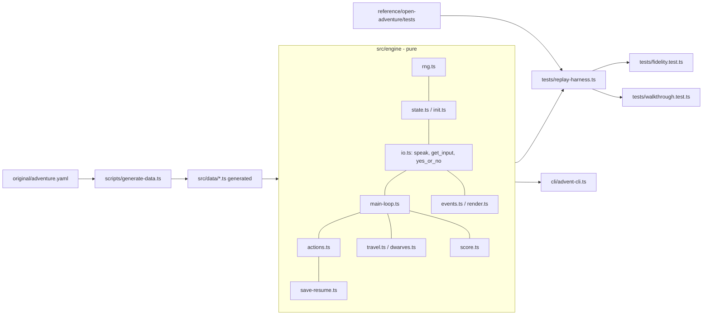
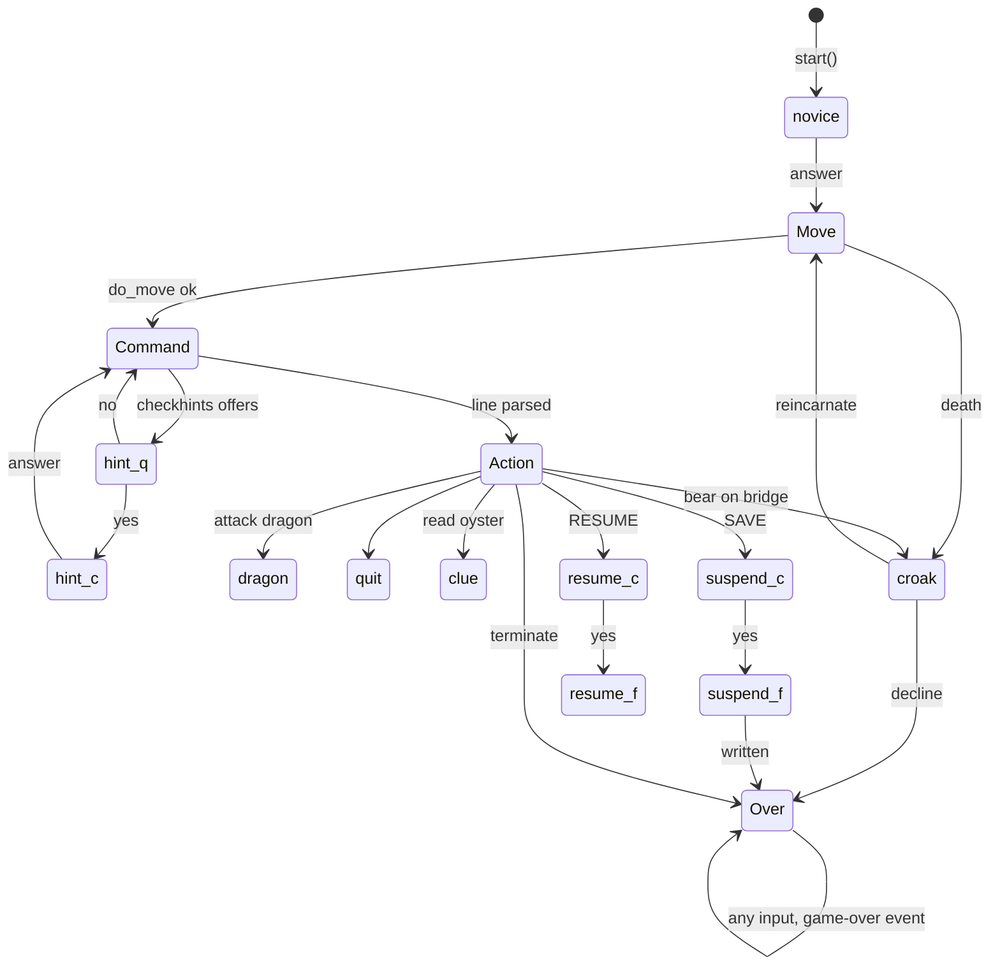

# Design Document: game-engine

## Overview

The Game_Engine is a pure TypeScript port of Open Adventure (reference commit `e6160529e70a8c7a06b9a5f190d69aa35c4c62f5`). It is driven by Game_Data that a build-time Data_Generator derives from `original/adventure.yaml`. The public surface is a small set of pure functions:

- `newGame(seed, options)` is the port of `initialise` (`init.c`).
- `start(state, env, restoreText?)` is the opening of `main` (`main.c`).
- `step(state, line, env)` is one line of player input.
- `endOfInput(state, env)` is end of file on stdin.
- `render(events)` is the exact stdout text.
- `serialize` / `deserialize` handle the JSON Save_Document.

The engine imports nothing from `ui`, `haunt`, `parser` (AI) or `voice`. It touches no DOM, network, timer, clock or file system.

Design decisions that shape everything else:

| # | Decision | Why |
|---|----------|-----|
| D1 | The C program blocks on input in 9 places (see "Blocking points"). Each one becomes a serializable `Pending` tag stored in the state. Each tag has a resume function that re-enters the ported control flow at the exact C continuation. | A pure `step(state, line)` cannot hold a suspended call stack. Generators and closures cannot be serialized, but Req 3.5 and 13.3 need a serializable state. |
| D2 | `step` deep-copies the input state, mutates the copy with C-style imperative code, and returns it. | Keeps the port line-for-line comparable with the C source (Req 3.3, 19.2) at negligible cost. The state is a few KB. |
| D3 | All C stdout writes become `text` events that carry the exact bytes. This includes the `\n` printed by `get_input`, the `> input` echo, the EOF prompt, and `printf` strings such as `Can't open file %s, try again.`. | Req 14.4 and 15.4 need byte-exact output. |
| D4 | The RNG seed is injected through `newGame`. The LCG state lives inside the state (`game.lcg_x`). | Matches C and Req 2.3. |
| D5 | `Save_Document` is JSON. SAVE/RESUME go through an injected sync `Storage`. | Req 13. |
| D6 | Generated data keeps the C tables' shapes and indices: parallel arrays, a flat `travel[]` plus `tkey[]`, and flat numeric constants for every enum and `#define`. | Lets the engine be a mechanical port and lets Req 1.7 compare against `make_dungeon.py`. |
| D7 | Only the effect of the C escape pass is reproduced: `\n` / `\t` written in YAML text become real control characters. | See "Requirement clarifications" (C-1). |
| D8 | The Replay_Harness is the upstream harness reimplemented in TypeScript. It reproduces `advent $OPTS < log`, including `#options:` parsing and the shared-file-system semantics of the `saveresume.*` logs. | Req 15. |

## Research Findings

Facts below were read from the reference sources. Each one changes the design.

**Test harness (`tests/Makefile`).**
- Each test runs `advent $OPTS < NAME.log` and compares stdout with `NAME.chk`. `OPTS` comes from `sed -n /#options:/s///p`: every line containing `#options:` contributes the text after the first occurrence, split on shell whitespace.
- Only 3 logs use options:
  - `oldstyle.log`: `-o`.
  - `logopt.log`: `-l scratch.tmp`. The log file is write-only and does not affect stdout.
  - `saveresumeopt.log`: `-r saveresume.adv`.
- `main` parses `getopt("dl:or:")`. `-d` is debug. `-o` sets `oldstyle=true` and `prompt=false`.
- Tests run in alphabetical order (`tests/README`). `saveresume.1` and `saveresume.3` write `saveresume.adv` and `saveresume_win.adv`. `saveresume.2`, `saveresume.4` and `saveresumeopt` read them.
- `multifile.chk` has no `.log` (it is the `issue36.log` script-argument mode). It is out of scope.

**Seeding (`init.c`, `actions.c`).**
- `initialise` seeds from `srand(time(NULL)); rand()`. The upstream harness therefore has no fixed seed.
- Determinism comes from the in-game `SEED n` verb: `seed()` in `actions.c` does `set_seed(strtol(arg))` and `--game.turns`.
- 15 of the 107 logs have no `seed` line. 4 of those are on the Skip_List, so the other 11 must not depend on the RNG.
- Consequence: the harness uses one fixed default seed. A property test checks that the seedless logs give identical output under any default seed.

**Input and output model (`misc.c`).**
- `get_input` prints `"\n"`, reads a line, skips lines starting with `#` silently, and echoes `PROMPT + line + "\n"` when stdin is not a tty. `PROMPT` is empty in `-o` mode. At EOF `myreadline` prints the prompt and returns NULL.
- `yes_or_no` re-speaks the question after `PLEASE_ANSWER`. `silent_yes_or_no` does not.
- Answer rule: first whitespace-delimited word, lowercased. Starting with `y` is yes. Starting with `n` is no. An empty line gives `PLEASE_ANSWER`.
- File names use `myreadline("\nFile name: ")` directly. There is no echo, no `#` skipping, and the prompt is printed only at EOF. Open failure prints `Can't open file %s, try again.\n` (no leading blank line) and loops.
- `vspeak` details:
  - A NULL or empty message prints nothing.
  - It prints a leading `\n` (blank) and a trailing `\n`.
  - It handles `%d`, `%s`, `%S` (plural from the previous `%d`) and `%V`.
  - It replaces `floor` with `ground` when followed by space, `.` or end of string and the player is not `INSIDE`.
  - It truncates to 4096 bytes.
- `sspeak` is a raw `vprintf` with no `floor` pass.

**Parsing (`misc.c`, `main.c`).**
- `word_count` splits on space and tab only. `sscanf("%s%s")` splits on any `isspace`.
- More than 2 words gives `TWO_WORDS` and re-prompts. An empty line re-prompts silently. A whitespace-only line is a real command (word id 0, a null move that costs a turn).
- Vocabulary match is `strncasecmp(word, entry, TOKLEN=5)`. Lookup order is motion, object, action (except `PART`), then `game.zzword`, then integer.
- `-o` additionally uppercases and truncates tokens to 10 characters. It skips single-letter words listed in the generated `ignore` string. It changes `bigwords` to say `START_OVER`.

**Control flow (`main.c`).**
- `main` loops: `do_move()` (a false return means `continue`), then `do_command()`.
- `do_command` has nested loops, driven by `command_t.state` and the `phase_codes_t` returned by `action()`:
  - `GO_TOP` re-describes the location.
  - `GO_CLEAROBJ`, `GO_CHECKHINT` and `GO_UNKNOWN` re-prompt without describing.
  - `GO_WORD2` re-processes.
  - `GO_MOVE` and `GO_TERMINATE` finish the command.
- `static command_t command` persists across calls. `clear_command` copies `cmd->obj` into `game.oldobj`, so previous-command state must be kept (it is not saved by C).
- `terminate()` and `exit()` end the process. Reasons: `terminate(endgame|quitgame)`, tampered save, successful `suspend`, EOF inside `yes_or_no`.

**Blocking points.**
- `main` novice question.
- `checkhints`: question, then confirm.
- `croak`: reincarnation.
- `attack`: bare-hands dragon (silent).
- `quit`.
- `read`: oyster clue.
- `suspend`: confirm, then file name.
- `resume`: confirm, then file name.
- `do_command`: the command prompt itself.

**RNG (`misc.c`).**
- `get_next_lcg_value` is `(1093*x + 221587) % 1048576`, computed in `long`. It returns the old `x`.
- `randrange(r)` is `r * old_x / 1048576` with `int32` multiplication. It overflows for `r > 2048` (`2048 * 1048575 < 2^31`, `2049 * 1048575 > 2^31`). The engine only calls it with `r <= 1000`.
- `set_seed` does `seed % LCG_M`, adds `LCG_M` if negative, then draws 5 times for `zzword` (`'A'+randrange(26)`, with index 1 forced to `'`).

**Save format (`saveresume.c`, `advent.h`, `cheat.c`).**
- C writes a raw struct (`magic`, `version=32`, `canary=2317`, `game`). `restore` checks in this order:
  1. magic/canary: `BAD_SAVE`.
  2. version: `VERSION_SKEW`, printed as `v/10 . v%10`.
  3. `is_valid`: `SAVE_TAMPERING`, then `exit`.
- `is_valid` checks abbnum, lcg_x upper bound only, location bounds, object place/fixed bounds, dwarf counts, `numdie >= NDEATHS`, tally recomputation, `PROP_IS_INVALID`, and atloc/link bounds.
- `suspend` adds 5 to `saved` before it asks for a file name, then writes and calls `exit(0)`.
- `.adv` fixtures other than `saveresume*.adv` come from the `cheat` binary. Those logs are on the Skip_List: `savetamper`, `cheatresume`, `cheatresume2`, `resumefail2` (4 entries; `resumefail` loads no fixture and runs as a normal test).
- `badmagic` uses `../main.o`, a non-save file. It passes with a static garbage fixture.

**Generated data (`make_dungeon.py`, `templates/*.tpl`).**
- Tables:
  - `arbitrary_messages[]`, `classes[]`, `turn_thresholds[]`, `locations[]`, `objects[]`, `obituaries[]`, `hints[]`, `motions[]`, `actions[]`.
  - `conditions[]`: a bitmask per location, with the hint bits.
  - `tkey[]` and `travel[]`: the travel table, flattened and run through the legacy numeric encoding (`buildtravel`).
  - `ignore`, `dwarflocs[]`.
- Enums and defines: `LOC_*`, object names, motion names, action names, message names, per-object state labels from `states:`, `MAX_STATE`, `BIRD_ENDSTATE`, `NDWARVES`, `COND_*`, and the `N*` counts.
- `initialise` ORs `COND_FORCED` into `conditions[]` for locations whose first travel entry is `HERE`. This is derived data and is not saved.
- `make_c_string` escapes only newline, tab and quotes. A literal backslash-n in YAML text becomes a C newline. Five strings are affected (hints WITT and CLIFF, the oyster description, the plant description, and a `\t\t\t` banner).
- `adventure.yaml` is ASCII-only, has no CRs, and is byte-identical to `reference/open-adventure/adventure.yaml` (SHA-256 `AFED0E32…`). It uses `!!omap`, `!!null`, anchors/aliases and `|-` scalars, so the parser must use the YAML 1.1 schema (like PyYAML).

## Architecture



Module map under `src/engine/`. Names avoid `parser.ts`, which `src/parser/` owns for the AI parser.

| File | Ports (C function) |
|------|--------------------|
| `rng.ts` | `set_seed`, `get_next_lcg_value`, `randrange` |
| `init.ts` | `initialise` and the static `game` initializer |
| `objects.ts` | `juggle`, `move`, `put`, `carry`, `drop`, `atdwrf`, `setbit`, `tstbit` and the `advent.h` macros |
| `io.ts` | `vspeak`, `speak`, `sspeak`, `pspeak`, `rspeak`, `get_input`, `yes_or_no`, `silent_yes_or_no`, `myreadline` |
| `classic-parser.ts` | `word_count`, `get_*_vocab_id`, `get_vocab_metadata`, `tokenize`, `get_command_input`, `clear_command`, `preprocess_command` |
| `main-loop.ts` | `main`, `do_move`, `do_command`, `describe_location`, `listobjects`, `checkhints`, `croak`, `lampcheck`, `closecheck` |
| `travel.ts` | `playermove`, `traveleq` |
| `dwarves.ts` | `dwarfmove`, `spotted_by_pirate` |
| `actions.ts` | `action` and every handler in `actions.c` (`attack`, `bigwords`, `blast`, `vbreak`, `pour`, `quit`, `read`, `reservoir`, `rub`, `say`, `throwit`, `wake`, `seed`, `waste`, `wave`, plus `vcarry`, `discard`, `lock`, `light`, `extinguish`, `eat`, `drink`, `feed`, `fill`, `find`, `inven`, `brief`, `listen`, `fly`) |
| `score.ts` | `score` (split into pure `computeScore` and a printing wrapper), `terminate` |
| `save-resume.ts` | `savefile`, `suspend`, `resume`, `restore`, `is_valid` |
| `events.ts`, `render.ts` | Output_Event types and the renderer |
| `index.ts` | Public API |

### Step lifecycle and resumable control flow

`step` never blocks. It consumes one line, runs the C code until the next blocking point, stores a `Pending` tag, and returns the events produced so far.



Resume targets. Each tag's resume function continues exactly where the C call returned:

| Pending tag | Entered from | After the answer |
|-------------|--------------|------------------|
| `novice` | `main` | Set `limit` if yes. Enter the main loop at `do_move`. |
| `command` | `get_command_input` | Run the rest of the pre-processing stage (below). |
| `hint-question {hint}` | `checkhints` | No: `return` from `checkhints`, then block on `command`. Yes: `rspeak(HINT_COST)`, then become `hint-confirm`. |
| `hint-confirm {hint}` | `checkhints` | Set `used` and extend `limit`. Continue the hint loop at `hint+1`, then block on `command`. |
| `croak {origin, obit}` | `croak` | See the origin table below. |
| `dragon` | `attack` | No: speak `NASTY_DRAGON`, return `GO_MOVE`. Yes: kill the dragon, return `GO_MOVE`. Then apply the phase code. |
| `quit` | `quit` | Yes: `terminate(quitgame)`. No: `GO_CLEAROBJ`. |
| `clue` | `read` | Set `clshnt`, return `GO_CLEAROBJ`. |
| `suspend-confirm`, `suspend-file`, `resume-confirm`, `resume-file` | `suspend` / `resume` | As in `saveresume.c` (see Save/Resume). |

`croak` origins and their continuations:

| Origin | Continuation |
|--------|--------------|
| `dwarf` | Rest of `do_move`: the `loc == LOC_NOWHERE` check, then the pit check. |
| `nowhere` | The pit check. |
| `pit` | `do_move` returns false, so the main loop calls `do_move` again. |
| `bridge` | `playermove` returns; the command is finished and `do_command` returns true. |

`do_command` is ported as an explicit stage machine, so any stage can be re-entered:

- **S1 (describe):** `describe_location`. If `FORCED`, call `playermove(HERE)` and return. Otherwise `listobjects`, then `clear_command`.
- **S2 (input loop):** closed-cave stash block, `wzdark`, `knfloc`.
- **S3 (pre-process loop):** `checkhints` (may block), then `get_command_input` (blocks), then `foobar`, `++turns`, `preprocess_command`. Repeat S3 while `state < PREPROCESSED`.
- **S4:** `closecheck`. If it returns true, return.
- **S5 (process loop):** dispatch the word, then `action()` (may block), then `applyPhase(code)`.

`applyPhase` maps each phase code to the next stage: `GO_TOP` to S1; `GO_CLEAROBJ`, `GO_CHECKHINT` and `GO_UNKNOWN` to S2; `GO_WORD2` to S5; `GO_MOVE`, `GO_TERMINATE` and motion to done; `GO_DWARFWAKE` to terminate. `GO_UNKNOWN` also uppercases the first letter of the word and speaks `DO_WHAT`.

Blocking on `get_input` emits `text{io:"\n"}` followed by a `prompt` event. Receiving a line emits the `echo`. A `#` line emits nothing and keeps the same pending. `file-name` pendings read raw lines.

## Components and Interfaces

### 1. Data_Generator (`scripts/generate-data.ts`, run with `npm run gen:data`)

A function-for-function port of `make_dungeon.py`, including `buildtravel` and its legacy `cond*1000+dest` encoding. A byte-identical regeneration is required (Req 1.4). The generator:

- Reads `original/adventure.yaml` as bytes. It fails if any byte is above 0x7F.
- Parses it with the `yaml` package in YAML 1.1 mode (`version: '1.1'`, `!!omap` kept as ordered pairs, `merge` on). The exact version is pinned at the tasks stage.
- Checks all 10 required top-level sections (`motions hints locations dwarflocs arbitrary_messages classes turn_thresholds objects obituaries actions`). Any problem exits non-zero, names the file, and writes nothing (Req 1.6). Output is written to temporary names and renamed only after every file is complete.
- Emits JSON-safe literals only (via `JSON.stringify`). There is no timestamp and no absolute path.
- Applies the C string pass before emitting each string (C-1): decode `\n`, `\t`, `\\`, `\"`, `\'`, `\r`, `\a`, `\b`, `\f`, `\v`, `\ooo`, `\xhh`. Any other escape makes the generator fail, listing the string.
- Computes `ignore` exactly as Python does. It appends upper-cased one-letter `words` of every motion and action whose `oldstyle` is false, in motions-then-actions order.
- Computes `BIRD_ENDSTATE` as `len(BIRD.sounds)-1`.
- Emits `states:` labels as numeric constants, plus `MAX_STATE`.

Every output file starts with a header containing the "generated, do not edit" notice, the exact regeneration command, and the BSD-2 notice (Req 1.2, 19.6).

Files, all under `src/data/`:

| File | Content |
|------|---------|
| `constants.ts` | Flat `export const LOC_START = 1` and similar for each location, object, motion, action, arbitrary message, state label, `COND_*`, and the counts and `TOKLEN`-independent values (`NLOCATIONS`, `NOBJECTS`, …). |
| `dungeon.ts` | The tables below, as `readonly` arrays. |
| `travel.ts` | `TKEY` and `TRAVEL`. |

`dungeon.ts` exports:

```ts
export const ARBITRARY_MESSAGES: readonly (string | null)[];
export const CLASSES: readonly { threshold: number; message: string | null }[];
export const TURN_THRESHOLDS: readonly { threshold: number; pointLoss: number; message: string }[];
export const LOCATIONS: readonly { small: string | null; big: string | null; sound: number; loud: boolean }[];
export const OBJECTS: readonly {
  words: readonly string[]; inventory: string | null; plac: number; fixd: number; isTreasure: boolean;
  descriptions: readonly (string | null)[] | null; sounds: ...; texts: ...; changes: ...;
}[];
export const OBITUARIES: readonly { query: string; yesResponse: string }[];
export const HINTS: readonly { number: number; turns: number; penalty: number; question: string; hint: string }[];
export const CONDITIONS: readonly number[];   // base bits from YAML; FORCED bit added in init
export const MOTIONS: readonly { words: readonly string[] }[];
export const ACTIONS: readonly { words: readonly string[]; message: string | null; noaction: boolean }[];
export const IGNORE: string;
export const DWARFLOCS: readonly number[];
```

`NULL` and `""` are kept distinct (`null` vs `""`).

`travel.ts` exports `TRAVEL: readonly { motion, condtype, condarg1, condarg2, desttype, destval, nodwarves, stop }[]` and `TKEY: readonly number[]`, with the same indices as C.

Reference check for Req 1.7: a developer script `scripts/dump-reference-dungeon.py` copies `original/adventure.yaml` and `reference/open-adventure/{make_dungeon.py,templates}` to a temp directory (never writing into `reference/`), runs `make_dungeon.py`, and writes `tests/golden/dungeon-summary.json`. That file holds table counts and a SHA-256 of the canonical dump of `travel`/`tkey`/`conditions`. It is committed. The test suite compares the generated `src/data` against it, so CI needs no Python.

### 2. RNG (`rng.ts`)

```ts
export function setSeed(game: Game, seed: number): void;   // set_seed
function nextLcg(game: Game): number;                      // get_next_lcg_value
export function randrange(game: Game, range: number): number;
export function pct(game: Game, n: number): boolean;       // PCT(n)
```

- `nextLcg`: `old = x; x = (1093*x + 221587) % 1048576`. All values stay far below 2^53, and JS `%` truncates like C, so doubles are exact even for negative tampered `x`.
- `randrange`: `Math.trunc(Math.imul(range, old) / 1048576)`. The `imul` reproduces int32 wrap for `range > 2048`.
- `setSeed`: `x = seed | 0; x = x % 1048576; if (x < 0) x += 1048576;` then 5 draws.
- Every call goes through these. A lint test fails on `Math.random`, `Date`, `performance` or `crypto` under `src/engine/`.
- A test-only optional `env.rngTrace?: (value:number)=>void` records each draw. It is used by tests only and does not change behavior.

### 3. State (`init.ts`, `objects.ts`)

`newGame(seed, options)` reproduces `initialise` in order:

1. The `game` initializer (`chloc`, `chloc2`, `abbnum=5`, `clock1=WARNTIME`, `clock2=FLASHTIME`, `newloc=loc=LOC_START`, `limit=GAMELIMIT`, `foobar=WORD_EMPTY`).
2. `set_seed` (5 draws).
3. Dwarf locations.
4. All objects `place = LOC_NOWHERE`.
5. The two `drop` loops that build the `atloc`/`link` lists.
6. Fixed/treasure props and `tally`.
7. `conds = setbit(COND_HBASE)`.

`FORCED` is not stored in `game`. A module-level `CONDITIONS_EFFECTIVE` is computed once at import from `CONDITIONS` and `TKEY`/`TRAVEL` using the same rule as `initialise`. This is immutable derived data, so the state stays serializable and identical across runs.

`step` begins with `const s = cloneState(state)`. A development-mode `deepFreeze` of the input detects accidental mutation.

### 4. Output layer (`io.ts`, `events.ts`, `render.ts`)

`speak(msg,{blank,args})` follows `vspeak`. It emits one `text` event with `channel:'speak'`, or nothing for NULL/empty text. The event carries both `template` (the Game_Data string) and `text` (after `%d/%s/%S/%V` and `floor→ground`). `sspeak` uses `channel:'sspeak'` (always blank, formatted with only `%d` and `%s`, no `floor` pass). `pspeak` selects `descriptions[skip]`, `sounds[skip]`, `texts[skip]`, `changes[skip]` or `inventory` and delegates to `speak`.

The renderer maps each text-carrying event to bytes:

| Channel | Bytes |
|---------|-------|
| `speak` / `sspeak` (blank) | `"\n"` + text + `"\n"` |
| `speak` (no blank) | text + `"\n"` |
| `echo` | text + `"\n"` |
| `io` | text, verbatim |

Non-text events render as the empty string. Unknown `type` values are skipped (Req 14.8). `render(events, { echo })` can drop `echo` events for an interactive tty (the CLI uses `echo:false`).

### 5. Classic parser (`classic-parser.ts`)

- `strncasecmp5(a, b)` compares ASCII-folded code units for up to 5 positions, treating end-of-string as NUL.
- `tokenize` uses `sscanf("%s%s")` semantics: split on C `isspace` (` \t\n\v\f\r`).
- Lookup order is as in `get_vocab_metadata`. `-o` adds uppercase, truncation to 10, and the `IGNORE` check.
- Input is capped at `LINESIZE-1 = 1023` code units (Req 3.7). Case-folding is ASCII only (C locale).
- No fuzzy, phonetic or alias logic exists in the engine (Req 4.7).

### 6. Main loop, travel, dwarves

Direct ports of `main.c` as described above. Event hooks:

- `room-entered {loc}` is emitted at the start of `describe_location`, before its text.
- `lamp-level {life, initial}` is emitted at most once per `step`, if `game.limit` differs from `session.reportedLimit` at the end of the step.
- `death {cause, count}` is emitted at the start of `croak`.
- `reincarnation-offered {obituary}` is emitted when `croak` asks the question.
- `magic-word-used {word}` is emitted when a motion XYZZY/PLUGH/PLOVER is dispatched, and when `bigwords` is entered. `say xyzzy` goes via `GO_WORD2` and so counts once.
- `score {score, max}` is emitted at the end of a `step` if `computeScore(game,'scoregame')` differs from `session.reportedScore`.
- `prompt {kind, text}` is emitted whenever the engine blocks.
- `game-over {score, rank, reason}` is emitted by `terminate`, by `exit` paths and by post-game input.

### 7. Actions (`actions.ts`)

All of `actions.c` is ported with identical branch order, including the `fill`/`feed`/`discard`/`vcarry` families that call `INVLIMIT`, bird/cage/rod/vase rules and `state_change`. The dispatcher `action()` returns `phase_codes_t`. Handlers that block return a `Blocked` marker after setting `Pending`; the matching resume function continues the handler and returns the phase code.

### 8. Score (`score.ts`)

`computeScore(game, mode)` returns `{ score, max }` and mutates nothing. The printing wrapper adds `GARNERED_POINTS` for `scoregame`. `terminate(mode)`:

1. Compute the score.
2. Speak `TOOK_LONG` / `WITHOUT_SUSPENDS` if applicable.
3. Speak `TOTAL_SCORE`.
4. Print the class message, then `NEXT_HIGHER` or `NO_HIGHER`, or `OFF_SCALE`.
5. Set `session.status='over'`, and emit `game-over`.

### 9. Save/Resume (`save-resume.ts`)

```ts
interface Storage {
  read(name: string): string | undefined;    // undefined = cannot open
  write(name: string, data: string): boolean; // false = cannot open for write
}
interface Env { storage: Storage; rngTrace?: (v: number) => void }
```

- `serialize(state)` writes keys in a fixed order. The result is `{ magic, version: 32, canary: 2317, game, session }`. `version` stays 32 so `VERSION_SKEW` text is identical.
- `SAVE`: `rspeak(SUSPEND_WARNING)`, then `yes_or_no(THIS_ACCEPTABLE)`. After yes, `saved += 5`. Then a raw file-name read loop (strip; EOF or empty gives `GO_TOP`; `storage.write` false gives `Can't open file NAME, try again.`). On success: `rspeak(RESUME_HELP)`, `status='over'`, no score output.
- `RESUME`: abandon check (`loc != LOC_START || locs[LOC_START].abbrev != 1`), then the file-name loop with `storage.read`. `restore(text)` runs the three checks in C order. A non-JSON, non-object or oversized (`> 1,000,000` chars) text gives `BAD_SAVE`. On success only `game` is replaced (as C replaces `game` only); `session` is untouched. `SAVE_TAMPERING` sets `status='over'`.
- `deserialize(text)` returns `{ ok: true, state }` or `{ ok: false, reason }` and never throws.
- `isValid(game)` ports `is_valid` and also checks array lengths and field types. Shape errors give `BAD_SAVE`; range errors give `SAVE_TAMPERING`.

### 10. Replay_Harness (`tests/replay-harness.ts`)

- `parseOptions(logText)`: collect text after the first `#options:` on every matching line, shell-split, then run a `getopt("dl:or:")`-compatible parse. Unknown flags throw.
- Option effects:
  - `-o` sets the engine option `oldstyle`.
  - `-l NAME` is accepted and ignored. A comment in the harness states that the file is write-only upstream.
  - `-r NAME` reads the fixture and passes it to `start`. If the fixture is absent, the game continues as C does when `fopen` fails.
  - `-d` is ignored.
- `splitLog(text)` uses getline semantics: split on LF; drop only the single empty element produced by a trailing LF.
- Read logs and checks as `latin1` strings so bytes map 1:1.
- Loop: `start`; then `step` for each line until `status==='over'`; then `endOfInput` if still running.
- Fixtures: a fresh `MemoryStorage` per test, built from `FIXTURE_DEPENDENCIES = { 'saveresume.2': ['saveresume.1'], 'saveresume.4': ['saveresume.3'], 'saveresumeopt': ['saveresume.1'] }` and a static map `{ '../main.o': <non-save bytes> }`. Dependency logs are replayed first into the same storage and their output is discarded. `MemoryStorage.write` returns false for an empty name or a name ending in `/`.
- Default seed `HARNESS_DEFAULT_SEED = 0`.
- Diff reporter: names the log, the first differing line number, and both lines.

### 11. Skip list (`tests/fidelity-skip-list.ts`)

```ts
export const SKIP_LIST: Record<string, string> = {
  'savetamper':   'needs the cheat tool (cheat_savetamper.adv), a C binary struct save',
  'cheatresume':  'needs the cheat tool (cheat_numdie.adv), a C binary struct save',
  'cheatresume2': 'needs the cheat tool (cheat_numdie1000.adv), a C binary struct save',
  'resumefail2':  'needs resume_badversion.adv, a C binary struct save with no generating rule',
};
```

Each entry becomes an `it.skip` with the reason in its name. A guard test (Req 15.12) fails if a key has no matching `.log`. The save, resume, tamper, version-skew and invalid-file paths are covered by unit tests that build JSON documents (Req 15.13).

### 12. CLI (`cli/advent-cli.ts`)

Node only, outside `src/engine/`. Flow:

1. Parse `--seed N` with `parseSeedArg` (`/^-?\d+$/` and int32 range; otherwise stderr plus a non-zero exit before any state exists).
2. `start`, print `render(events,{echo:false})` plus prompt text.
3. For each stdin line: `step`, then print.
4. At EOF: `endOfInput`, exit 0. A `game-over` also exits 0.
5. `FileStorage` implements `Storage` with `fs`. An internal engine exception prints to stderr and exits non-zero.

## Data Models

### Game (port of `struct game_t`)

```ts
interface Game {
  lcg_x: number; abbnum: number; bonus: 0|1|2|3;      // none, splatter, defeat, victory
  chloc: number; chloc2: number; clock1: number; clock2: number;
  clshnt: boolean; closed: boolean; closng: boolean; lmwarn: boolean; novice: boolean;
  panic: boolean; wzdark: boolean; blooded: boolean;
  conds: number; detail: number; dflag: number; dkill: number; dtotal: number; foobar: number;
  holdng: number; igo: number; iwest: number; knfloc: number; limit: number;
  loc: number; newloc: number; numdie: number; oldloc: number; oldlc2: number; oldobj: number;
  saved: number; tally: number; thresh: number; seenbigwords: boolean; trnluz: number; turns: number;
  zzword: string;                                     // 5 chars, index 1 is "'"
  locs: { abbrev: number; atloc: number }[];          // NLOCATIONS
  dwarves: { seen: boolean; loc: number; oldloc: number }[];  // NDWARVES+1
  objects: { fixed: number; prop: number; place: number }[];  // NOBJECTS
  hints: { used: boolean; lc: number }[];             // NHINTS
  link: number[];                                     // NOBJECTS*2
}
```

### Session (everything C keeps outside `game_t`)

```ts
interface Session {
  settings: { oldstyle: boolean; prompt: boolean };
  cmd: CommandT;            // the `static command_t command` in do_command
  pending: Pending;
  status: 'running' | 'over';
  exitReason: null | 'quit' | 'endgame' | 'suspended' | 'tampered' | 'eof';
  reportedLimit: number;    // for lamp-level events
  reportedScore: number;    // for score events
}
interface CommandT {
  part: 0|1|2; verb: number; obj: number; state: 0|1|2|3|4|5|6;  // EMPTY..EXECUTED
  word: [Word, Word];
}
interface Word { raw: string; id: number; type: 0|1|2|3|4 }       // NO_WORD_TYPE..NUMERIC
type Pending =
  | { k: 'novice' } | { k: 'command' }
  | { k: 'hint-question'; hint: number } | { k: 'hint-confirm'; hint: number }
  | { k: 'croak'; origin: 'dwarf' | 'nowhere' | 'pit' | 'bridge'; obit: number }
  | { k: 'dragon' } | { k: 'quit' } | { k: 'clue' }
  | { k: 'suspend-confirm' } | { k: 'suspend-file' }
  | { k: 'resume-confirm' } | { k: 'resume-file' };

interface GameState { game: Game; session: Session }
```

All values are numbers, strings, booleans, arrays or plain objects, so the state is JSON-safe.

### Output_Event (JSON-safe discriminated union)

```ts
type OutputEvent =
  | { type: 'text'; channel: 'speak' | 'sspeak' | 'echo' | 'io'; blank: boolean; template: string | null; text: string }
  | { type: 'room-entered'; loc: number }
  | { type: 'lamp-level'; life: number; initial: number }
  | { type: 'death'; cause: 'dwarf' | 'pit' | 'bridge' | 'nowhere'; count: number }
  | { type: 'reincarnation-offered'; obituary: number }
  | { type: 'magic-word-used'; word: string }
  | { type: 'score'; score: number; max: number }
  | { type: 'prompt'; kind: 'command' | 'yesno' | 'filename'; text: string }
  | { type: 'game-over'; score: number; rank: string | null; reason: string; already: boolean };
interface StepResult { state: GameState; events: OutputEvent[] }
```

For `template`, `text === template` whenever the template has no `%` specifier and no standalone `floor`. This invariant is how Req 14.3 is tested.

### Save_Document

```json
{ "magic": "open-adventure", "version": 32, "canary": 2317, "game": { "…": "…" }, "session": { "…": "…" } }
```

Keys are written in a fixed order. `RESUME` applies only `game`. `deserialize` restores both.

## Requirement clarifications found during design

These are conflicts or imprecisions between the approved requirements and the C source. The design resolves each one as follows.

- **C-1 (Req 1.5).** "Character for character" comparison against the YAML cannot hold for the 5 strings that contain a literal `\n` or `\t`, because `make_c_string` leaves backslashes alone and the C compiler turns them into control characters. The design compares against the YAML after the C escape pass. A unit test lists exactly those 5 strings.
- **C-2 (Req 2.6 and 16.5).** `randrange` overflows `int32` for `n > 2048` in C, so the output can be out of `[0,n)`. The property is tested for `n` in `1..2048`. Engine call sites use `n <= 1000`.
- **C-3 (Req 10.3 and 16.2).** The upper bound 430 always holds. A lower bound of 0 holds for sequences of up to 100 commands from a new game. Unbounded play with many hints, turn penalties and saves can go negative in C, because `score()` does not clamp. Tampered saves (`cheat_numdie`) can exceed 430. The design keeps C behavior.
- **C-4 (Req 4.6).** C skips `#` lines inside `get_input` only (novice, command and yes/no reads), not the raw file-name read. The engine therefore skips them itself, based on the pending tag. The harness passes every line through unmodified. Observable behavior for the upstream logs is identical.
- **C-5 (Req 4.5).** An empty line is a silent re-prompt. A whitespace-only line is a real null move that costs one turn.
- **C-6 (Req 2.4).** There is no reference RNG trace to compare against. RNG call order is verified transitively: any extra or missing draw changes a later `.chk` line for every seeded log. A hand-computed vector pins `set_seed` for 3 seeds. An optional developer script can diff traces if a C toolchain is present.
- **C-7 (Req 13.6).** After a successful SAVE the C program exits. The engine sets `status='over'` and prints no score.
- **C-8 (Req 15.2).** The upstream harness has no fixed seed (see Research Findings). The spec statement is satisfied by the default-seed rule (Req 15.14).

## Correctness Properties

*A property is a characteristic or behavior that should hold true across all valid executions of a system-essentially, a formal statement about what the system should do. Properties serve as the bridge between human-readable specifications and machine-verifiable correctness guarantees.*

**Property reflection.** The prework produced about 60 testable criteria. They were reduced as follows:

- 2.1, 2.2 and 2.5 became one model-equivalence property.
- 2.6 and 16.5 became one range property.
- 3.7 and 16.1 merged; 6.8 joined them.
- 4.3 merged into 3.8.
- 6.2 and 6.6 merged with the world invariants of 7.2.
- 7.6 and 7.7 merged into one conditional property.
- 7.8 merged with 14.3.
- 8.1, 8.2, 8.3, 8.7 and 8.8 became one lamp property; 8.6 merged with 5.3 (the dark room is a variant of the description).
- 9.5, 9.6 and 9.7 became one accounting property.
- 10.3, 10.6, 12.5 and 16.2 merged. 10.4 stays separate because it is about events.
- 11.5 and 11.7 merged. 11.8 and 12.6 merged.
- 13.1, 13.2, 13.3, 9.8, 3.5 and 16.3 became one round-trip property. 13.4 stays separate.
- 2.7, 3.1 and 16.4 merged. 3.3 and 16.6 merged.
- 14.5, 14.7 and 14.8 merged.

Properties that depend on a specific scenario (dwarf fights, closing, special travel, hint wording) are covered by the Fidelity_Suite instead, because they need exact seeded sequences.

### Property 1: RNG matches the C formulas

*For any* int32 seed and any sequence of `set_seed`, `randrange(n)` (with `n` in 1..2048) and PCT calls, the TypeScript RNG returns the same values and the same `lcg_x` and `zzword` as an independent BigInt model of `misc.c`.

**Validates: Requirements 2.1, 2.2, 2.5**

### Property 2: RNG output ranges

*For any* int32 seed and any `n` in 1..2048, `randrange(n)` returns an integer in `[0, n-1]`. *For any* int32 seed, after `set_seed`, `zzword` has 5 characters, character 1 is `'` and the others are in `A..Z`, and `lcg_x` is in `[0, 1048575]`.

**Validates: Requirements 2.5, 2.6, 16.5**

### Property 3: Determinism

*For any* int32 seed and options, two calls to `newGame` return deeply equal states. *For any* state reachable by random play and any command, two evaluations of `step` give deeply equal `StepResult`s.

**Validates: Requirements 2.7, 3.1, 16.4**

### Property 4: Step does not mutate its input

*For any* reachable state and any command string, the input state is deeply equal to a clone taken before the call (and survives being deep-frozen).

**Validates: Requirements 3.3, 16.6**

### Property 5: Step is total

*For any* string of 0 to 100,000 UTF-16 code units (including empty, whitespace-only, non-ASCII and control characters) and any pending tag, `step` returns a result and does not throw. This also holds for random verb/object pairs built from the vocabulary.

**Validates: Requirements 3.7, 6.8, 16.1**

### Property 6: Unknown words

*For any* token that matches no vocabulary entry and is not numeric, a command with that token as the first word produces a `DONT_KNOW` text containing the token exactly as typed. Afterwards the game is unchanged except for `turns`, `igo`, `iwest` and `oldobj`/`cmd` bookkeeping.

**Validates: Requirements 3.8, 4.3**

### Property 7: Vocabulary matching

*For any* vocabulary word `v` and any casing of it, the lookup resolves to the same entry as `v`. *For any* `v` of length 5 or more and any suffix `s`, the lookup of `v.slice(0,5)+s` resolves to the same entry as `v`. *For any* token that differs from every vocabulary entry within its first 5 code units (case-insensitively), the lookup fails. No edit-distance, phonetic or alias matching exists.

**Validates: Requirements 4.1, 4.7**

### Property 8: More than two words

*For any* input with three or more words separated by spaces or tabs, when the engine is waiting at the command prompt, the output is the `TWO_WORDS` message and the game and pending tag are unchanged.

**Validates: Requirements 4.2**

### Property 9: Empty, whitespace and comment input

*For any* string made only of spaces and tabs (including empty), `loc` is unchanged and the computed score is unchanged; empty input does not change `turns`. *For any* string starting with `#`, while the pending tag reads through `get_input`, the result has no events and an unchanged state. While the pending tag is a file-name read, the same string is taken as a file name.

**Validates: Requirements 4.5, 4.6**

### Property 10: Magic-word events

*For any* sequence of vocabulary commands, each `step` emits at most one `magic-word-used` event. It emits none when no token of the command resolves to XYZZY, PLUGH, PLOVER, FEE, FIE, FOE, FOO or FUM. It emits exactly one when the command is such a word, or `say` followed by one. The original text is unchanged by the event.

**Validates: Requirements 4.8**

### Property 11: Compiled travel equals the YAML rules

*For any* location, motion, set of carried objects, set of object states and sequence of pct outcomes, resolving the move through the compiled `TRAVEL`/`TKEY` tables with the `playermove` algorithm yields the same destination (or speak/special code) as an independent oracle that walks the YAML `travel` rule lists.

**Validates: Requirements 5.1**

### Property 12: Magic-word sequence state machine

*For any* sequence of the words FEE, FIE, FOE, FOO, FUM and other commands, `foobar` evolves as the model of `bigwords` and the per-input `foobar` negate/zero rule.

**Validates: Requirements 5.6**

### Property 13: Invalid motions are harmless

*For any* reachable state and any motion word with no travel entry from `loc`, `loc` is unchanged and the refusal text is the one the C `switch` selects for that motion class.

**Validates: Requirements 5.5**

### Property 14: Room entry and darkness

*For any* sequence of commands, every `room-entered` event is immediately followed by the text event for that location's description. In a non-forced location that is dark (no `COND_LIT` and the lamp dark or absent), that text is `PITCH_DARK`.

**Validates: Requirements 5.3, 8.6**

### Property 15: World invariants during play

*For any* sequence of up to 100 vocabulary commands, after every step:

- `holdng` equals the number of objects with `place == CARRIED` other than the bird.
- Every object is on at most one `atloc` chain, and every chain terminates.
- All `place`, `fixed` and dwarf locations are in range.
- `dflag` never decreases and `dkill <= NDWARVES-1`.
- `tally` equals the number of treasures that are not found.

**Validates: Requirements 6.2, 6.6, 7.2**

### Property 16: Pirate theft

*For any* generated state in which the pirate is spotted and the player carries a set of treasures, after `spotted_by_pirate` every carried treasure other than the exempt pyramid case is at `chloc`, and no non-treasure changes hands. If no treasure is carried or here, the inventory is unchanged.

**Validates: Requirements 7.6, 7.7**

### Property 17: Text events carry the original text

*For any* sequence of commands, every `text` event with a non-null `template` has a `template` that is a member of the Game_Data string pool. When the template contains no `%` and no standalone `floor`, `text === template`.

**Validates: Requirements 7.8, 14.3**

### Property 18: Lamp rules

*For any* generated `Game` with a lamp state and `limit`:

- `lampcheck` lowers `limit` by exactly 1 when the lamp is bright, and by 0 otherwise.
- The dim warning is spoken at most once until `lmwarn` is reset, and exactly when `lmwarn` goes from false to true.
- `limit == 0` becomes `-1` with the lamp dark.
- With the fresh batteries and the lamp present and `limit <= WARNTIME`, `limit` grows by `BATTERYLIFE`, the batteries become dead and `lmwarn` is cleared.
- `limit == -1` never decreases.

**Validates: Requirements 8.1, 8.2, 8.3, 8.7, 8.8**

### Property 19: Lamp-level events

*For any* sequence of commands, a step emits at most one `lamp-level` event. It emits one exactly when `game.limit` differs before and after the step, and the event carries the new life and `GAMELIMIT`.

**Validates: Requirements 8.4**

### Property 20: Hint counters

*For any* generated `Game`, location and unused hint, one `checkhints` pass sets the counter to `0` when the location lacks the hint bit and to `lc+1` when it has it. A used hint is never offered again.

**Validates: Requirements 9.1**

### Property 21: Hint accounting

*For any* generated `Game` and hint `i`: marking `i` used lowers `computeScore` by exactly `penalty(i)`, however many times the score is computed afterward. Resuming `hint-confirm` with yes sets `used` and, if `limit > WARNTIME`, raises `limit` by `WARNTIME * penalty`. Resuming `hint-question` or `hint-confirm` with no leaves the score and `used` unchanged.

**Validates: Requirements 9.5, 9.6, 9.7**

### Property 22: Score bounds and purity

*For any* sequence of 1 to 100 vocabulary commands from a new game, `computeScore` is an integer in `[0, 430]` after every step. *For any* state, calling it twice returns the same value and leaves the state deeply equal. The upper bound holds for every reachable state (see C-3).

**Validates: Requirements 10.3, 10.6, 12.5, 16.2**

### Property 23: Score events

*For any* sequence of commands, a step emits exactly one `score` event iff `computeScore` differs before and after the step, and the event carries the new value.

**Validates: Requirements 10.4**

### Property 24: Yes/no answers

*For any* string `s`, the answer classifier says yes iff the first whitespace-delimited word (ASCII-lowercased) starts with `y`, no iff it starts with `n`, and invalid otherwise. *For any* invalid `s` at a yes/no pending tag, `step` leaves the pending tag, `turns` and `lcg_x` unchanged and emits `PLEASE_ANSWER`. It also re-speaks the question unless the pending tag is the silent dragon question.

**Validates: Requirements 11.3**

### Property 25: Reincarnation

*For any* generated `Game` with an arbitrary set of carried objects and `numdie < NDEATHS-1` when `croak` is accepted: no object is carried, `holdng` is 0, the lamp (if it was carried) is dark and at `LOC_START`, other objects are at `oldlc2`, `loc == oldloc == newloc == LOC_BUILDING`, and `numdie` has grown by 1.

**Validates: Requirements 11.4**

### Property 26: Game end

*For any* death count and answer, declining reincarnation or reaching `NDEATHS` sets `status` to `over` and emits one `game-over` event. Its score is an integer and its rank is the class message for that score.

**Validates: Requirements 11.5, 11.7**

### Property 27: Game over is absorbing

*For any* ended state and any command string, `step` returns a state deeply equal to the input, consumes no RNG value, and emits exactly one `game-over` event.

**Validates: Requirements 11.8, 12.6**

### Property 28: Closing transition

*For any* generated `Game` with `clock1 == 0`, `closecheck` locks the grate, sets `closng`, and sets every dwarf's location to nowhere and `seen` to false. *For any* generated `Game` with `clock2 == 0`, it sets `closed` and destroys every carried object.

**Validates: Requirements 12.3**

### Property 29: Serialization round trip and continuation

*For any* state reached by up to 100 random commands, `deserialize(serialize(s))` is deeply equal to `s`. *For any* further command sequence, the original and the restored states produce deeply equal events.

**Validates: Requirements 3.5, 9.8, 13.1, 13.2, 13.3, 16.3**

### Property 30: Canonical serialization

*For any* state, `serialize(s)` called twice gives identical strings, and `serialize(deserialize(serialize(s)))` equals `serialize(s)`.

**Validates: Requirements 13.4**

### Property 31: Deserialization is total

*For any* string (random text, empty, over 1,000,000 characters, valid JSON of the wrong type) and *for any* valid document with one randomly mutated field, `deserialize` returns an ok result or a rejection with a reason (`bad-save`, `version-skew` or `tampered`) and does not throw. Rejected documents leave the live game unchanged when passed to `RESUME`.

**Validates: Requirements 13.5, 13.9**

### Property 32: Failed storage

*For any* reachable state at the command prompt and a storage whose reads always fail, a `RESUME` followed by any file names and end of input leaves `game` unchanged.

**Validates: Requirements 13.8**

### Property 33: Events are typed and JSON-safe

*For any* sequence of commands, every emitted event has a `type` in the defined set, and `JSON.parse(JSON.stringify(e))` is deeply equal to `e`.

**Validates: Requirements 14.1, 14.6**

### Property 34: Renderer ignores non-text and unknown events

*For any* event list, inserting or removing non-text events, or arbitrary objects with an unknown `type`, leaves `render` unchanged. `render([])` is `""`. `render(a ++ b)` equals `render(a) + render(b)`.

**Validates: Requirements 14.5, 14.7, 14.8**

### Property 35: C escape round trip

*For any* string over an alphabet containing letters, digits, space, tab, newline, `'` and `"`, decoding the C-escaped form produced by `make_c_string` returns the original string.

**Validates: Requirements 1.5**

### Property 36: Log splitting

*For any* text, `splitLog` followed by joining the lines with LF (plus a final LF when the text had one) returns the text. A trailing LF adds no extra line.

**Validates: Requirements 15.2**

### Property 37: Seedless logs are seed-independent

*For any* int32 default seed, replaying each non-skipped seedless upstream log yields output equal to its `.chk`.

**Validates: Requirements 15.14**

### Property 38: CLI seed parsing

*For any* string, `parseSeedArg` accepts iff it is an optional `-` followed by decimal digits that fits in a signed 32-bit integer, and returns that integer.

**Validates: Requirements 18.4**

## Error Handling

| Situation | Behavior |
|-----------|----------|
| Unknown or ill-formed command | Original C responses (`DONT_KNOW`, `DO_WHAT`, `TWO_WORDS`). Never an exception (Property 5). |
| Input after game end | One `game-over` event with `already:true`. State, RNG and score are untouched. |
| End of input at a `get_input` yes/no | Prompt text, then `status='over'` with `exitReason:'eof'` and no score (C `exit(EXIT_SUCCESS)`). |
| End of input at the command prompt | Prompt text, then `terminate(quitgame)`. |
| End of input at a file-name read | Prints `\nFile name: ` and returns `GO_TOP`. |
| Storage read returns `undefined` | `Can't open file NAME, try again.` and loop. |
| Storage write returns false | Same message. The `saved` penalty stays (as in C). |
| Save text not JSON, not an object, over 1,000,000 chars, wrong magic or canary | `BAD_SAVE`; game unchanged. |
| Save version differs from 32 | `VERSION_SKEW` with `v/10.v%10`; game unchanged. |
| `is_valid` range failure | `SAVE_TAMPERING`, then `status='over'` (as in C). |
| Internal invariant failure (C `BUG(...)` paths) | Throws `EngineBug` carrying the C enum name. Not reachable from Property 5 inputs. The CLI prints it to stderr and exits non-zero. |
| Generator input problems | Non-zero exit, message naming the file, previous outputs left untouched. |
| Replay mismatch | Failure message names the log and the first differing line number and content. |
| Skip-list entry with no log | Guard test fails naming the entry. |

## Testing Strategy

**Approach.** The tests have three layers:

1. The Fidelity_Suite is the primary check. It replays every non-skipped upstream log and compares the output byte for byte.
2. Property-based tests, written with `fast-check`, cover the pure sub-functions and the invariants. Each runs at least 100 iterations, configured with `numRuns: 100`, and prints the seed and shrunk counterexample on failure.
3. Example-based unit tests cover specifics: the generator, the harness, the CLI, the skip list, save/resume documents, and the initial state.

No property-based testing is written from scratch. fast-check is used throughout.

**Tag format.** Each property test carries a comment: `// Feature: game-engine, Property N: <property title>`. Each property is implemented by exactly one `fc.assert(fc.property(...))` call.

**Where PBT does not apply, and what is used instead.**

| Area | Test type |
|------|-----------|
| Dwarf, pirate, special travel, closing and hint wording | Fidelity logs (fixed seeded sequences). Pure sub-functions are covered by Properties 16, 18, 20, 21 and 28. |
| Data_Generator I/O (1.1–1.4, 1.6, 1.7) | Smoke and example tests. Output goes to a temp directory; table counts and a travel hash are compared with `tests/golden/dungeon-summary.json`. |
| BSD-2 headers, `// C: function` comments, import rules, no `Math.random`/`Date`, exact dependency versions, `.gitignore` (1.8, 2.3, 3.4, 13.7, 19.x) | Static lint tests that print offending files, functions or dependencies. |
| CLI (Req 18) | A few spawn-based integration tests with a temp directory. |
| Walkthrough (Req 17) | Replays `reference/open-adventure/tests/win430.log` through the harness. Asserts equality with `win430.chk`, final score 430, a `game-over` event, and identical output on a second run. No new command list is written. |

**Fidelity_Suite details.**

- Discovers `*.log` with `readdirSync`, sorted alphabetically.
- Skips only the names in `SKIP_LIST`. Each skip appears as a named, skipped test with its reason.
- Guard tests keep the list honest (Req 15.12).
- `.chk` and `.log` are read as `latin1` strings and never written.
- The save-related tests that remain active are `saveresume.1–4`, `saveresumeopt`, `savefail` and `badmagic`.

**Generators.**

- *Vocabulary commands:* verbs, objects and motions sampled from `MOTIONS`, `OBJECTS` and `ACTIONS` words, mixed with magic words. Answers `yes`/`no` are included so pending prompts are resolved.
- *Reachable states:* produced by replaying a generated command list from `newGame(seed)`; the prefix is shrunk by fast-check.
- *Synthetic `Game` states* (Properties 16, 18, 20, 21, 25, 28): a builder starts from `newGame` and then sets fields to random values within the `is_valid` bounds.

**Test files.**

| File | Content |
|------|---------|
| `tests/fidelity.test.ts` | One case per upstream log. |
| `tests/walkthrough.test.ts` | win430. |
| `tests/engine.properties.test.ts` | Properties 1–34. |
| `tests/generator.test.ts` | Properties 35 and the generator examples. |
| `tests/harness.properties.test.ts` | Properties 36–37. |
| `tests/cli.test.ts` | CLI examples and Property 38. |
| `tests/save-resume.test.ts` | JSON documents for tamper, skew, bad magic, failures (Req 15.13). |
| `tests/lint.test.ts` | Provenance and layering checks. |

**Commands.** Tests run with `vitest --run`. The generator runs with `npm run gen:data`.
