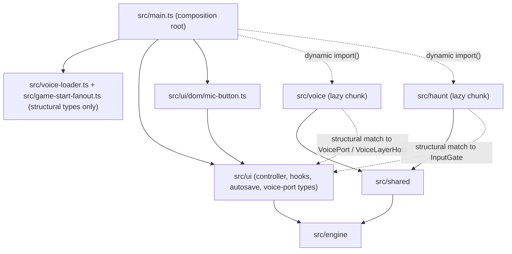
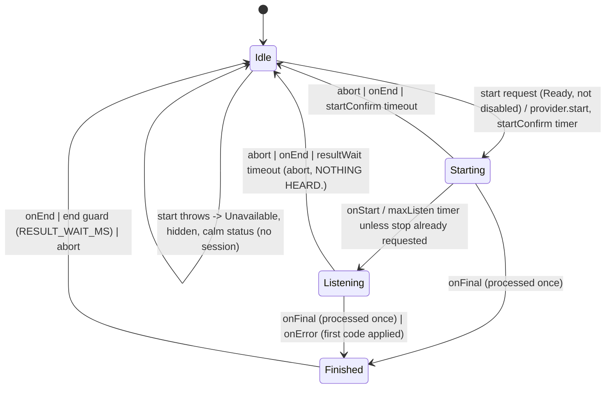
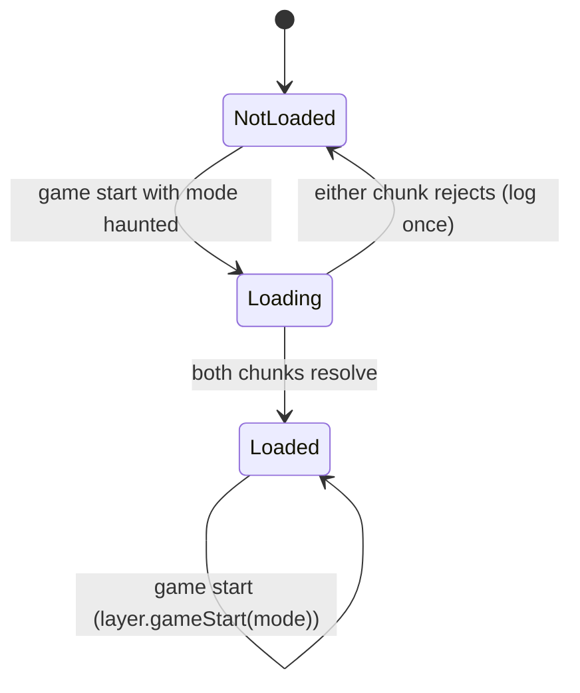

# Design Document: Voice Input

## Overview

Voice input lets a Haunted-mode player hold a microphone button with a mouse or pen, tap it on a touch screen, or press Alt+M, speak an English command, and have the recognized sentence travel the same path as a typed line: the same `GameController.submit` queue, input echo, history, AI parser and fallback rules. Recognition uses the browser's Web Speech API behind a provider-agnostic `SpeechProvider` interface, so a hosted speech-to-text service behind the Worker can replace it later without touching the matcher, the session logic or the UI.

The design has six parts:

1. **Voice layer (`src/voice`)**: provider interface, Web Speech adapter, a pure session state machine with a thin imperative shell, a transcript-cleaning function, a deterministic magic-word matcher (alias table, bounded Damerau-Levenshtein, Stop_List) and the final-result decision function.
2. **Haunt rule (`src/haunt`)**: the Spoken_Word_Rule (a typed XYZZY is deflected once per game while voice is usable) and the fixed Deflection_Line.
3. **Seams in `src/ui`**: an `InputOrigin` on `submit`, an `origin` field on `ResolveContext`, an input gate in `ExtensionHooks`, read-only getters, a per-game Deflection_Count persisted in an optional autosave `ui` field, and a structurally typed voice port (`src/ui/voice-port.ts`) that the DOM module uses.
4. **DOM module (`src/ui/dom/mic-button.ts`)** plus markup in `index.html` and a "Voice input" block in `crt.css`: Mic_Button, Voice_Status, Voice_Disclosure, Voice_Live_Region.
5. **Composition (`src/main.ts`, `src/voice-loader.ts`, `src/game-start-fanout.ts`)**: lazy dynamic `import()` of the voice and haunt chunks on the first Haunted game start, with independent fan-out next to the AI loader.
6. **Build, headers, docs and tests**: `Permissions-Policy: microphone=(self)` in `public/_headers`, extensions to `scripts/check-dist.ts`, README and CREDITS text, a single exported `VOICE_DISCLOSURE_TEXT` constant under `src/shared`, and a test suite that never touches a microphone or the network.

Design decisions that matter most:

- **The session controller is a pure `reduce(state, event, ctx) -> { state, effects }` function** plus a shell that executes effects (provider calls, timers, `submit`). Every lifecycle rule of Requirements 4 to 7 lives in the pure function, so the fast-check session property (Requirement 18.4) can drive arbitrary event sequences with a fake provider and an injected clock.
- **The edge cases of one final result (cleaning, Magic_Match, yes/no, Meta block, filename block) are one pure function `decideFinal`**, checked against a reference table by a property test.
- **`src/ui` imports nothing from `src/voice`, `src/haunt` or `src/parser`.** `src/main.ts` reaches `src/voice/browser` and `src/haunt/spoken-word-rule` only through dynamic `import()`. The module contracts are structural types declared in `src/ui/voice-port.ts` and `src/voice-loader.ts`, the same pattern as `InputResolver` and `ai-loader.ts`.
- **The engine, `src/data`, `src/parser`, `original` and `reference` are not modified.** The XYZZY motion word is detected with the existing `lookupWord` of `src/shared/vocabulary.ts`, which wraps the engine's own `getMotionVocabId`.
- **Typing is never blocked.** Every failure path degrades to the unchanged typed path.

## Research findings

### Verified

Sources were read during this design pass (dates of the pages are as served; the Cloudflare page says "Last updated Aug 25, 2026").

| # | Finding | Source |
|---|---|---|
| V1 | `SpeechRecognition` is `[SecureContext]`. `start()` throws `InvalidStateError` if the object is started and neither `error` nor `end` has fired. `stop()` is ignored if `start` was never called, `end` or `error` fired, or `stop` was already called; the service must still try to return a result from the audio it has. `abort()` returns no result, raises `end`, and is ignored if already stopped or aborting. The `end` event "must always be generated when the session ends no matter the reason". | [Web Speech API spec](https://webaudio.github.io/web-speech-api/) |
| V2 | The error enum is `no-speech`, `aborted`, `audio-capture`, `network`, `not-allowed`, `service-not-allowed`, `language-not-supported`, `phrases-not-supported`. | same |
| V3 | `resultIndex` is the lowest index that changed; the results array is "final results followed by interim results"; final results are never overwritten; alternatives are sorted by non-increasing confidence; `isFinal` true means this index will not change again. With `continuous = false` the list holds a single result. | same |
| V4 | `phrases` is an `ObservableArray<SpeechRecognitionPhrase>`; `new SpeechRecognitionPhrase(phrase, boost)` with boost in [0.0, 10.0]. If phrases are set and the browser has no contextual biasing, `start()` queues an `error` with `phrases-not-supported` and aborts the start. Chrome documents the feature from version 139 (blink-dev intent). | same; [blink-dev](https://groups.google.com/a/chromium.org/g/blink-dev/c/FAoeEf5hcTg) |
| V5 | The start algorithm asks to "request permission to use microphone"; a `denied` result queues an `error` with `not-allowed`. | spec |
| V6 | The Permissions spec says a powerful feature disabled by Permissions Policy "always has its permission state reflected as `denied`", because reading the permission goes through the HTML "allowed to use" check. Read together with V5, a policy of `microphone=()` blocks `SpeechRecognition.start()` on the spec's reading. `microphone=(self)` is the default allowlist and is therefore safe under both readings. MDN documents the `microphone` directive only for `getUserMedia`. | [Permissions spec](https://w3c.github.io/permissions/), [MDN microphone directive](https://developer.mozilla.org/en-US/docs/Web/HTTP/Reference/Headers/Permissions-Policy/microphone) |
| V7 | Browser-compat-data: unprefixed `SpeechRecognition` in Chrome 139+ (prefixed `webkit` since 33), Edge mirrors Chrome, Safari prefixed since 14.1, Safari on iOS mirrors Safari, **Firefox desktop lists 160 (prefixed and unprefixed)**, Firefox Android `false`, Opera `false` for the constructor. | [BCD SpeechRecognition.json](https://raw.githubusercontent.com/mdn/browser-compat-data/main/api/SpeechRecognition.json) |
| V8 | `navigator.permissions.query({ name: "microphone" })` rejects with `TypeError` if the name is unsupported. | [MDN Permissions.query](https://developer.mozilla.org/en-US/docs/Web/API/Permissions/query) |
| V9 | `pointerdown` counts as an activation-triggering input event only for `pointerType` "mouse"; for touch and pen the activation comes on `pointerup`. `keydown` (not Escape) and `mousedown` activate. | [WebKit: The User Activation API](https://webkit.org/blog/13862/the-user-activation-api/) |
| V10 | Cloudflare Pages `_headers`: a request matching several rules inherits all of their headers; a header applied twice has its values joined with a comma; rules are not applied to Pages Functions responses; at most 100 rules and 2,000 characters per line. | [Pages headers](https://developers.cloudflare.com/pages/configuration/headers/) |
| V11 | The spec's `on-device-speech-recognition` policy-controlled feature governs only `available()`/`install()`/`processLocally`, which this design does not use. | spec |

### Decisions that follow from the findings

- **D-R1.** Prefer the unprefixed constructor, fall back to `webkitSpeechRecognition` (V7). Detection is by `typeof === "function"`, never by user-agent sniffing.
- **D-R2.** `maxAlternatives = 5`, `continuous = false`, `interimResults = true`, `lang = "en-US"` (V3). With `continuous = false` the adapter delivers the first final result and ignores everything after it.
- **D-R3.** The adapter creates one recognition object per Voice_Session and detaches its handlers on `abort()`. This satisfies Requirement 3.6 and avoids the V1 `InvalidStateError` from reusing an object whose `end` has not fired.
- **D-R4.** `phrases` are set only when `typeof SpeechRecognitionPhrase === "function"` and `"phrases" in recognition`. If the first event of the session is `phrases-not-supported` (V4), the adapter silently builds a new recognition object without phrases and starts it once more, so the session controller never sees the error (Requirement 3.7).
- **D-R5.** `Permissions-Policy: microphone=(self)` is the only header change (V6). Whether the directive governs `SpeechRecognition` in each browser stays on the "Not verified" list.
- **D-R6.** Recognition starts on `pointerdown` for `mouse` and `pen` (hold-to-talk, Requirement 4.1) and on the `click` that follows a touch press for `touch` (Requirements 4.17 to 4.19). V9 shows that `pointerdown` is not a user activation for touch, while the `click` that follows `pointerup` is, so starting touch recognition on `click` removes the activation risk by design (DD-16, decided). Touch is a tap-to-toggle latch with no MIN_HOLD_MS decision. Alt+M is unchanged. Whether `SpeechRecognition.start()` accepts that activation on every touch browser stays on the manual checklist (item g).
- **D-R7.** Firefox 160 is listed by BCD (V7). Because detection is by feature test only (Requirement 2.1, 2.13), a Firefox that exposes the constructor shows the Mic_Button and the Voice_Disclosure, and no browser is special-cased. If `start()` then fails in that browser (`not-allowed`, `service-not-allowed`, `language-not-supported`, or a throw), the button hides for the rest of the page lifetime (Requirement 2.14, 7.17; DD-3, decided).

## Architecture

### Layering



Rules enforced by `tests/ui-layering.test.ts` and `tests/voice/layering.test.ts`:

- `src/ui` imports nothing from `src/voice`, `src/haunt` or `src/parser` (static, `import type` or dynamic), and still nothing from `src/shared` or `src/parse-api` (unchanged rule).
- `src/main.ts` has no static import of `src/voice`, `src/haunt` or `src/parser`; it reaches the first two only through `import()`.
- `src/voice` and `src/haunt` import nothing from `src/ui` or `src/parser`, and nothing from each other. They may import `src/shared` and `src/engine`.
- `src/engine` imports nothing from `src/voice` or `src/haunt`.
- The module that exports `matchMagicWords` is not reachable by static imports from `src/parser`, `src/ui/game-controller.ts`, `src/engine` or `src/main.ts`.

### Module layout

```
src/
  shared/
    voice-disclosure.ts         VOICE_DISCLOSURE_TEXT (no imports; imported by tests and scripts/check-dist.ts)
  ui/
    types.ts                    + InputOrigin
    extension-hooks.ts          + InputGate, GateResult, addInputGate, gateInput
    input-resolver.ts           + ResolveContext.origin?
    game-controller.ts          seams (see 2.4)
    autosave.ts                 + optional "ui" field, DEFLECTION_LIMIT
    voice-port.ts               types only: VoiceViewState, VoiceGestureEvent, VoicePort, VoiceLayer, VoiceLayerHost
    dom/mic-button.ts           DOM glue
  voice/
    config.ts                   constants (Requirement glossary), MAGIC_PHRASES
    messages.ts                 fixed Voice_Status strings
    speech-provider.ts          SpeechProvider, ProviderCallbacks, VoiceErrorCode, StartOptions
    web-speech-adapter.ts       the only file that mentions SpeechRecognition identifiers
    clean.ts                    cleanTranscript
    edit-distance.ts            damerauLevenshtein (model) and isDistanceOne (fast)
    magic-aliases.ts            Magic_Alias_Table, STOP_LIST, LEAD_INS
    magic-match.ts              tokenize, matchMagicWords
    yes-no.ts                   mapYesNo
    final-result.ts             decideFinal (pure)
    session-machine.ts          VoiceState, VoiceEvent, VoiceEffect, reduce (pure)
    session-controller.ts       createVoiceLayer (shell: queue, effects, timers, provider)
    detect.ts                   detectEnvironment (feature test, probe construct, permission query)
    browser.ts                  createBrowserVoiceLayer (real globals)
  haunt/
    spoken-word-rule.ts         DEFLECTION_LINE, DEFLECTION_LIMIT, containsXyzzyMotionWord, decideSpokenWord, createSpokenWordGate
  voice-loader.ts               createVoiceStartLoader (lazy policy + gate registration)
  game-start-fanout.ts          createGameStartFanOut
scripts/
  headers-policy.ts             parseHeadersFile, checkHeadersPolicy (used by check-dist.ts and a test)
  voice-near-words.ts           developer helper: prints distance-1 candidates for Stop_List review (not run in CI)
tests/                          see "Testing Strategy"
```

### Press-to-submit flow

```mermaid
sequenceDiagram
    participant P as Player
    participant D as mic-button.ts (DOM)
    participant L as VoiceLayer (shell + reduce)
    participant S as SpeechProvider (Web Speech adapter)
    participant G as GameController
    P->>D: pointerdown on #mic (mouse/pen), touch click on #mic, or Alt+M keydown
    D->>L: dispatch(pointer-down | button-activate | altm-down)
    L->>S: start({ phrases }) in the same task (for touch: the task of the click)
    S-->>L: onStart
    L-->>D: view { pressed, status "LISTENING..." }
    S-->>L: onInterim("go in")
    L-->>D: view { status "HEARD: go in" }
    P->>D: pointerup (>= 250 ms; mouse/pen only, touch has no hold)
    D->>L: dispatch(pointer-up)
    L->>S: stop()
    S-->>L: onFinal(["go inside", "go in side"])
    L->>L: decideFinal(alternatives, host snapshot)
    L->>G: submit("go inside", "spoken")  (one or up to four calls, same task)
    L-->>D: view { status "HEARD: go inside", announcement "Heard: go inside" }
    S-->>L: onEnd
    L-->>D: view { pressed false, Ready }
    G->>G: queue, echo, history, AI resolve, gate, step (same code path as typed)
```

### Session state machine

The pure `reduce` models one session at a time. `stopRequested`, `mode`, `held` and `errorSeen` are fields of the session, not separate states.



`Idle` with `Ready` availability and `Finished` with `Busy` availability are the only places where a new start request behaves differently. In `Starting` and `Listening`, a start request in Latch_Mode is a stop request; in every other combination it is ignored (Requirement 4.9). A touch `pointer-down` or `pointer-up` is never a start or stop request in any state; only the touch `button-activate` is (Requirements 4.17 to 4.19).

### Lazy loading and composition



`createVoiceStartLoader` records the latest mode of every game start. When the loading promise resolves it calls `layer.gameStart(latestMode)`, so a 1976 game that started while the chunks were loading leaves the layer in `Suspended` with no gate and no detection (Requirement 1.10). Detection (feature test, probe construction, permission query) runs inside the first `gameStart("haunted")` only.

### Submit flow changes

```text
submit(raw, origin) -> queue entry { line, origin }
processLine(line, origin)
  history: pushLine; for origin "spoken" keep the browsing cursor (pos, draft)
  echo(line)
  resolver? needsTranslation(line, ctx{ ..., origin }) -> beginResolution(..., origin) -> onResolved -> deliver(line, text, origin)
  else deliver(line, line, origin)
deliver(line, text, origin)
  transformed = hooks.transformInput(text)
  verdict = hooks.gateInput(transformed, origin, deflections, ctx)     <-- new
  deflect: deflections = min(LIMIT, deflections + 1); emit narrator lines; persistAutosave(); return   (no step, no accepted())
  allow:   step(...) as before
```

## Components and Interfaces

### 1. Shared: `src/shared/voice-disclosure.ts`

```ts
export const VOICE_DISCLOSURE_TEXT =
  "Speech is processed by your browser's speech service (from the maker of your browser). This game stores no audio.";
```

The file has no imports. `scripts/check-dist.ts` and the tests import it. `index.html` carries the same text statically. The DOM module does **not** import it, because `tests/ui-layering.test.ts` forbids `src/shared` imports in `src/ui` and `src/main.ts` and this design keeps that rule (see decision DD-6). Four assertions keep the copies in sync: the unit test `tests/shared/voice-disclosure.test.ts` (source `index.html` equals the constant, length at most 140, contains `browser's speech service`, `maker of your browser`, `stores no audio`), `check:dist` on `dist/index.html`, the README test (Requirement 16.9) and the credits-page test.

### 2. UI seams (`src/ui`)

#### 2.1 `types.ts`

```ts
export type InputOrigin = 'typed' | 'spoken';
```

#### 2.2 `extension-hooks.ts`

```ts
export type GateResult =
  | { readonly kind: 'allow' }
  | { readonly kind: 'deflect'; readonly lines: readonly string[] }; // 1 to 3 non-empty strings

export type InputGate = (
  text: string,            // exactly what would be given to step: after AI resolution and transformInput
  origin: InputOrigin,
  deflections: number,     // plain number
  ctx: HookContext,        // frozen
) => GateResult;

class ExtensionHooks {
  addInputGate(fn: InputGate): () => void;   // disposer: idempotent, identity-safe
  gateInput(text, origin, deflections, ctx): GateResult;
}
```

Behaviour of `gateInput` (Requirements 13.3 and 13.4):

- `ctx.gameMode !== 'haunted'` returns allow without calling any gate.
- Iterates over a copy of the gate list (a gate added or removed during evaluation does not affect it), in registration order, and stops at the first valid deflect result.
- A gate that throws, returns a Promise, or returns anything that is not `{ kind: 'allow' }` or `{ kind: 'deflect', lines }` with `lines` an array of 1 to 3 non-empty strings is logged through `Logger.error` and treated as allow; evaluation continues with the next gate.
- Each registration is wrapped in its own entry object, so registering the same function twice and disposing twice never removes the other registration.
- The returned deflect result is a fresh frozen copy.

#### 2.3 `input-resolver.ts`

`ResolveContext` gains `origin?: InputOrigin`. `classifyInput` and `AiParser` take structural `ResolveInput` and ignore the extra field. No file in `src/parser` changes.

#### 2.4 `game-controller.ts`

| Change | Detail |
|---|---|
| Queue | `queue: { line: string; origin: InputOrigin }[]`. `submit(raw, origin: InputOrigin = 'typed')` normalizes `origin` (anything other than `'spoken'` becomes `'typed'`). `idleCheck` and `startFresh` use the new entry type. |
| `Resolution` | gains `origin`. `beginResolution`, `onResolved`, `onResolveFailed`, the watchdog path and `startFresh` carry it to `deliver`. |
| `resolveContext(origin)` | sets `origin` for every `needsTranslation` and `translate` call. |
| `processLine(line, origin)` | typed: unchanged. spoken: `pushLine` as for typed, then restore `pos` and `draft` from the history state before the push, adjusting `pos` by the number of entries the 100-entry cap dropped (clamped to 0). The input element's text, caret and focus are never touched (the controller never touches them). |
| `deliver(line, text, origin)` | after `transformInput`, calls `hooks.gateInput(transformed, origin, this.deflections, this.ctx())`. On deflect: `applyDeflection(lines)` and return without `step`, without `accepted()`. |
| `applyDeflection(lines)` | `deflections = Math.min(DEFLECTION_LIMIT, deflections + 1)`, then `emit('narrator', line + '\n')` per line in order, then `persistAutosave()`. A failing `kv.set` is swallowed by `storeAutosave` as today; the in-memory count stays raised (Requirement 12.15). |
| `persistAutosave()` | extracted from the tail of `present()`: `storeAutosave(kv, state, prompt, transcript.tail(AUTOSAVE_MAX_LINES, AUTOSAVE_LINE_KINDS), AUTOSAVE_MAX_CHARS, this.deflections)`. `present()` calls it too, so a `step` after a Deflection keeps `ui` (Requirement 13.15). |
| Count lifecycle | `newGameStart()` sets `deflections = 0` (covers boot without autosave, invalid autosave, restart offer, `requestNewGame`, mode change that starts a game). The restore branch of `beginGame()` sets `deflections = restored.deflections`. An engine `SAVE`/`RESUME` and a reincarnation never touch the field. |
| Getters | `get promptKind(): PromptKind \| undefined` returns `undefined` when `state === undefined`, else `prompt.kind`. `phase` and `gameMode` already exist. |
| `onGameStart` | unchanged (already called once per game start with the running game's mode, wrapped in try/catch with `log.error`). |

`DEFLECTION_LIMIT` is exported from `src/ui/autosave.ts` (value 1). `src/haunt/spoken-word-rule.ts` exports its own `DEFLECTION_LIMIT` (value 1); `tests/haunt/constants-sync.test.ts` asserts the two are equal (decision DD-5).

No other behaviour changes: with no gate and no voice layer installed, transcript, autosave bytes and engine output are identical to today (Requirement 13.9).

#### 2.5 `autosave.ts`

```ts
export const DEFLECTION_LIMIT = 1;

export interface AutosaveRecord { v: 1; state: string; prompt: PromptInfo; lines: TranscriptLine[]; ui?: { deflections: number } }
export interface Restored { state; prompt; lines; deflections: number }

encodeAutosave(state, prompt, lines, maxChars = AUTOSAVE_MAX_CHARS, deflections = 0): string | undefined
storeAutosave(kv, state, prompt, lines, maxChars = AUTOSAVE_MAX_CHARS, deflections = 0): void
```

- `build(ls)` appends `ui: { deflections }` as the last key only when `deflections > 0`, inside the line-dropping loop, so the size check includes it. With `deflections === 0` the JSON is byte-identical to the pre-feature encoding.
- `decodeAutosave` reads `ui` after all existing checks: `ui` must be a plain object whose `deflections` satisfies `Number.isInteger(d) && d >= 0 && d <= DEFLECTION_LIMIT`; otherwise the count is 0 and the record is **not** rejected. Unknown keys inside `ui` are ignored. `v` stays 1.
- `Restored.deflections` is a new field; the existing tests read named fields (`lines`, `prompt`, `state`) and are unaffected.
- `engine/serialize`, `deserialize` and `GameState` are untouched.

#### 2.6 `voice-port.ts` (types only)

```ts
export type VoiceAvailability = 'Unsupported' | 'Ready' | 'Busy' | 'Suspended' | 'Unavailable';

/** Everything the DOM module renders. */
export interface VoiceViewState {
  readonly availability: VoiceAvailability;
  readonly pressed: boolean;     // a Voice_Session is running (aria-pressed)
  readonly disabled: boolean;    // phase !== 'ready' or prompt kind 'filename' or no running game (aria-disabled)
  readonly status: string;       // Voice_Status text; '' when empty
  readonly announcement: { readonly seq: number; readonly text: string } | null;
}

export type PointerKind = 'mouse' | 'pen' | 'touch';

export type VoiceGestureEvent =
  | { type: 'pointer-down'; pointerType: PointerKind } | { type: 'pointer-up'; pointerType: PointerKind } | { type: 'pointer-cancel'; pointerType: PointerKind }
  | { type: 'button-activate'; via: 'keyboard' | 'touch' }   // keyboard: click with detail 0; touch: Touch_Click (click with detail > 0 after a touch pointer-down)
  | { type: 'altm-down'; repeat: boolean } | { type: 'altm-up' }
  | { type: 'escape' } | { type: 'window-blur' } | { type: 'page-hidden' } | { type: 'pagehide' };

export interface GestureReply { readonly preventDefault: boolean }

export interface VoicePort {
  getView(): VoiceViewState;
  onView(listener: (view: VoiceViewState) => void): () => void;
  dispatch(event: VoiceGestureEvent): GestureReply;
}

/** What main.ts and voice-loader.ts hold. */
export interface VoiceLayer {
  readonly port: VoicePort;
  readonly usable: boolean;                 // Ready or Busy
  readonly listening: boolean;              // Requirement 19.2
  subscribe(listener: (listening: boolean) => void): () => void;
  gameStart(mode: Mode): void;
  syncHost(): void;                         // called every animation frame; cheap no-op when nothing changed
}

export interface VoiceLayerHost {
  submit(line: string, origin: InputOrigin): void;
  readonly promptKind: PromptKind | undefined;
  readonly phase: GamePhase | undefined;
  readonly gameMode: Mode | undefined;
  readonly log: Logger;
}
```

`GameController` satisfies the first four members of `VoiceLayerHost` as is (its `submit` has an optional second parameter), and `src/main.ts` adds `log`.

### 3. Voice layer (`src/voice`)

#### 3.1 `config.ts` and `messages.ts`

All constants from the glossary except `DEFLECTION_LIMIT` (see DD-5): `MIN_HOLD_MS = 250`, `MAX_LISTEN_MS = 10000`, `RESULT_WAIT_MS = 3000`, `STATUS_CLEAR_MS = 4000`, `PREVIEW_MAX_CHARS = 80`, `MAX_ALTERNATIVES = 5`, `MAGIC_ALTERNATIVES_CHECKED = 3`, `MAGIC_TOP_TOKEN_LIMIT = 4`, `REPEATED_ERRORS_BEFORE_HIDE = 3`, `SPOKEN_TEXT_MAX_CHARS = 200`. Also `MAGIC_PHRASES = ['xyzzy','plugh','plover','fee','fie','foe','foo']` and `PHRASE_BOOST = 3` (an untested tuning value, see Not verified).

`messages.ts` exports the fixed strings: `LISTENING = 'LISTENING...'`, `NOTHING_HEARD = 'NOTHING HEARD.'`, `DIDNT_CATCH = "DIDN'T CATCH THAT."`, `TYPE_FILE_NAME = 'TYPE THE FILE NAME.'`, `TYPE_THAT_COMMAND = 'TYPE THAT COMMAND; DO NOT SAY IT.'`, `VOICE_NOT_AVAILABLE = 'VOICE IS NOT AVAILABLE. KEEP TYPING.'`, `NO_MICROPHONE = 'NO MICROPHONE FOUND. KEEP TYPING.'`, `SERVICE_NOT_ANSWERING = 'THE VOICE SERVICE IS NOT ANSWERING. TRY AGAIN OR TYPE.'`, `VOICE_TROUBLE = 'VOICE TROUBLE. TYPE INSTEAD.'`, and the prefixes `HEARD_PREFIX = 'HEARD: '` (status) and `HEARD_ANNOUNCE_PREFIX = 'Heard: '` (live region).

#### 3.2 `speech-provider.ts`

```ts
export type VoiceErrorCode = 'denied' | 'no-device' | 'network' | 'no-speech' | 'unsupported-language' | 'aborted' | 'other';

export interface ProviderCallbacks {
  onStart(): void;
  onInterim(text: string): void;
  onFinal(alternatives: readonly string[]): void;   // 1..MAX_ALTERNATIVES, best first
  onError(code: VoiceErrorCode): void;
  onEnd(): void;
}

export interface StartOptions { readonly phrases?: readonly string[]; readonly [hint: string]: unknown }

export interface SpeechProvider {
  isSupported(): boolean;            // no side effects, never throws
  start(options?: StartOptions): void;   // throws if a session is running; may throw for other reasons
  stop(): void;                      // never throws; ignored when idle
  abort(): void;                     // never throws; ignored when idle; no callback after abort
}
```

Contract (Requirements 3.9, 3.13): per session, `onStart` at most once, then any number of `onInterim`, then at most one `onFinal`, then at most one `onError`, then exactly one `onEnd` last, and nothing after `onEnd`. After `abort()` the provider calls no callback for that session.

#### 3.3 `web-speech-adapter.ts` (the only file naming `SpeechRecognition*` identifiers)

`createWebSpeechProvider(callbacks, win)` returns a `SpeechProvider`. `win` is `globalThis` in production and a stub object in tests. The adapter declares its own minimal structural types (names start with `SpeechRecognitionLike`, which is allowed inside this file) so the build does not depend on the DOM lib's typings, which were not checked for TypeScript 7.0.2 (see Not verified).

- **Construction (`probe`)**: resolves the constructor as `typeof win.SpeechRecognition === 'function' ? it : typeof win.webkitSpeechRecognition === 'function' ? it : undefined`, then constructs one object and discards it. A throw propagates to `detectEnvironment`, which maps it to `Unavailable` (Requirement 2.3).
- **`start(options)`**: throws `Error('session running')` if `current !== undefined`. Builds a fresh recognition object; sets `lang = 'en-US'`, `continuous = false`, `interimResults = true`, `maxAlternatives = MAX_ALTERNATIVES` (ignores any such key in `options`); installs handlers; applies phrases when supported (D-R4); calls `rec.start()` in a `try`. If `rec.start()` throws, `current` is cleared and the exception is rethrown (the controller maps it to an unusable start: `Unavailable`, hidden, calm message, Requirements 5.8, 7.17).
- **Events** (every handler first checks `current` identity, so a late event of an aborted or ended session is dropped, Requirement 3.6):
  - `start` -> `onStart()` once.
  - `result` -> iterate from `event.resultIndex`. A final result (`isFinal`) with `length >= 1` yields `alternatives = first min(length, 5)` of `result[j].transcript` and one `onFinal`; a final result with zero alternatives is remembered as "no result". Non-final results produce `onInterim(text)` where `text` is the best transcripts of all result entries joined by a space. After the first `onFinal`, later `result` events are ignored.
  - `error` -> `mapRecognitionError(event.error)` (total function, exact table of Requirement 3.4; a non-string or missing value maps to `other`). The first error is delivered once. If the code is `phrases-not-supported` and phrases were set, the adapter retries once without phrases and delivers nothing.
  - `end` -> if neither a final nor an error was delivered, `onError('no-speech')`; then `onEnd()` and `current = undefined` (Requirements 3.9, 3.10).
- **`stop()`**: `current?.rec.stop()` inside `try/catch`. **`abort()`**: `const c = current; current = undefined;` mark `c` dead, `c.rec.abort()` inside `try/catch`; the adapter never calls a callback for `c` afterwards.
- **`isSupported()`**: the constructor test above plus `win.isSecureContext === true`; no construction.

#### 3.4 `clean.ts`

`cleanTranscript(input: unknown): string` implements Requirement 8.1 in order: coerce non-strings to `''`; `normalizePlayerText`; map U+02BC and the quote characters to `'` and U+2010 to `-`; `toLowerCase()`; replace each run of characters outside `[a-z0-9' -]` with one space; collapse spaces; trim; cut to 200 characters; trim. It is total (no regex backtracking, one pass per step), bounded, and idempotent. The same function cleans interim text.

#### 3.5 `edit-distance.ts`

- `damerauLevenshtein(a, b)`: the optimal-string-alignment dynamic program (insertion, deletion, substitution, adjacent transposition). OSA and unrestricted Damerau-Levenshtein agree for every pair whose distance is at most 1, which is the only value the matcher uses. This function is the reference model in tests.
- `isDistanceOne(a, b)`: the production check, linear time with an early length-difference exit. A model-based property compares `isDistanceOne(a, b)` with `damerauLevenshtein(a, b) === 1` over generated strings.

#### 3.6 `magic-aliases.ts` and `magic-match.ts`

**Alias table (source, not generated).** Keys are canonical commands; values are spoken spellings.

| Command | Aliases |
|---|---|
| `XYZZY` | `xyzzy`, `zizzy`, `sizzy`, `xizzy`, `zyzzy`, `x y z z y` |
| `PLUGH` | `plugh`, `plug`, `plu`, `plug h` |
| `PLOVER` | `plover`, `plovers`, `plover's`, `plove` |
| `FEE` | `fee` |
| `FIE` | `fie`, `fi` |
| `FOE` | `foe`, `fo` |
| `FOO` | `foo`, `fum` |

`aliasIndex` is built once at module load by running every alias through the matcher's tokenizer (so `x y z z y` is stored as `xyzzy`, `plug h` stays `plug h`). A load-time assertion in the unit test checks that no alias is a Game_Vocabulary word except the nine exceptions of Requirement 10.11 (`xyzzy`, `plugh`, `plove`, `plover`, `fee`, `fie`, `foe`, `foo`, `fum`), using `lookupWord` from `src/shared/vocabulary.ts` over every motion, object and action word of `src/data/dungeon.ts`.

**Lead-ins** (longest first): `say the magic word`, `say the word`, `the word`, `magic word`, `say`.

**Algorithm** `matchMagicWords(alternatives: readonly unknown[]): MagicMatch | null`, with `MagicMatch = { commands: readonly MagicCommand[]; alternativeIndex: number; tier: 'alias' | 'edit' }`:

1. `tokenize(cleaned)`: split on spaces and hyphens, drop empty tokens, then replace every run of two or more consecutive single-letter (`a-z`) tokens with one concatenated token (Requirement 10.18).
2. `stripLeadIn(tokens)`: remove at most one lead-in (longest first). A lead-in followed by nothing yields no tokens (no match).
3. **Top-token limit**: let `n0` be the token count of the first Alternative after lead-in removal and joining. If `n0 > MAGIC_TOP_TOKEN_LIMIT` the result is no match for the whole call (Requirement 10.8).
4. For each Alternative index `i` in `0 .. min(len, MAGIC_ALTERNATIVES_CHECKED) - 1`, in order, compute `matchOne(tokens_i)`; the first non-null result wins and carries `alternativeIndex = i`. (Within one Alternative the alias tier is tried before the edit tier; across Alternatives the first one that yields any match wins, which keeps Requirement 11.9 true. This resolves the wording "whole utterance" of 10.5 per Alternative, see DD-7.)
5. `matchOne(tokens)`:
   - **Whole-run alias**: join tokens with a space; if it is an alias key, return its single command (tier `alias`).
   - **Single token** (`tokens.length === 1`): exact alias; else strip one trailing `'s` or `s` and accept only if the remainder is an alias of five or more letters; else the **edit tier**: the token must match `/^[a-z]{5,}$/`, not be in `STOP_LIST`, and `isDistanceOne(token, canon)` for `canon` in `xyzzy`, `plugh`, `plover` (tier `edit`).
   - **Run of 2 to 4 tokens**: the sequence rule. `tokens[k]` must be an alias of the k-th word of `FEE, FIE, FOE, FOO` for every `k`, with the aliases of Requirement 11.1. Anything else (a skipped word, a repeated word, a wrong order, a fifth token, a non-sequence token) returns null (Requirement 11.3).
   - Runs of five or more tokens return null.
6. No fuzzy rule is applied to tokens of four or fewer letters, to tokens inside a run of two or more, or to FEE/FIE/FOE/FOO.

Commands are returned upper-case. The function uses no clock, no randomness and no I/O, and never throws (inputs are coerced with `cleanTranscript`).

**Stop_List and corpus.** `STOP_LIST` is a checked-in `readonly string[]` in `magic-aliases.ts` with at least 30 ordinary words. The initial list (to be finalized during implementation) is: `plush`, `plugs`, `plough`, `plum`, `plus`, `plume`, `plumb`, `flush`, `blush`, `slush`, `clover`, `lover`, `lovers`, `prover`, `glover`, `hover`, `cover`, `fizzy`, `dizzy`, `fuzzy`, `frizzy`, `jazzy`, `tizzy`, `muzzy`, `buzzy`, `woozy`, `fussy`, `fizzle`, `sizzle`, `pluck`, `plugged`. Because there is no dictionary dependency (and none is added), completeness is defined against a **checked-in corpus**:

- `tests/voice/support/ordinary-words.ts` exports `ORDINARY_WORDS` (at least 200 ordinary English words, including every word listed in Requirement 10.14 and every `STOP_LIST` word).
- `tests/voice/stop-list.test.ts` asserts: `STOP_LIST.length >= 30`; the required words are present; for every corpus word `w` matching `/^[a-z]{5,}$/` with `isDistanceOne(w, canon)` for some canonical word, `w` is in `STOP_LIST`; `matchMagicWords([w])` is null for every corpus word and every stop word; no stop word is an alias.
- `scripts/voice-near-words.ts` (developer helper, not part of `npm test`) generates all strings at distance 1 from `xyzzy`, `plugh` and `plover` (insertions over a-z, deletions, substitutions, adjacent swaps; about 300 candidates each), optionally filters them with a word list given as `--dict <file>` (for example `/usr/share/dict/words` on a developer machine), and prints the survivors for a human to add to `STOP_LIST` and `ORDINARY_WORDS`. This is how the 200-word corpus and the list were built, and rerunning it is how they are extended. Residual risk: an English word that neither the corpus nor the list contains and that is at distance 1 from a canonical word would match in the edit tier; this is listed under Not verified.

#### 3.7 `yes-no.ts`

`mapYesNo(cleaned): 'YES' | 'NO' | null`: whole-string comparison against `yes, yeah, yep, yup, sure, ok, okay, affirmative` and `no, nope, nah, negative`.

#### 3.8 `final-result.ts` (pure)

```ts
interface HostSnapshot { gameMode: Mode | undefined; promptKind: PromptKind | undefined; phase: GamePhase | undefined }
type FinalOutcome =
  | { kind: 'silent' }                                         // no line, no message
  | { kind: 'message'; text: string }                          // no line, Voice_Status + announcement = text
  | { kind: 'submit'; lines: readonly string[]; heard: string } // heard = Cleaned_Text of the Alternative that produced the lines
decideFinal(alternatives: readonly unknown[], host: HostSnapshot): FinalOutcome
```

Order (Requirements 8.12 and 9.12):

| Step | Condition | Outcome |
|---|---|---|
| a | `phase !== 'ready'`, or `promptKind`/`phase` undefined, or `gameMode !== 'haunted'` | `silent` |
| b | `promptKind === 'filename'` | `message TYPE_FILE_NAME` |
| c | Cleaned first Alternative has no `[a-z0-9]` | `message DIDNT_CATCH` |
| d | `promptKind === 'yesno'` | `mapYesNo` -> `submit ['YES'\|'NO']`; else Meta block (first two space-separated tokens, `isMetaWord`) -> `message TYPE_THAT_COMMAND`; else `submit [cleaned0]`. The matcher is never called. |
| e | `promptKind === 'command'` | `matchMagicWords` -> `submit match.commands` with `heard` cleaned from `alternatives[match.alternativeIndex]` |
| f | Meta block on the first two tokens | `message TYPE_THAT_COMMAND` |
| g | otherwise | `submit [cleaned0]` |

The Voice_Layer never reads engine state: `isMetaWord` from `src/shared/meta-commands.ts` is the only word list used.

#### 3.9 `session-machine.ts` (pure) and `session-controller.ts` (shell)

See "Data Models" for the types. `reduce(state, event, ctx)` returns the next state and a list of effects. The shell (`createVoiceLayer`) owns the provider, the scheduler and a run-to-completion event queue:

1. `dispatch(event)` enqueues; the loop `while (queue not empty)` takes one event, reads `ctx = { now: scheduler.now(), host: readHost() }`, calls `reduce`, stores the state, executes effects in order, and then publishes the new `VoiceViewState` (and the `listening` change) to subscribers.
2. Effects: `provider-start` (a throw is converted into a `start-threw` event enqueued before the loop continues), `provider-stop`, `provider-abort`, `timer-set(id, ms)` / `timer-clear(id)` (the shell keeps one scheduler handle per id and tags the fired event with the session id and status sequence number captured at `set` time), `submit(lines)` (a synchronous loop of `host.submit(line, 'spoken')` calls, so a Magic_Match is atomic, Requirement 8.10), and `log(code)` (one `host.log.error('voice: ' + code)` call; the message contains only the error code).
3. The provider callbacks become `p-start`, `p-interim`, `p-final`, `p-error`, `p-end` events. The shell reads the host snapshot **at the moment the event is processed**, which is the moment `onFinal` is invoked (Requirement 9.10).
4. `subscribe(listener)` and `listening` implement Requirement 19: `listening` is `state.session !== null`; each listener is called once, synchronously, per change; a throwing listener is caught and does not stop the others.
5. `syncHost()` enqueues `host-changed` only if `(phase, promptKind, gameMode)` differs from the last snapshot read.

Transition table (inputs to effects). `now` comes from the scheduler; "S" is the current session.

| Input | Condition | Next state and effects |
|---|---|---|
| start request (`pointer-down` with `pointerType` `mouse` or `pen`, `button-activate` (`via` `keyboard` or `touch`), `altm-down` with `repeat = false`) | availability Ready, not disabled, no session | new session `{ phase: starting, mode: pending (latch for button-activate), held: true except button-activate, pressedAt: now }`; effects `provider-start`, `timer-set(startConfirm, MAX_LISTEN_MS + RESULT_WAIT_MS)`, `timer-clear(statusClear)` |
| `pointer-down`, `pointer-up`, `pointer-cancel` with `pointerType` `touch` | any state | ignored: no start, no stop, no abort, no `swallowRelease`, no MIN_HOLD_MS (Requirements 4.17, 4.19); only the touch `button-activate` acts |
| start request | disabled (Requirement 4.14) | ignored, no message |
| start request | session exists, `mode = latch`, `stopRequested = false` | `stopRequested = true`, `swallowRelease = true` for a mouse/pen `pointer-down` only (a keyboard, Alt+M or touch stop has no release to swallow), `provider-stop`, `timer-set(resultWait)`, `timer-clear(maxListen)` |
| start request | any other session state, or `altm-down` with `repeat = true` | ignored |
| `start-threw` (the effect `provider-start` threw) | session `starting` | `session = null`, all timers cleared, `fatal = runtime` (availability `Unavailable`, hidden), status and announcement `VOICE IS NOT AVAILABLE. KEEP TYPING.`, one `log('other')`, failure counter unchanged, `statusClear` armed (Requirements 5.8, 7.17, 2.14) |
| `pointer-up`, `altm-up` | S.held, `mode = pending` | `held = false`; if `now - pressedAt >= MIN_HOLD_MS` then `mode = hold` and stop (as above) else `mode = latch` |
| `pointer-up`, `altm-up` | `swallowRelease` | clear the flag, nothing else |
| `pointer-up`, `altm-up` | no session, `phase = finished`, or mode already decided | ignored (never calls `stop` or `abort` on an ended session) |
| `pointer-cancel` | S.held and press source is pointer (mouse or pen) | abort (below) |
| `escape` | session exists | abort. No session: ignored (the DOM module also skips `preventDefault`) |
| `window-blur`, `page-hidden`, `pagehide` | session exists | abort |
| abort | session exists | `provider-abort`, clear all timers, `session = null`, status `''` immediately, announcement unchanged, availability back to Ready (or Suspended/Unavailable if set), no console entry |
| `p-start` | S exists, `phase = starting` | `phase = listening`, `timer-clear(startConfirm)`, `timer-set(maxListen, MAX_LISTEN_MS)` unless `stopRequested`, status `LISTENING...` |
| `p-interim(text)` | S exists, `phase !== finished`, not errored | `c = cleanTranscript(text)`; if non-empty, status `HEARD: ` + first 80 characters of `c`; no announcement; never submits or logs |
| `p-final(alts)` | S exists, `phase !== finished`, not errored | `phase = finished`; clear startConfirm, maxListen; `failures = 0`; `decideFinal` outcome applied: `submit` -> effect `submit(lines)`, status `HEARD: ` + cut `heard`, announcement `Heard: ` + `heard`; `message` -> status and announcement = text; `silent` -> status `''`; then `timer-set(statusClear, 4000)` and `timer-set(resultWait)` as the end guard |
| `p-final` | no session, `phase = finished`, or error already applied | discarded |
| `p-error(code)` | S exists, `phase !== finished`, no error yet | `errorSeen = true`, `phase = finished`, one `log(code)`; table below |
| `p-error` | otherwise | discarded without message, count change or log |
| `p-end` | S exists | clear all timers; if no final and no error: status `NOTHING HEARD.` (announce), `failures = 0`; `session = null`; availability from `fatal`/`suspended` |
| `p-end` | no session | discarded |
| `timer maxListen` | S matches, `phase = listening`, not stopRequested | stop (as above) |
| `timer resultWait` | S matches, no final, no error | `provider-abort`, `session = null`, status and announcement `NOTHING HEARD.`, arm statusClear. (An abort-caused `aborted` never reaches the machine: the provider is detached.) |
| `timer resultWait` | S matches, final or error already handled (end guard) | `provider-abort`, `session = null`, no message |
| `timer startConfirm` | S matches, `phase = starting` | `provider-abort`, treated as error `other` |
| `timer statusClear` | `seq` equals `status.seq` and no session | status `''` |
| `game-start(mode)` | any | abort any session, clear all timers, status `''`, announcement `null`, `suspended = (mode === '1976')`; detection result applied by the shell the first time the mode is haunted |
| `host-changed` | session exists and (phase not ready or prompt `filename`) | abort. Always recomputes `disabled` |
| `permission(state)` | `suspended` | ignored (Requirement 1.11) |
| `permission('denied')` | not suspended | `fatal = permission` unless a runtime fatal is already set; hides |
| `permission('granted'\|'prompt')` | `fatal = permission` | `fatal = null` |

Error table (applied once per session, at the `p-error` event):

| Code | Status and announcement | Availability | Failure counter |
|---|---|---|---|
| `denied` (provider `not-allowed`, `service-not-allowed`) | `VOICE IS NOT AVAILABLE. KEEP TYPING.` | runtime fatal (page lifetime, button and disclosure hidden) | n/a |
| `no-device` | `NO MICROPHONE FOUND. KEEP TYPING.` | runtime fatal | n/a |
| `unsupported-language` (provider `language-not-supported`) | `VOICE IS NOT AVAILABLE. KEEP TYPING.` | runtime fatal | n/a |
| `start` throws (`start-threw`, also on the first activation) | `VOICE IS NOT AVAILABLE. KEEP TYPING.` | runtime fatal | unchanged |
| `network` | `THE VOICE SERVICE IS NOT ANSWERING. TRY AGAIN OR TYPE.` | Ready, unless counter reaches 3 | +1 |
| `other` | `VOICE TROUBLE. TYPE INSTEAD.` | Ready, unless counter reaches 3 | +1 |
| `no-speech` | `NOTHING HEARD.` | Ready | reset to 0 |
| `aborted` (browser-initiated) | none; status `''` | unchanged | unchanged |

Reaching `REPEATED_ERRORS_BEFORE_HIDE` (3) consecutive `network`/`other` failures shows the message of the last code and sets the runtime fatal. All messages except `aborted` arm the 4000 ms clear timer.

Derived availability (`availabilityOf(state)`): `Unsupported` if `fatal === 'unsupported'`; else `Suspended` if `suspended`; else `Unavailable` if `fatal` is `runtime` or `permission`; else `Busy` if a session exists; else `Ready`. `suspended` is an independent flag so that a runtime `Unavailable` survives a 1976 game and a later Haunted game start (Requirement 7.8), see DD-8. Before the first Haunted game start (`detected = false`) the layer is `Suspended`.

#### 3.10 `detect.ts` and `browser.ts`

`detectEnvironment(env)` runs once, inside the first `gameStart('haunted')`:

1. `!env.isSecureContext || !env.hasRecognition()` -> `fatal = 'unsupported'`; no further call is made.
2. `env.probe()` (constructs and discards one recognition object) throws -> `fatal = 'runtime'`, one `log('other')`.
3. Otherwise `Ready` immediately (Requirement 2.11). If `env.queryMicrophone` exists, the shell calls it inside `try/catch`; a rejection, a throw or an unsupported name is ignored (Requirement 2.6). On `denied` the shell enqueues `permission('denied')`; it keeps the `PermissionStatus` object and enqueues `permission(state)` from its `change` listener for the page lifetime.
4. `start()` is never called here, and `getUserMedia` appears nowhere.

`browser.ts` exports `createBrowserVoiceLayer(host)`. It builds the real environment (`globalThis.isSecureContext`, `navigator.permissions`), `performance.now()` and `setTimeout`/`clearTimeout` as the scheduler, and `createWebSpeechProvider(callbacks, globalThis)` as the provider factory. It passes `{ phrases: MAGIC_PHRASES }` on every `start`.

### 4. Haunt rule: `src/haunt/spoken-word-rule.ts`

```ts
export const DEFLECTION_LINE = 'SAY IT ALOUD. HOLD THE MIC OR ALT+M. TYPE XYZZY AGAIN IF YOU MUST.'; // 66 characters
export const DEFLECTION_LIMIT = 1;

export function containsXyzzyMotionWord(text: string): boolean;   // scanWords(text).words.some(w => lookupWord(w) is motion with canonical 'XYZZY')

export function decideSpokenWord(i: {
  gameMode: Mode; promptKind: PromptKind; voiceUsable: boolean;
  origin: InputOrigin; text: string; deflections: number;
}): GateResult;                 // deflect iff haunted && command && voiceUsable && typed && containsXyzzyMotionWord && deflections < DEFLECTION_LIMIT

export function createSpokenWordGate(deps: { isVoiceUsable(): boolean }): InputGate;
```

- XYZZY detection uses `scanWords` (C `word_count` and `sscanf "%s%s"` semantics: at most two words) and `lookupWord` (motion, object, action order; first five characters; case-insensitive). The test `tests/haunt/xyzzy-id.test.ts` additionally asserts that for each deflected example `lookupWord(w).id` equals the `XYZZY` constant of `src/data/constants.ts`.
- The gate knows nothing about the controller or the voice layer: voice availability arrives through `isVoiceUsable`, which `voice-loader.ts` binds to `layer.usable`.
- The deflect result is `{ kind: 'deflect', lines: [DEFLECTION_LINE] }`.

### 5. DOM module and markup

#### 5.1 `src/ui/dom/mic-button.ts`

```ts
export interface MicElements {
  button: HTMLButtonElement; status: HTMLElement; disclosure: HTMLElement;
  unavailable: HTMLElement; live: HTMLElement; input: HTMLInputElement;
}
export interface MicOptions { els: MicElements; doc?: Document; defer?: (fn: () => void) => void }
export function installMicButton(opts: MicOptions): { attach(port: VoicePort): void; dispose(): void };
```

The module is installed at startup in every mode. Until `attach(port)` is called every element stays hidden (the static `hidden` attributes) and every listener does nothing.

- **Rendering** (`render(view)`), one synchronous pass:
  - usable = availability is `Ready` or `Busy`. Set `button.hidden` and `disclosure.hidden` together. If the button is about to be hidden and `doc.activeElement === button`, first call `input.focus({ preventScroll: true })` (the input keeps its value, caret and selection because `focus()` does not change them), then hide (Requirements 7.15, 17.9).
  - `aria-pressed = String(view.pressed)`; `aria-disabled` set to `true` or removed from `view.disabled`; `aria-describedby = 'mic-disclosure'` or `'mic-disclosure mic-unavailable'` when disabled (disclosure first, DD-2); visible label `MIC` or `MIC ON` while pressed.
  - `status.textContent = view.status; status.hidden = view.status === ''`.
  - Live region: `announcement === null` -> `live.textContent = ''`; a new `seq` -> write `text`. If the text equals the current content, first set `''` and write the text from `defer` (default: `setTimeout(fn, ANNOUNCE_REARM_MS)` with `ANNOUNCE_REARM_MS = 50`), so two identical consecutive announcements are both announced (Requirement 17.7). The screen-reader behaviour is a manual check.
- **Listeners** (all call `port.dispatch` only when attached). The module keeps `pressType: PointerKind | null`, the `pointerType` of the last press on the button:
  - `button` `pointerdown` (button 0, `isPrimary`): record `prev = doc.activeElement` and `pressType = e.pointerType` (anything other than `mouse`, `pen` or `touch` is treated as `mouse`), `preventDefault()` for every type (the on-screen keyboard stays up), dispatch `pointer-down` with the `pointerType`. For `touch` the reducer ignores it (Requirement 4.17) and no pointer capture is taken (touch is implicitly captured); for `mouse` and `pen` the module tries `setPointerCapture(pointerId)` when the method exists. A `mousedown` listener also calls `preventDefault()` (focus never moves; after dispatch, if `doc.activeElement === button` and `prev` was the input, `prev.focus()` restores it, Requirement 4.13).
  - `pointerup` -> `pointer-up` with the `pointerType`. `pointercancel` -> `pointer-cancel` with the `pointerType`, and clears `pressType` (a cancelled touch press has no click). `lostpointercapture` without a preceding `pointerup`, for `mouse` and `pen` only -> `pointer-cancel`.
  - `click`: `detail === 0` -> `button-activate` with `via: 'keyboard'`; `detail > 0` and `pressType === 'touch'` -> `button-activate` with `via: 'touch'` (the Touch_Click; after the dispatch, if `doc.activeElement === button` and `prev` was the input, `prev.focus()` restores it); `detail > 0` and `pressType` `mouse` or `pen` or `null` -> ignored (Requirement 4.15). `pressType` is reset to `null` after every `click`. One touch tap therefore dispatches `pointer-down` (ignored), `pointer-up` (ignored) and one `button-activate`, never a second start or stop (Requirement 4.19). `contextmenu` -> `preventDefault()` and clears `pressType` (a long press ends in `contextmenu` and starts nothing).
  - `document` `keydown`: Alt+M (`e.code === 'KeyM'`, `altKey`, no ctrl/meta/shift) while `getView().availability` is `Ready` or `Busy` -> `preventDefault()` always (also when `repeat`), dispatch `altm-down` with `repeat`; Escape while `getView().pressed` -> dispatch `escape` (no `preventDefault` otherwise). `keyup` of `KeyM` or `Alt` -> `altm-up`.
  - `window` `blur`, `document` `visibilitychange` (when hidden), `window` `pagehide` -> the matching events.
- Text is written only through `textContent` and attributes; no `innerHTML`, no `style` attribute (the CSP has `style-src 'self'`).
- If any required element is missing, `installMicButton` logs nothing, installs nothing and returns a no-op handle; typing is unaffected.

#### 5.2 `index.html`

Added after the `.input-line` block and before the live regions:

```html
<div class="voice-bar" id="voice-bar">
  <button id="mic" class="mic" type="button" hidden aria-pressed="false"
          aria-keyshortcuts="Alt+M" aria-label="Mic: hold to talk"
          aria-describedby="mic-disclosure">MIC</button>
  <p id="voice-status" class="voice-status" aria-hidden="true" hidden></p>
  <p id="mic-disclosure" class="voice-disclosure" hidden>Speech is processed by your browser's speech service (from the maker of your browser). This game stores no audio.</p>
  <span id="mic-unavailable" hidden>Voice input is not available for this question</span>
</div>
...
<div id="voice-live" class="sr-only" aria-live="polite" aria-atomic="true"></div>
```

`#voice-live` follows `#live-interpreted` and is neither an ancestor nor a descendant of either. The accessible name `Mic: hold to talk` contains the visible label `MIC` (WCAG 2.5.3) and the whole words "hold" and "talk". The static HTML has no `style` attribute.

#### 5.3 `crt.css` additions

Tokens in `:root`: `--voice-text: var(--fg)`, `--voice-border: var(--fg-dim)`, `--voice-target: 44px`. Rules:

```css
.voice-bar { display: flex; flex-wrap: wrap; align-items: center; gap: 0.25rem 0.75rem; flex: none; min-width: 0; font-size: max(16px, 0.8em); text-shadow: none; }
.voice-bar > :not([hidden]) { margin-top: 0.25rem; }
.voice-bar [hidden] { display: none !important; }
.mic { box-sizing: border-box; min-width: var(--voice-target); min-height: var(--voice-target); padding: 0.1em 0.6em; font: inherit; color: var(--voice-text); background: var(--bg); border: 2px solid var(--voice-border); border-radius: 2px; touch-action: manipulation; user-select: none; -webkit-user-select: none; -webkit-touch-callout: none; cursor: pointer; }
.mic[aria-pressed="true"] { background: var(--fg); color: var(--bg); }
.mic[aria-disabled="true"] { border-style: dashed; }
.voice-status { flex: 1 1 12ch; min-width: 0; margin: 0; color: var(--voice-text); overflow-wrap: anywhere; white-space: normal; }
.voice-disclosure { flex: 1 1 100%; margin: 0; color: var(--voice-text); overflow-wrap: anywhere; white-space: normal; }
```

The three states differ in a non-colour cue: ready has text `MIC` and a solid border; listening has the text `MIC ON`; disabled has a dashed border (Requirement 17.4). `touch-action: manipulation` (not `none`) is chosen so that the browser still delivers the `click` that starts touch recognition, with no double-tap-zoom delay or interference on the button, while pinch zoom of the page stays available; `-webkit-touch-callout: none`, `user-select: none` and the `contextmenu` handler keep a long press from selecting text or opening a menu (Requirement 4.12). There is no animation or transition on any new element, and the existing `prefers-reduced-motion` block gets `.mic, .voice-status { animation: none !important; transition: none !important; }` as a guard. The focus ring is the existing global `:focus-visible` rule.

Contrast: the new text uses `--fg` (an estimate by hand gives about 8:1 under the 22% scanline plus 96% flicker worst case). `--fg-dim` on `--bg` is about 6.9:1 undimmed but about 4.2:1 in the same hand estimate of the worst case, which is below 4.5:1, so no new text uses `--fg-dim`; only the 2 px border does (3:1 required). The test helper is authoritative (DD-15, DD-18).

### 6. Composition

#### 6.1 `src/voice-loader.ts`

```ts
export interface VoiceModule { createBrowserVoiceLayer(host: VoiceLayerHost): VoiceLayer }
export interface HauntModule { createSpokenWordGate(deps: { isVoiceUsable(): boolean }): InputGate }

export interface VoiceLoaderDeps {
  getHost(): (VoiceLayerHost & { addInputGate(gate: InputGate): () => void }) | undefined;
  log: Logger;
  loadVoice(): Promise<VoiceModule>;
  loadHaunt(): Promise<HauntModule>;
  onLayer?(layer: VoiceLayer): void;       // main.ts attaches layer.port to the DOM module
}
export function createVoiceStartLoader(deps: VoiceLoaderDeps): { onGameStart(mode: Mode): void; syncHost(): void };
```

Behaviour:

- `onGameStart(mode)` records `latestMode`. If loaded: `layer.gameStart(mode)` and gate management (below). If not loaded, `mode === 'haunted'` and not loading: set `loading`, run `Promise.all([loadVoice(), loadHaunt()])`.
- On resolve: `loading = false`, create the layer with the host, call `onLayer(layer)`, mark loaded, then run the same path as a game start with `latestMode`.
- On reject: `loading = false`, one `log.error('voice failed to load', e)`, nothing shown, nothing loaded; the next Haunted game start tries again. (A failed dynamic import may stay failed until a reload in some browsers; see Not verified.)
- Gate management: entering Haunted registers `createSpokenWordGate({ isVoiceUsable: () => layer.usable })` through `host.addInputGate` if not registered; entering 1976 disposes it. Both happen synchronously in `onGameStart`, before the first line of that game can be delivered.
- A game start while loading with mode 1976 creates no request and, when the load resolves with `latestMode === '1976'`, leaves the layer suspended (Requirement 1.10).
- `syncHost()` forwards to `layer.syncHost()` when loaded.

#### 6.2 `src/game-start-fanout.ts`

`createGameStartFanOut(handlers, log)` returns `(mode) => void` that calls every handler in order inside its own `try/catch` and logs failures only (Requirement 13.8). `src/ai-loader.ts` is unchanged.

#### 6.3 `src/main.ts`

```ts
const loadVoiceModule = (): Promise<VoiceModule> => import('./voice/browser');
const loadHauntModule = (): Promise<HauntModule> => import('./haunt/spoken-word-rule');
...
const mic = installMicButton({ els: findMicElements(), });
const voice = createVoiceStartLoader({
  getHost: () => controller && ({
    submit: (l, o) => controller!.submit(l, o),
    get promptKind() { return controller!.promptKind; }, get phase() { return controller!.phase; }, get gameMode() { return controller!.gameMode; },
    addInputGate: (g) => hooks.addInputGate(g), log }),
  log, loadVoice: loadVoiceModule, loadHaunt: loadHauntModule, onLayer: (l) => mic.attach(l.port),
});
const onGameStart = createGameStartFanOut([createHauntedStartLoader(() => controller, log, loadParserModule), voice.onGameStart], log);
...
// in the existing requestAnimationFrame loop: voice.syncHost();
```

Neither `import('./voice/browser')` nor the haunt import is awaited on the game path (Requirement 1.9).

### 7. Headers, build checks and documentation

#### 7.1 `public/_headers`

One new line appended to the existing `/*` block, all other lines byte-identical:

```
/*
  Content-Security-Policy: default-src 'self'; img-src 'self' data:; style-src 'self'; font-src 'self'; connect-src 'self'; frame-ancestors 'none'
  X-Content-Type-Options: nosniff
  Referrer-Policy: no-referrer
  Permissions-Policy: microphone=(self)
```

#### 7.2 `scripts/headers-policy.ts`

`parseHeadersFile(text)` returns blocks `{ pattern, headers: { name, value }[] }` (a non-indented, non-comment line starts a block; indented `Name: value` lines belong to it; comments start with `#`). `checkHeadersPolicy(text)` returns a list of failures for Requirements 15.1 to 15.5 and 15.9:

- exactly one `/*` block, exactly one `Permissions-Policy` header in it whose value is exactly `microphone=(self)` (anything else is reported by name: `microphone=()`, `microphone=*`, `microphone=(*)`, quoted origins, extra directives);
- exactly one `Content-Security-Policy`, parsed by `;` into directives; requires `default-src 'self'`, `connect-src 'self'`, `img-src 'self' data:`, `style-src 'self'`, `font-src 'self'`, `frame-ancestors 'none'`; rejects any source starting with `http:`, `https:`, `ws:`, `wss:` or `*`, any `'unsafe-inline'`/`'unsafe-eval'`, `data:` outside `img-src`, and any source other than `'self'` in `script-src`, `media-src` and `connect-src`;
- `X-Content-Type-Options: nosniff` and `Referrer-Policy: no-referrer` present and unchanged;
- any second path block must not repeat `Permissions-Policy`, `Content-Security-Policy` or `X-Content-Type-Options` (stricter than "different value", because Cloudflare joins duplicate headers with a comma, V10; DD-10).

#### 7.3 `scripts/check-dist.ts`

- `PRIVACY_STATEMENTS` gains `e`: `['voice input', 'speech recognition service', 'maker of the browser', 'never records or stores audio']`, `f`: `['1976 mode never uses the microphone']`, `g`: `['typing always works']`. Entries `a` to `d` unchanged.
- New checks, all reported in one run: `dist/index.html` has exactly one element with id `mic-disclosure`, with a `hidden` attribute (any serialization), whose text after entity decoding and whitespace collapsing equals `VOICE_DISCLOSURE_TEXT` (parsed with happy-dom's `DOMParser`, a pinned devDependency, so entity decoding and attribute forms are handled by a real parser); `dist/_headers` exists and passes `checkHeadersPolicy`; no script that `dist/index.html` loads at start (`<script src>` or `<link rel="modulepreload" href>`) contains `SpeechRecognition`, and at least one `.js` under `dist/assets` does.
- Output never prints header or credential values.
- Because the credits page imports `CREDITS.md` with `?raw` into a JavaScript string, a phrase is found in the bundle only if it sits on one source line without markup or quotes inside it (the string holds `\n` escapes, which `visibleText` does not collapse). The new CREDITS text keeps every phrase on a single line (DD-13).

#### 7.4 README and CREDITS

- `README.md`: new section "Voice input" (usage, Alt+M, tap-to-latch, supported browsers, the XYZZY rule and once-per-game hint, completable without a microphone, `VOICE_DISCLOSURE_TEXT` verbatim, first press and the browser prompt, headers, the not-verified list); the sentence "Later specs (microphone) may add a `Permissions-Policy`." is replaced by text naming `Permissions-Policy: microphone=(self)`, that `_headers` covers static assets only (V10), that the Vite dev server does not apply `_headers`, and that the CSP needs no new origin; the manual checklist gains items (a) to (k) of Requirement 16.8, each marked "not verified".
- `CREDITS.md`: a new section "Voice input and privacy" appended, existing sections unchanged. Draft (each bullet is one source line):

```
## Voice input and privacy

In Haunted mode you can speak commands. Browsers that support it show a microphone button.

- In Haunted mode, voice input uses the speech recognition service of the maker of the browser. The audio is sent to that service for recognition; which company that is depends on the browser.
- This site never records or stores audio. A line you speak is stored like a line you type.
- 1976 mode never uses the microphone.
- If voice does not work, typing always works.
```

`credits.html` needs no edit: `credits-page.ts` renders `CREDITS.md` (single source), so Requirement 16.3 is met by `CREDITS.md`, and a test asserts the phrases in `buildCreditsText()`.

### 8. Test infrastructure

| File | Purpose |
|---|---|
| `tests/setup/no-capture.ts` (added to `setupFiles` in `vitest.config.ts`) | replaces `navigator.mediaDevices.getUserMedia`, `MediaRecorder`, `AudioContext.prototype.createMediaStreamSource` (only if `AudioContext` exists; `AudioContext` itself is not replaced), `XMLHttpRequest`, `WebSocket`, `EventSource` and `navigator.sendBeacon` with throwing stubs, via `Object.defineProperty` with `configurable: true`; `fetch` is already guarded by `no-network.ts` |
| `tests/setup/no-capture.test.ts`, `no-capture-dom.test.ts` | each stub throws in the node and happy-dom environments |
| `tests/voice/support/fake-recognition.ts` | `FakeSpeechRecognition` class installed on `globalThis` (and `FakeSpeechRecognitionPhrase`): records property writes, throws `InvalidStateError` from `start()` when started and not ended (V1), exposes `emitStart/Result/Error/End`, optional `phrases` support flag |
| `tests/voice/support/fake-provider.ts` | conforming `FakeSpeechProvider` (callback order, detach on abort) with scripted emitters and a call log |
| `tests/voice/support/fake-scheduler.ts` | `FakeScheduler` (`now`, `setTimer`, `clearTimer`, `advance(ms)` firing due timers in order at their due times); no real time anywhere |
| `tests/voice/support/fake-host.ts` | mutable `promptKind`, `phase`, `gameMode`; records `submit(line, origin)` calls in order |
| `tests/voice/support/fake-permissions.ts` | `query` returning a status object with settable `state` and `onchange` |
| `tests/voice/support/ordinary-words.ts` | `ORDINARY_WORDS` corpus (3.6) |
| `tests/voice/support/generators.ts` | arbitraries: cleaned and dirty transcripts, alias variants, token runs, alternative lists, session event sequences |
| `tests/voice/support/pbt.ts` | `VOICE_SEED = 20261031`, `voiceAssert(property, runs = 100)` using `{ numRuns, seed: VOICE_SEED, verbose: 1 }` (the seed is printed in the failure report) |
| `tests/support/contrast.ts` | WCAG contrast helper: reads hex tokens from `crt.css`, `dimmedColor(fg, scanlineAlpha 0.22, flicker 0.96)`, `contrastRatio`. The crt-terminal-ui design plans this helper in `tests/ui/css-assets.test.ts` (task 10.10, optional and not yet present in the repository), so this spec creates it and the CSS test can reuse it later (DD-15) |

## Data Models

### Session machine types

```ts
type TimerId = 'maxListen' | 'resultWait' | 'startConfirm' | 'statusClear';
type PressSource = 'pointer' | 'altm' | 'activate';

interface Session {
  readonly sid: number;
  phase: 'starting' | 'listening' | 'finished';
  mode: 'pending' | 'hold' | 'latch';
  source: PressSource;
  pressedAt: number;        // scheduler.now() at the start request
  held: boolean;            // pointer / Alt+M still down for the press that started the session
  swallowRelease: boolean;  // a stop-press is in progress: its release must do nothing
  stopRequested: boolean;
  finalSeen: boolean;
  errorSeen: boolean;
}

type Fatal = null | 'unsupported' | 'permission' | 'runtime';

interface VoiceState {
  detected: boolean;
  fatal: Fatal;
  suspended: boolean;
  failures: number;                   // page-lifetime consecutive failure counter (Requirement 7.13)
  session: Session | null;
  nextSid: number;
  disabled: boolean;
  status: { text: string; seq: number };
  announcement: { seq: number; text: string } | null;
}

type VoiceEvent =
  | VoiceGestureEvent                                         // pointer-down, pointer-up, pointer-cancel, button-activate, altm-down, altm-up, escape, window-blur, page-hidden, pagehide
  | { type: 'p-start' } | { type: 'p-interim'; text: string } | { type: 'p-final'; alternatives: readonly string[] }
  | { type: 'p-error'; code: VoiceErrorCode } | { type: 'p-end' } | { type: 'start-threw' }
  | { type: 'timer'; id: TimerId; sid: number; seq: number }
  | { type: 'game-start'; mode: Mode } | { type: 'host-changed' }
  | { type: 'detected'; fatal: Fatal } | { type: 'permission'; state: 'granted' | 'denied' | 'prompt' };

type VoiceEffect =
  | { kind: 'provider-start'; options: StartOptions } | { kind: 'provider-stop' } | { kind: 'provider-abort' }
  | { kind: 'timer-set'; id: TimerId; ms: number } | { kind: 'timer-clear'; id: TimerId }
  | { kind: 'submit'; lines: readonly string[] } | { kind: 'log'; code: VoiceErrorCode };

interface ReduceContext { now: number; host: HostSnapshot }
function reduce(state: VoiceState, event: VoiceEvent, ctx: ReduceContext): { state: VoiceState; effects: VoiceEffect[] };
```

Invariants of every reachable `VoiceState`: `session !== null` implies availability `Busy` unless `suspended` or a fatal set during the session; `status.text.length <= 87`; `announcement.text.length <= 207`; `failures >= 0`; at most one session; `session.sid < nextSid`.

### Constants

| Name | Value | Used by |
|---|---|---|
| `MIN_HOLD_MS` | 250 | hold versus latch (4.2, 4.3) |
| `MAX_LISTEN_MS` | 10000 | `maxListen` timer, `startConfirm` (5.1, 5.12) |
| `RESULT_WAIT_MS` | 3000 | `resultWait` timer, `startConfirm`, end guard (5.2, 5.12) |
| `STATUS_CLEAR_MS` | 4000 | `statusClear` timer (6.5) |
| `PREVIEW_MAX_CHARS` | 80 | status preview cut (6.3) |
| `MAX_ALTERNATIVES` | 5 | adapter, `maxAlternatives` (3.5) |
| `MAGIC_ALTERNATIVES_CHECKED` | 3 | matcher (10.8) |
| `MAGIC_TOP_TOKEN_LIMIT` | 4 | matcher (10.8) |
| `REPEATED_ERRORS_BEFORE_HIDE` | 3 | machine (7.7) |
| `SPOKEN_TEXT_MAX_CHARS` | 200 | `cleanTranscript` (8.1); equals `TEXT_MAX_CHARS` of `src/shared/limits.ts`, asserted by a unit test |
| `DEFLECTION_LIMIT` | 1 | haunt rule and `src/ui/autosave.ts` (two copies, asserted equal) |
| `ANNOUNCE_REARM_MS` | 50 | DOM module only, identical-announcement re-arm |

### Autosave record

```json
{ "v": 1, "state": "<serialized engine state>", "prompt": { "kind": "command", "text": "" }, "lines": [], "ui": { "deflections": 1 } }
```

`ui` is present only when `deflections` is 1. Absent, malformed or out-of-range `ui` decodes to a Deflection_Count of 0 and the record is still accepted.

### Voice_Status and live-region texts

| Source | Status text | Live region |
|---|---|---|
| session start (`onStart`) | `LISTENING...` | nothing |
| interim, non-empty Cleaned_Text | `HEARD: ` + first 80 characters (at most 87) | nothing |
| processed final that submits | `HEARD: ` + first 80 characters of the Cleaned_Text of the producing Alternative | `Heard: ` + the full Cleaned_Text (once) |
| `message` outcomes and error rows | the fixed message | the same text (once) |
| `silent` outcome, abort, `aborted`, new game, switch to 1976 | `''` | unchanged (cleared to `''` only by game start / suspension) |

## Correctness Properties

*A property is a characteristic or behavior that should hold true across all valid executions of a system-essentially, a formal statement about what the system should do. Properties serve as the bridge between human-readable specifications and machine-verifiable correctness guarantees.*

Reflection on redundancy (done before writing the list): redundancies removed or merged: determinism and totality of the matcher (10.1, 10.2) became one property; the tokenization rule (10.18) and the sequence rules (11.1 to 11.3, 11.6, 11.8) became one property because the same generator drives both; the Deflection bound (13.13) and the "no step, one narrator line" rule (12.3, 13.14) became one controller-level property; the filename, empty-text, yes/no, Meta and Magic checks (8.3, 8.12, 9.1 to 9.6, 9.9, 9.12, 10.16, 11.7) became one decision-order property checked against a reference table; availability transitions (1.4, 1.5, 1.11, 2.5, 7.8) became one model property separate from the session-safety property so each stays small. The DOM attribute mapping (2.8, 4.10, 4.14, 14.5) is a finite product (5 availabilities x pressed x disabled = 20 view states) and is covered by an exhaustive example test, not a property. Criteria that are infrastructure, static or manual are not properties (see the Testing Strategy).

All properties run with `numRuns >= 100` and the fixed seed `VOICE_SEED` from `tests/voice/support/pbt.ts`; fast-check prints the seed and the shrunk counterexample on failure.

### Property 1: Cleaning is total, bounded, normalized and idempotent

*For any* input value (empty, 10,000 characters or more, non-ASCII, lone surrogates, non-string), `cleanTranscript` returns without throwing a string of at most 200 characters that contains only `a` to `z`, `0` to `9`, apostrophe, hyphen and single spaces, has no leading or trailing space, maps U+2018, U+2019 and U+02BC to an apostrophe and U+2010 to a hyphen before filtering, and satisfies `cleanTranscript(cleanTranscript(x)) === cleanTranscript(x)`.

**Validates: Requirements 8.1, 8.2, 6.3**

### Property 2: The matcher is total and deterministic

*For any* array of 0 to 10 elements whose items are arbitrary strings (empty, very long, non-ASCII) or non-strings, `matchMagicWords` returns a result or `null` without throwing, returns `null` for the empty array, and returns a deep-equal result when called twice with the same input. Every returned command is one of `XYZZY`, `PLUGH`, `PLOVER`, `FEE`, `FIE`, `FOE`, `FOO`, the list has 1 to 4 entries, and `alternativeIndex` is below `MAGIC_ALTERNATIVES_CHECKED`.

**Validates: Requirements 10.1, 10.2**

### Property 3: Alias recognition survives its variants

*For any* alias in the Magic_Alias_Table and *for any* variant of it (upper case, trailing period, leading or trailing whitespace, one lead-in from the list, or any combination), `matchMagicWords([variant])` returns the same commands as for the plain alias, with tier `alias`; and a token `<alias>s` or `<alias>'s` matches only when the alias has five or more letters, so `plovers` and `plover's` match while `plugs`, `fee's` and `lovers` do not. A lead-in alone, a lead-in followed by a non-alias token, and any token before a lead-in give no match.

**Validates: Requirements 10.3, 10.4, 10.7, 10.12**

### Property 4: The Magic_Sequence is accepted exactly in order, as a whole or as a prefix

*For any* choice of one alias for each of FEE, FIE, FOE and FOO and *for any* separator (spaces or hyphens) and optional lead-in, the whole sequence and each prefix of length 2 or 3 return the corresponding commands in order; and *for any* run of two or more tokens that are aliases of Magic_Words but is not the sequence or one of those prefixes (a repeat, a skipped word, another order, more than four tokens, a token such as `plugh` inside the run, `xyzzy xyzzy`), the result is `null`. Runs of single letters join into one token (`x y z z y` counts as one token) and the token limit counts only tokens after the lead-in.

**Validates: Requirements 10.17, 10.18, 11.1, 11.2, 11.3, 11.6, 11.8**

### Property 5: The edit tier obeys its boundaries

*For any* token of five or more letters `a-z` that is at Damerau-Levenshtein distance 1 from `xyzzy`, `plugh` or `plover` and is not in the Stop_List, a single-token utterance returns a match with tier `edit` and the command of that canonical word; *for any* token of four or fewer letters, *for any* token inside a run of two or more tokens, and *for any* token in the Stop_List, no edit-tier match is returned.

**Validates: Requirements 10.5, 10.6**

### Property 6: The fast distance check agrees with the model

*For any* pair of strings over a small alphabet (so adjacent swaps and repeats occur), `isDistanceOne(a, b)` equals `damerauLevenshtein(a, b) === 1`.

**Validates: Requirements 10.5**

### Property 7: Ordinary words never match

*For all* words in the finite set formed by every Game_Vocabulary word (motions, objects and actions of `src/data/dungeon.ts`) other than the nine exceptions of Requirement 10.11, every word of the checked-in ordinary-word corpus (at least 200 words including those listed in Requirement 10.14), and every Stop_List word, `matchMagicWords([word])` returns `null`; and every corpus word with five or more letters at distance 1 from a canonical word is in the Stop_List. This is an exhaustive test over a finite set, not a sampled one.

**Validates: Requirements 10.11, 10.13, 10.14**

### Property 8: Alternative selection is first-match-wins within the first three

*For any* list of Alternatives, `matchMagicWords(list)` equals the result of the first index `i < min(len, 3)` for which the single-Alternative matcher succeeds (with `alternativeIndex = i`), provided the first Alternative has at most four tokens after lead-in removal; otherwise it returns `null`; Alternatives at index 3 or later are never examined, and an earlier Alternative that matches wins even when a later one would give a longer sequence.

**Validates: Requirements 10.8, 11.8, 11.9**

### Property 9: The final-result decision follows the fixed check order

*For any* list of 0 to 5 Alternatives (including empty, punctuation-only and Meta words), *for any* prompt kind (including undefined), phase (including undefined) and game mode (including undefined), `decideFinal` equals a reference table implemented independently in the test: silent when phase is not `ready` or any host field is undefined or the mode is not haunted; the filename message at a `filename` prompt; `DIDN'T CATCH THAT.` for an empty or letterless first Alternative; at a `yesno` prompt the YES/NO mapping from the first Alternative only, else the Meta message, else the Cleaned_Text unchanged, and never a Magic_Match; at a `command` prompt the Magic_Match first, then the Meta block on the first two tokens, then the lower-case Cleaned_Text of the first Alternative; the Meta words `QUIT`, `SAVE`, `RESUME`, `SEED`, `WASTE` and their vocabulary spellings are withheld in the first two tokens and not later.

**Validates: Requirements 8.3, 8.4, 8.11, 8.12, 9.1, 9.2, 9.3, 9.5, 9.6, 9.9, 9.12, 10.16, 11.7**

### Property 10: Session safety invariants hold for every event sequence

*For any* sequence of events drawn from mouse and pen pointer press and release (with hold times around 250 ms), touch pointer press, release and cancel, touch click, Alt+M keydown and keyup (including `repeat`), Enter or Space activation, Escape, window blur, visibility change, pagehide, pointer cancel, provider interim, provider final (1 to 5 alternatives, including empty text and `fee fie foe foo`), provider error with every code, provider end, start throwing, clock advances of 0 to 20,000 ms, new game, switch to Mode_1976, and host phase or prompt changes, driven into the session controller with a conforming fake provider and a fake scheduler: at most one Voice_Session exists at any time; `pressed` equals "a session exists"; a touch pointer press, release or cancel never starts, stops or aborts a session, a touch click starts a Latch_Mode session while `Ready` and calls `stop` while one is latched, and one touch tap (press, release, click) causes at most one `start` or one `stop`; a `start` that throws leaves the availability `Unavailable` (never `Busy`), shows only `VOICE IS NOT AVAILABLE. KEEP TYPING.`, leaves the failure counter unchanged, and no later event calls `start` again; a session submits lines for at most one utterance, namely none, one, or the one to four lines of exactly one Magic_Match consecutively and in order within a single `onFinal` invocation; nothing is submitted after an abort, after the session's end, before the first final, while the game mode is not haunted, or from interim text; a second final of the same session submits nothing; `stop` is called at most once per session and `abort` is never followed by a late effect; the Mic is `disabled` exactly when the phase is not `ready` or the prompt kind is `filename`, and no session starts while disabled; a release after the session ended calls neither `stop` nor `abort`; one console entry at most per failed session and none contains Spoken_Text; and the controller never throws.

**Validates: Requirements 2.14, 4.2, 4.3, 4.4, 4.5, 4.8, 4.9, 4.10, 4.14, 4.16, 4.17, 4.18, 4.19, 5.1, 5.2, 5.3, 5.4, 5.5, 5.6, 5.7, 5.8, 5.9, 5.11, 6.4, 6.11, 7.12, 7.14, 7.17, 8.10, 8.11**

### Property 11: Availability follows the model

*For any* sequence of detection results (including an API that exists in any browser, Firefox included), game starts (Haunted or 1976), permission events (`denied`, `granted`, `prompt`), runtime errors (`denied` from `not-allowed` or `service-not-allowed`, `no-device`, `unsupported-language`, a `start` that throws including on the first activation, three consecutive failures) and page lifetime, the derived availability equals an independent model: `Unsupported` is decided by the feature test alone and is final; `Suspended` holds exactly while the running game is Mode_1976 and wins over `Ready`; a runtime `Unavailable` (including one caused by a failed start) survives game starts and permission changes and hides the Mic_Button and the Voice_Disclosure for the rest of the page lifetime; a permission-based `Unavailable` is reversed only by a permission change to `granted` or `prompt` and only while not suspended; permission events are ignored while suspended; detection runs once.

**Validates: Requirements 1.4, 1.5, 1.11, 2.5, 2.12, 2.13, 2.14, 7.1, 7.2, 7.8, 7.17**

### Property 12: The failure counter follows its rules

*For any* sequence of finished sessions with outcomes `network`, `other`, `no-speech`, `aborted`, processed final (including withheld finals), and start-throw, the counter increases by one on `network` and `other`, resets to zero on a processed final or `no-speech`, and is unchanged on `aborted` and on a start-throw (which sets the runtime `Unavailable` instead, Requirement 7.17); the third consecutive increase shows the message of the last code and sets the runtime `Unavailable`; the counter is not reset by a new game.

**Validates: Requirements 7.7, 7.13, 7.17**

### Property 13: Status and announcements follow the timeline

*For any* event sequence as in Property 10, the Voice_Status text is always one of `''`, `LISTENING...`, `HEARD: ` plus at most 80 characters (so at most 87), or a fixed message; it is cleared exactly 4000 ms after its last change once no session is running (each change restarts the period, a new session cancels it); a processed final produces exactly one live-region announcement, `Heard: ` plus the Cleaned_Text of the Alternative that produced the lines (one announcement for a multi-line Magic_Match), or the fixed message instead of `Heard: `; messages of Requirements 5.2, 5.10, 7, 8.3, 9.5 and 9.6 are announced once with the same text; `LISTENING...`, interim previews and session starts are never announced; the first error of a session replaces the status within the same event; two consecutive identical announcements carry different sequence numbers.

**Validates: Requirements 6.3, 6.5, 6.7, 6.10, 6.12, 7.16, 10.10, 11.9, 17.7**

### Property 14: The adapter delivers callbacks in contract order and drops stale events

*For any* sequence of raw recognition events (start, results with 0 to 8 alternatives and mixed `isFinal`, errors with arbitrary values, end, and calls to `abort` and `stop`) delivered to a fake recognition object: `onStart` is called at most once, `onFinal` at most once and only with 1 to 5 alternatives in provider order, `onError` at most once, `onEnd` exactly once as the last callback of a session that ends normally, nothing is called after `onEnd`, nothing is called for a session after `abort()`, an end without a result or error yields `onError('no-speech')` before `onEnd`, an empty final yields `no-speech` and no `onFinal`, and a second `start` while a session runs throws and leaves the session unchanged.

**Validates: Requirements 3.6, 3.9, 3.10, 3.11, 3.13**

### Property 15: Recognition error mapping is total and exact

*For any* value (string, number, object, `undefined`, `null`), `mapRecognitionError` returns one of the seven Voice_Error_Codes; `not-allowed` and `service-not-allowed` give `denied`, `audio-capture` gives `no-device`, `network` gives `network`, `no-speech` gives `no-speech`, `language-not-supported` gives `unsupported-language`, `aborted` gives `aborted`, and every other value gives `other`.

**Validates: Requirements 3.4**

### Property 16: The voice loader obeys its lifecycle

*For any* sequence of game starts (Haunted or 1976), load outcomes (resolve, reject, never settle) and `syncHost` calls, with counting fakes for the chunk loaders, the recognition constructor, `navigator.permissions.query` and `getUserMedia`: no loader call, constructor call, permission query or `getUserMedia` call is made while the latest game is Mode_1976; at most one load runs at a time; a successful load is kept and never repeated; a rejected load is logged once and retried only at the next Haunted game start; a layer created while the latest game is 1976 stays suspended and registers no gate; detection runs at most once; the first prompt and typed input are never blocked by the pending load; and a throwing handler in the fan-out never prevents the other handler from running.

**Validates: Requirements 1.1, 1.3, 1.5, 1.8, 1.10, 2.12, 13.8**

### Property 17: The gate registry honours its contract

*For any* list of registered gates (each returning allow, a valid deflect, an invalid value, a Promise, or throwing), *for any* game mode: in a non-Haunted mode `gateInput` returns allow and calls no gate; in Haunted mode gates run in registration order, the first valid deflect is returned and later gates are not called, invalid results and throws are logged and treated as allow, a returned deflect has 1 to 3 non-empty strings, gates added or removed during an evaluation do not affect it, and a disposer is safe to call repeatedly and removes only its own registration (including when the same function was registered twice).

**Validates: Requirements 13.3, 13.4**

### Property 18: The Spoken_Word_Rule deflects exactly when its conditions hold

*For any* sequence of typed and spoken lines (from a pool that includes `xyzzy`, `XYZZY`, `go xyzzy`, `plugh xyzzy`, `xyzzyx`, PLUGH, PLOVER, FEE, FIE, FOE, FOO and ordinary commands), game modes, prompt kinds, Voice_Availability values and availability changes during a game, the gate deflects a line if and only if the mode is Haunted, the prompt kind is `command`, availability is `Ready` or `Busy`, the origin is `typed`, the final engine-bound text contains the XYZZY motion word (found by the engine's lookup in either of the at most two words, case-insensitively, by the first-five-characters rule), and the Deflection_Count is below `DEFLECTION_LIMIT`; the count never exceeds the limit; a spoken XYZZY is never deflected; and with several typed XYZZY lines queued while the count is 0, exactly the first is deflected and the rest reach `step`.

**Validates: Requirements 12.1, 12.2, 12.5, 12.7, 12.8, 12.10, 12.17, 13.13**

### Property 19: A Deflection is transparent to the engine

*For any* reachable engine state (reached by a generated command sequence with a seed) and *for any* typed line containing the XYZZY motion word submitted while the rule applies, the `serialize` output of the engine state is byte-identical before and after the line, the transcript gains exactly the input echo and one `narrator` line equal to `DEFLECTION_LINE` (a Translation_Line may precede it for an AI-translated line), no `original` line is added, `accepted()` is not called on the resolver, the input history gains the typed line, the Deflection_Count rises by exactly one, and the autosave written immediately afterwards carries `ui.deflections` equal to the new count.

**Validates: Requirements 12.3, 12.14, 13.13, 13.14**

### Property 20: The autosave round-trips the Deflection_Count and every other field

*For any* valid autosave inputs (state, prompt, lines) and any Deflection_Count from 0 to `DEFLECTION_LIMIT`, `decodeAutosave(encodeAutosave(...))` returns the same count and the same state, prompt and lines; the encoding with count 0 is byte-identical to the pre-feature encoding and has no `ui` key; and an autosave written after a `step` that follows a Deflection still carries the count.

**Validates: Requirements 13.11, 13.12, 13.15**

### Property 21: Autosave decoding tolerates a bad `ui` field

*For any* autosave record whose `ui` is absent, not an object, an object with `deflections` equal to a negative number, a number above the limit, a fraction, `NaN`, a string or another type, or an object with extra keys, `decodeAutosave` accepts the record, returns a Deflection_Count of 0 for the bad cases and the stored value for a valid one, ignores unknown keys, and returns the same state, prompt and lines as for the record without `ui`.

**Validates: Requirements 13.11**

### Property 22: Typed and spoken lines of the same text are equivalent

*For any* line from a fixed sample of at least 20 Classic_Commands and sentences that is not a Meta_Command and not a Magic_Word, and *for any* reachable state and seed, submitting the line with origin `spoken` and with origin `typed` yields identical `original` text, identical Translation_Line, identical queue order, identical history entry and identical resolver outcome (with a scripted resolver, the translated command is the same); the single utterance `fee fie foe foo` yields the same `original` text sequence as the four typed lines `fee`, `fie`, `foe`, `foo` with zero resolver requests.

**Validates: Requirements 8.5, 8.7, 11.5, 13.2, 18.15**

### Property 23: Delivery follows submission order and keeps the origin

*For any* interleaving of typed and spoken submissions (including while the Teletype is busy or an AI resolution is pending), lines are echoed and delivered in submission order, each delivered line carries the origin it was submitted with (a gate sees `spoken` for spoken lines), and any value other than `'spoken'` passed as the origin is treated as `typed`.

**Validates: Requirements 8.9, 12.17, 13.1**

### Property 24: A spoken line leaves the history cursor and draft alone

*For any* history state (including one browsing an entry, and one at the 100-entry cap) and *for any* spoken line, the entries equal those a typed line of the same text would produce, and the browsing position (adjusted only for entries dropped by the cap) and the stored draft are unchanged; the input element's value, caret, selection and focus are not touched.

**Validates: Requirements 8.13**

### Property 25: Listening subscriptions behave as specified

*For any* sequence of session starts, ends, aborts, subscribes, unsubscribes and listeners that throw, `listening` is true exactly while a Voice_Session exists, each subscribed listener is called once per change with the new value and never when the value is unchanged, a disposed listener is never called again, and a throwing listener neither stops the others nor changes `listening`.

**Validates: Requirements 19.2, 19.3**

## Error Handling

All failures degrade to the unchanged typed path. No error shows a dialog, alarm styling, sound or transcript line, and none contains Spoken_Text.

| Situation | Detected where | Behaviour | Requirements |
|---|---|---|---|
| Insecure context or no recognition constructor | `detectEnvironment` | `Unsupported` for the page lifetime; elements stay hidden; zero API calls; the decision is by feature test only, so a browser that exposes the API (Firefox included) is not `Unsupported` | 2.1, 2.2, 2.13 |
| Recognition constructor throws at probe | `detectEnvironment` | runtime `Unavailable`, hidden, one console entry with code `other` | 2.3 |
| `permissions.query` throws, rejects, or name unsupported | shell | ignored; availability unchanged | 2.6 |
| Permission already `denied` at detection | shell, `permission` event | permission-based `Unavailable`, hidden, no message; reversed by a later `granted`/`prompt` | 2.4, 2.5 |
| `provider.start` throws (unusable API, also synchronously on the first activation; the layer never calls `start` while a session runs) | shell -> `start-threw` | `Unavailable` for the page lifetime, Mic_Button and disclosure hidden, `VOICE IS NOT AVAILABLE. KEEP TYPING.` only, counter unchanged, one console entry `other`, typing unaffected | 2.14, 5.8, 7.17 |
| Browser exposes the API but start fails with `not-allowed`, `service-not-allowed` or `language-not-supported` (for example a Firefox with the API, or a denied prompt) | `p-error` | same as above: `Unavailable`, hidden, calm status line only | 2.13, 2.14, 7.1, 7.2 |
| No `onStart`/`onError`/`onEnd` within 13,000 ms of the start request | `startConfirm` timer | `provider-abort`, error `other` (also fires after a very slow permission prompt) | 5.12 |
| Error code `denied` / `no-device` / `unsupported-language` | `p-error` | message, runtime `Unavailable`, hide, focus moves to the input | 7.1, 7.2, 7.15, 2.14 |
| Error code `network` / `other` | `p-error` | message, counter +1, hide after 3 in a row | 7.3, 7.4, 7.7 |
| `no-speech` or end without result | `p-error` / `p-end` | `NOTHING HEARD.`, counter reset | 5.10, 7.5 |
| `aborted` not caused by us | `p-error` | no message, status cleared, counter unchanged | 7.6 |
| No result within 3000 ms after `stop` | `resultWait` timer | `provider-abort`, `NOTHING HEARD.`, no line | 5.2 |
| `end` never arrives after a final or an error | end guard (`resultWait` reused) | `provider-abort`, session closed, no message | 5.7 |
| Late event of an ended or aborted session | adapter and reducer | dropped silently | 3.6, 5.6 |
| Empty / letterless first Alternative | `decideFinal` | `DIDN'T CATCH THAT.`, nothing submitted | 8.3 |
| Prompt or phase undeterminable or not `ready` | `decideFinal` | silent, nothing submitted | 9.9 |
| `filename` prompt | `decideFinal` | `TYPE THE FILE NAME.` | 9.5 |
| Meta word in first two tokens | `decideFinal` | `TYPE THAT COMMAND; DO NOT SAY IT.` | 9.6 |
| Voice chunk or haunt chunk fails to import | `voice-loader` | one console entry, nothing shown, retry at next Haunted game start | 1.8 |
| Import never settles | `voice-loader` | no effect on the game; typed input and first prompt proceed | 1.9 |
| Gate throws, returns a Promise or an invalid value | `ExtensionHooks.gateInput` | logged, treated as allow, next gate runs | 13.4 |
| Game-start handler throws | fan-out | logged; the other handler still runs | 13.8 |
| Autosave write fails after a Deflection | `storeAutosave` | swallowed; line still shown; in-memory count kept; next typed XYZZY passes | 12.15 |
| Autosave `ui` malformed | `decodeAutosave` | count 0, record accepted | 13.11 |
| `phrases` unsupported or throws | adapter | ignored; transparent retry without phrases on `phrases-not-supported` | 3.7 |
| `setPointerCapture` missing or throws | DOM module | ignored (feature test and `try/catch`); pointer cancel paths still abort | 4.5 |
| A required element id is missing from the page | `installMicButton` | no-op handle; typing unaffected | 2.10 |
| Identical consecutive announcements | DOM module | cleared, then rewritten after `ANNOUNCE_REARM_MS` | 17.7 |
| Header or markup regression in a build | `check:dist` | non-zero exit; every failing check reported; no values printed | 16.5 to 16.7, 16.10 |
| Header blocks voice at runtime (CSP or Permissions-Policy) | manual checklist | symptom is a `denied`/`network` first press; recorded in the README; headers fixed in a follow-up | 15.7 |

## Testing Strategy

### Approach

Property-based testing applies: the matcher, the cleaning function, the decision function, the session reducer, the adapter's event normalization, the hook registry, the gate rule and the autosave codec are pure or in-memory logic with a large input space. It does not apply to the CSS and layout, the real browser behaviour, the headers (a single checked-in file) or the build checks; those use example, static and manual tests. Library: `fast-check` 4.10.2 (already pinned in `package.json`); no new dependency is added. `happy-dom` 21.0.4 (already pinned) provides the DOM and is also used by `scripts/check-dist.ts`. Tests run with `vitest --run`, in the node environment unless a file starts with `// @vitest-environment happy-dom`.

Conventions: each property is one test with `numRuns >= 100` and `VOICE_SEED` through `voiceAssert`; each carries the tag comment `// Feature: voice-input, Property N: <title>` and `// **Validates: Requirements ...**`; property files live in `tests/voice/properties/`, `tests/haunt/properties/` and `tests/ui/properties/` named `pNN-<slug>.test.ts`, as in the ai-parser and crt-terminal-ui specs. No test waits on real time (`FakeScheduler`) and none reaches a microphone or a network (the setup file stubs throw).

### Unit and example tests

| Area | File (under `tests/`) | What it checks |
|---|---|---|
| Alias table, lead-ins, Stop_List size and corpus | `voice/magic-aliases.test.ts`, `voice/stop-list.test.ts` | Requirement 10.3 content, 10.11 vocabulary exceptions (exhaustive), `STOP_LIST.length >= 30`, required words, corpus of at least 200 words with the 10.14 words, distance-1 corpus words are in the list |
| Cleaning examples | `voice/clean.test.ts` | `plover's`, curly apostrophes, hyphens, accents, empty |
| Edit distance | `voice/edit-distance.test.ts` | transposition, insertion, deletion, substitution, equal strings |
| Yes/no | `voice/yes-no.test.ts` | every listed word; `yes please` is not `yes` |
| Adapter with `FakeSpeechRecognition` | `voice/web-speech-adapter.test.ts` | property writes (`lang`, `continuous`, `interimResults`, `maxAlternatives`), options ignored, phrases supported / unsupported / throwing / `phrases-not-supported` retry, constructor preference, `isSupported` without construction, idle `stop`/`abort` |
| Detection | `voice/detect.test.ts` | the matrix of Requirements 2.1 to 2.7, 2.11, 2.12 with counting fakes; a fake API in a Firefox-like user-agent shows the button (2.13) |
| Session shell with fake provider and scheduler | `voice/session-controller.test.ts` | hold at 249/250 ms for mouse and pen, a touch pointer press and release start nothing, a touch click starts a latch session and the next touch click stops it, `stop` at 9999/10000 ms, `abort` and `NOTHING HEARD.` at 2999/3000 ms, final at 2999 ms delivered, start-confirm at 12999/13000 ms, status clear at 3999/4000 ms, `Busy` -> `Ready` on end, every error row of 7.1 to 7.6 (text, availability, no transcript line), a `start` that throws (synchronously on the first mouse press, touch click, keyboard activation and Alt+M) ends in `Unavailable` with only `VOICE IS NOT AVAILABLE. KEEP TYPING.` and no counter change (7.17), `not-allowed` / `service-not-allowed` / `language-not-supported` hide the button for the page lifetime (2.14), first press without notice, final while held, Escape inert when idle, session driven without the adapter imported (3.8) |
| Withheld finals and ordering | `voice/final-result.test.ts` | filename, Meta words for each of the five, pass-through of a late Meta word to the AI path (rejected by `validateCommand`), prompt kind read at final time (changed between start and final), queue/transcript/history unchanged on withhold |
| Haunt rule | `haunt/spoken-word-rule.test.ts`, `haunt/xyzzy-id.test.ts`, `haunt/constants-sync.test.ts` | exact `DEFLECTION_LINE` (66 chars, `ALOUD`, `MIC`, `ALT+M`, at most 80), motion id equals `XYZZY` constant, `DEFLECTION_LIMIT` equals the ui copy |
| Hooks | `ui/gate-hooks.test.ts` | registration order, first deflect, invalid results, Promise, mode gating |
| Controller seams | `ui/controller-origin.test.ts`, `ui/controller-deflection.test.ts` | origin default and normalization, `ResolveContext.origin`, gate on every `deliver` path (plain, AI translated, AI failed, watchdog, state changed), not on `NEW`, Deflection once, next XYZZY passes, autosave right after, `ui` kept after a following `LOOK`, restore keeps 1, reset on boot / restart offer / mode change / invalid autosave, no reset on `SAVE`/`RESUME`/reincarnation, failing store tolerated, getters |
| Autosave | `ui/autosave-ui.test.ts` | byte-identical encoding at count 0 against a stored pre-feature string, all bad `ui` shapes, existing tests unchanged |
| History | `ui/history-spoken.test.ts` | spoken push keeps `pos` and `draft` |
| DOM module (happy-dom) | `ui/dom/mic-button.test.ts` | exhaustive 20-view-state table (hidden together, `aria-pressed`, `aria-disabled`, `aria-describedby` order, label), static attributes (`aria-keyshortcuts`, name words, no `aria-hidden` on disclosure, `aria-hidden` on status), pointer press keeps focus/value/selection, 249/250 ms hold for `mouse` and `pen`, touch `pointerdown`/`pointerup` dispatch events the reducer ignores and start nothing, touch `click` after a touch `pointerdown` dispatches exactly one `button-activate` (`via: 'touch'`) and a second touch click a second one (start, then stop), `click` with detail > 0 after a mouse press is ignored, `contextmenu` prevented, `pointercancel` clears the touch state, `preventDefault` on touch `pointerdown` and `mousedown` with focus restored after the touch click, Alt+M with `preventDefault` on repeats, ignored Ctrl/Meta/Shift, Escape, `click` detail 0 versus >0, blur/visibility/pagehide, focus moves to input when hidden while focused, identical announcements re-armed with an injected `defer`, input untouched by a session |
| Loader and fan-out | `voice/voice-loader.test.ts`, `ui/game-start-fanout.test.ts` | first Haunted start loads once, never in 1976, independent of the AI loader, pending import does not block typing, failure logged and retried |
| Layering and static scans | `ui-layering.test.ts` (changed), `voice/layering.test.ts` | see below |
| Headers | `scripts/headers-policy.test.ts` | the real `public/_headers` passes; mutated copies (`microphone=()`, `microphone=*`, `microphone=(*)`, quoted origin, extra directive, `unsafe-inline`, `http:` source, missing `connect-src`, second block repeating a header) fail with a named message |
| Build check | `scripts/check-dist.test.ts` (fixture helper extended, assertions untouched) | one test per Requirement 16.4 to 16.7 failure on a modified temporary dist; clean dist passes; `maker of your browser` does not satisfy `maker of the browser`; no values printed |
| Docs | `repo/readme-voice.test.ts`, `shared/voice-disclosure.test.ts`, `ui/credits-voice.test.ts` | README section "Voice input" contains `Alt+M`, `Permissions-Policy: microphone=(self)` and the disclosure text; the removed sentence is gone; checklist items a to k marked "not verified"; `buildCreditsText()` and `CREDITS.md` contain every Requirement 14.10 phrase; `index.html` `#mic-disclosure` text equals the constant |
| CSS and contrast | `ui/voice-css.test.ts` | `crt.css` has the tokens and rules (44 px, `touch-action: manipulation`, `[hidden]` override, `overflow-wrap`, `flex-wrap`, reduced-motion guard); `tests/support/contrast.ts` gives at least 4.5:1 for text and 3:1 for borders and the focus colour in ready, listening and disabled states under 22% scanline and 96% flicker |
| Frozen paths | `repo/frozen-paths.test.ts` | `git diff --quiet <VOICE_INPUT_BASE_COMMIT> -- src/engine src/data src/parser original reference` (skipped when git or the commit is unavailable; the constant is filled in at implementation time) |
| Setup guards | `setup/no-capture.test.ts`, `setup/no-capture-dom.test.ts` | each stub throws |

### Static tests (`tests/voice/layering.test.ts` and `tests/ui-layering.test.ts`)

`tests/ui-layering.test.ts` changes only the voice rule: the test titled "src/ui and src/main.ts import nothing from src/haunt, src/voice, src/shared or src/parse-api" is split so that (1) `src/ui` imports nothing from `src/voice`, `src/haunt` or `src/parser` by static import, `import type` or dynamic `import()`, and nothing from `src/shared` or `src/parse-api` as before; (2) `src/main.ts` has no static import (including `import type`) of `src/voice`, `src/haunt` or `src/parser`, and imports `src/shared` and `src/parse-api` in no form; (3) a planted fixture shows that a dynamic `import("../voice/browser")` in a file under `src/ui` fails rule (1) while the same import in `main.ts` passes rule (2). Every other test of that file is unchanged. `tests/voice/layering.test.ts` asserts: `src/voice` and `src/haunt` import nothing from `src/ui`, `src/parser` or each other, and only `src/shared` and `src/engine` otherwise; `src/engine` imports nothing from them; `SpeechRecognition*` and `webkitSpeechRecognition` identifiers appear only in `web-speech-adapter.ts` (comments and tests excluded); `speechSynthesis`, `SpeechSynthesisUtterance`, `getUserMedia`, `MediaRecorder` and `createMediaStreamSource` appear nowhere under `src/voice`, `src/ui`, `src/haunt` or `src/main.ts`; no `localStorage`, `sessionStorage`, `indexedDB`, `document.cookie` or `KeyValueStore` use in `src/voice`; no `alert(`, `confirm(`, `prompt(` or `<dialog` in the voice and DOM modules; the module exporting `matchMagicWords` is not reachable by static imports from `src/parser`, `game-controller.ts`, `src/engine` or `src/main.ts`; the voice files use `isMetaWord` from `src/shared` and define no second Meta word list.

### Integration tests

- **win430 three-run replay** (`tests/ui/voice-win430.test.ts`): replays `reference/open-adventure/tests/win430.log` through `GameController` in Haunted mode with the upstream seed and options and the injected clock: (1) without the Voice_Layer; (2) with the layer installed and availability `Unavailable`, typed XYZZY; (3) with a fake provider that speaks every `xyzzy`, `plugh`, `plover`, `fee`, `fie`, `foe` and `foo` line as its own Voice_Session. Each run expects a final score of 430 in the last `game-over` event, a byte-identical `original` text sequence across the runs (echo lines excluded) and a Deflection_Count of 0 at the end. A fourth test (Requirement 12.13) uses a stub layer in `Ready`, types every XYZZY, types the first one twice, and expects 430 and exactly one Deflection.
- **Existing suites** (fidelity against all upstream `.log`/`.chk`, walkthrough, UI, ai-parser) run unchanged; they are the evidence for Requirement 13.9 and 19.8.

### What is not tested here

Real recognition, the real permission prompt, whether `SpeechRecognition.start()` accepts the touch `click` activation, long-press and double-tap behaviour on touch devices, screen-reader announcements, on-screen keyboard behaviour, 320 px layout, whether `Permissions-Policy` or the CSP affect recognition, and which company processes audio are covered by the README manual checklist (Requirement 16.8) and marked "not verified" until a person runs them.

## Requirement Traceability

| Requirement | Components | Tests |
|---|---|---|
| 1 Mode gating, lazy loading | `voice-loader.ts`, `game-start-fanout.ts`, `main.ts`, `session-machine.ts` (`game-start`) | Properties 11, 16; loader and DOM examples |
| 2 Feature detection and hiding | `detect.ts`, `web-speech-adapter.ts` (`probe`, `isSupported`), `session-machine.ts` (failed start, 2.14), `mic-button.ts`, markup | Properties 10, 11; `detect.test.ts`; DOM table |
| 3 Provider interface | `speech-provider.ts`, `web-speech-adapter.ts` | Properties 14, 15; adapter examples; static scan |
| 4 Push-to-talk (mouse, pen, touch click, keyboard, Alt+M) | `mic-button.ts`, `session-machine.ts` | Property 10; DOM and shell examples |
| 5 Lifecycle | `session-machine.ts`, `session-controller.ts` | Properties 10, 12; clock-boundary examples |
| 6 Status and preview | `session-machine.ts`, `mic-button.ts`, `crt.css` | Property 13; CSS static test; manual 320 px |
| 7 Errors (including a failed start) | `session-machine.ts`, `messages.ts` | Properties 10, 11, 12, 13; error-row examples |
| 8 Cleaning and shared path | `clean.ts`, `final-result.ts`, `game-controller.ts` | Properties 1, 9, 22, 23, 24 |
| 9 Prompt kinds, phases | `final-result.ts`, `yes-no.ts` | Property 9; examples |
| 10 Magic-word matching | `magic-aliases.ts`, `magic-match.ts`, `edit-distance.ts` | Properties 2 to 8; stop-list tests |
| 11 Magic sequence | `magic-match.ts`, `final-result.ts` | Properties 4, 8, 22; examples |
| 12 Spoken-word rule | `spoken-word-rule.ts`, `game-controller.ts`, `autosave.ts` | Properties 18, 19; controller examples; win430 |
| 13 Seams | `types.ts`, `extension-hooks.ts`, `input-resolver.ts`, `game-controller.ts`, `autosave.ts` | Properties 17, 19 to 23; frozen-paths; existing suite |
| 14 Privacy, disclosure | `voice-disclosure.ts`, `index.html`, `mic-button.ts`, README/CREDITS | disclosure, docs and static tests |
| 15 Headers | `public/_headers`, `headers-policy.ts` | `headers-policy.test.ts`, `check-dist.test.ts` |
| 16 Docs, build checks | `check-dist.ts`, README, CREDITS | `check-dist.test.ts`, `readme-voice.test.ts`; manual checklist |
| 17 Accessibility | `index.html`, `crt.css`, `mic-button.ts` | DOM table, `voice-css.test.ts`, contrast helper, Property 13 |
| 18 Testing | `tests/` as above, `vitest.config.ts` | itself |
| 19 Scope | `session-controller.ts` (`listening`, `subscribe`), static scans | Property 25; layering test |

## Decisions needing user confirmation

### Defaults flagged in the requirements (approved by the user: Decided)

- **D-1. Decided.** A short Alt+M tap (under 250 ms) latches listening like a short pointer tap.
- **D-2. Decided.** A `denied` permission found at page load is recoverable if the permission later changes; a runtime `denied`, `no-device`, `unsupported-language` or three failed sessions in a row hide the button until reload.
- **D-5. Decided.** Order of checks for a spoken result: silent -> filename -> empty text -> yes/no -> Magic_Match -> Meta block -> submit; magic words are not recognised at yes/no or file-name prompts.
- **D-6. Decided.** A spoken line whose first two words include a Meta word is withheld; a Meta word later in a longer sentence goes to the AI path, which rejects it.
- **D-7. Decided.** The fourth PLUGH alias is `plug h`; a lone `fum`, `fi`, `fo`, `fee`, `fie`, `foe` or `foo` matches; the prefixes `fee fie` and `fee fie foe` match; the first Alternative that gives any Magic_Match wins, even over an exact classic command.
- **D-8. Decided.** The hint line is `SAY IT ALOUD. HOLD THE MIC OR ALT+M. TYPE XYZZY AGAIN IF YOU MUST.` and fires on the first typed XYZZY of a game even where XYZZY would do nothing.
- **D-11. Decided.** The only header change is `Permissions-Policy: microphone=(self)`; the headers change in a follow-up only if the deployed-site check finds them blocking recognition.
- **D-13. Decided.** No spoken `Listening` announcement; listening is shown by `LISTENING...` and `aria-pressed`.
- **D-14. Decided.** A permission prompt left unanswered for about 13 seconds ends the session with `VOICE TROUBLE. TYPE INSTEAD.` and counts as an `other` error.

### Decisions made in this design

Items marked Decided were settled by the user (including the touch and failed-start changes B and C). Items marked [default, confirm] are design defaults the user has not addressed yet.

- **DD-1. Layout.** [default, confirm] The Mic_Button, Voice_Status and Voice_Disclosure sit in a new `#voice-bar` row directly below the input line, not inside `.input-line`. The disclosure must be a sibling of the button in the same container (Requirement 14.4) and wraps over several lines, which would break the single-row baseline layout of `.input-line`. Cost: one more row of vertical space, up to three lines at 320 px.
- **DD-2. Conflicting description order.** [default, confirm] Requirement 14.6 lists `mic-disclosure` first in `aria-describedby` and the unavailable description after it; Requirement 17.4 says the opposite. The design follows 14.6 (disclosure first). Please confirm or reverse.
- **DD-3. Firefox.** **Decided (C).** BCD lists desktop Firefox 160 as supporting `SpeechRecognition`. Detection is by feature test only (Requirement 2.1, 2.13), so a Firefox that exposes the constructor shows the button and the disclosure; no browser is special-cased and checklist item (d) of Requirement 16.8 now reads "a browser without the API shows no button and no disclosure; a browser with the API shows it". If `start()` then fails with `not-allowed`, `service-not-allowed`, `language-not-supported` or a throw, the button and the disclosure hide for the rest of the page lifetime and only the calm status line shows (Requirement 2.14, 7.17).
- **DD-4. `isClassicCommand` is unused.** [default, confirm] The glossary and Requirement 8.6 say the predicate is injected into the Voice_Layer, but no decision in Requirements 8 to 12 needs it: the AI path decides eligibility itself (`classifyInput`), and Meta detection uses `isMetaWord`. The design leaves it out of `VoiceLayerHost` rather than add dead code. Please confirm, or name the decision that should use it.
- **DD-5. Where `DEFLECTION_LIMIT` lives.** [default, confirm] The glossary puts it in `src/voice/config.ts`, but `src/ui` needs it for the autosave decoder and the clamp and cannot import `src/voice`. The design keeps one copy in `src/haunt/spoken-word-rule.ts` and one in `src/ui/autosave.ts`, with an equality test.
- **DD-6. Disclosure constant and the DOM module.** [default, confirm] Requirement 16.5 says the DOM glue imports the constant. `src/ui` and `src/main.ts` may not import `src/shared` (existing layering rule, kept). The static text lives in `index.html`; the constant is imported by the tests and `check-dist.ts`, and four assertions keep them equal.
- **DD-7. Alias tier versus Alternatives.** **Decided (D-7).** Requirement 10.5 says the edit tier runs only after the alias tier failed "for the whole utterance"; Requirement 11.9 says the first Alternative that gives any match wins. The design applies alias-before-edit within each Alternative and first-match across Alternatives (so an edit match on Alternative 0 beats an alias match on Alternative 1).
- **DD-8. `Suspended` is a flag, not a state that overwrites `Unavailable`.** [default, confirm] This keeps a runtime `Unavailable` final across a 1976 game and a later Haunted game, as Requirement 7.8 demands, while Requirements 1.4 and 1.5 still hold for the visible behaviour.
- **DD-9. Two small timing additions.** [default, confirm] The end guard (close a session whose `end` never arrives after a final or an error) reuses `RESULT_WAIT_MS`, so it adds no new timer constant; the DOM module's identical-announcement re-arm uses `ANNOUNCE_REARM_MS = 50`, which is a DOM concern and not a Voice_Layer timer.
- **DD-10. Stricter second-block rule.** [default, confirm] Requirement 15.9 forbids a repeat "with a different value". Because Cloudflare joins duplicate headers with a comma (V10), even an identical repeat changes the effective value, so the check fails on any repeat of the three headers.
- **DD-11. Existing `check-dist` test helper.** [default, confirm] The new `dist/index.html` and `dist/_headers` checks make the old default fixture in `tests/scripts/check-dist.test.ts` fail. The design extends the fixture helper `makeDist` (a compliant `index.html`, `_headers` and a split voice chunk) and leaves every assertion untouched. This is the only edit to an existing test besides the layering rule.
- **DD-12. History cursor.** [default, confirm] `pushLine` resets the browsing position. Requirement 8.13 says a spoken line must not change it, so `processLine` restores `pos` and `draft` for spoken lines. `history.ts` is unchanged.
- **DD-13. Credits.** [default, confirm] `credits.html` needs no change because the page renders `CREDITS.md`; the new phrases must sit on single lines with no markup or quotes inside them for `check:dist` to find them in the JavaScript bundle.
- **DD-14. Host change notification.** [default, confirm] Requirement 5.5 and 4.14 need to know when the phase or the prompt kind changes. The design polls three getters once per animation frame in the existing loop of `main.ts` (`voice.syncHost()`) and also reads the host synchronously at every gesture and every final result. This avoids a seventh seam on the controller (Requirement 19.7). The cost is at most one frame (about 16 ms) before `aria-disabled` updates, inside the 100 ms bound.
- **DD-15. Contrast helper.** [default, confirm] The helper that Requirement 17.5 calls "the same as the crt-terminal-ui tests" does not exist in the repository yet (its test task 10.10 is optional and unimplemented). This spec creates `tests/support/contrast.ts` and the CSS test can reuse it.
- **DD-16. Touch activation.** **Decided (B), now the chosen design.** `pointerdown` is not a user activation for touch (V9), so touch does not start on `pointerdown`. A pointer press with `pointerType` `touch` starts, stops and aborts nothing (the `pointerdown` and `pointerup` are default-prevented to keep the on-screen keyboard up); the `click` that follows (`detail > 0`) toggles Latch_Mode: the first Touch_Click starts, the next calls `stop`, with no MIN_HOLD_MS decision. Hold-to-talk with the pointer applies to `mouse` and `pen` only; Alt+M keeps its hold and tap-latch behaviour. `touch-action: manipulation` is used instead of `none` so that the click is delivered without a double-tap-zoom delay and a double tap does not zoom, while `contextmenu` stays prevented for long press. One tap dispatches one `button-activate`, so it never starts and stops twice.
- **DD-17. `LISTENING...` and assistive technology.** [default, confirm] The Voice_Status is `aria-hidden`, so a screen reader never reads `LISTENING...`; Requirement 17.7's wording "read from the Mic_Button's surroundings" cannot hold. Assistive technology learns the state from `aria-pressed` on the button only.
- **DD-18. `--fg-dim` under dimming.** [default, confirm] A hand estimate puts `--fg-dim` on `--bg` below 4.5:1 under the worst-case scanline plus flicker (about 4.2:1 versus about 6.9:1 undimmed). New text therefore uses `--fg`; the existing uses of `--fg-dim` are outside this spec. The helper decides the real numbers.
- **DD-19. Frozen-path test base.** [default, confirm] The frozen-paths test needs the commit that precedes this feature; the constant is filled in when the first implementation task starts.
- **DD-20. Alt+M collisions.** [default, confirm] Alt+M may collide with browser, OS or assistive-technology shortcuts. Only `keydown` `preventDefault` is applied. This is on the manual checklist.

## Not verified

Items below were not confirmed by documentation, by running a browser, or by a test in this environment.

1. Whether the `microphone` Permissions-Policy directive governs `SpeechRecognition.start()` in each browser. The spec text (V5, V6) implies it does, community reports say `microphone=()` yields `not-allowed` in Chrome, and MDN documents the directive only for `getUserMedia`. `microphone=(self)` is safe either way.
2. Whether Content-Security-Policy `connect-src` affects the browser's own connection to the speech service. No documentation says it does; the CSP is unchanged.
3. Which company processes the audio in Chrome, Edge, Safari and any other browser. Third-party pages say Google (Chrome) and Apple (Safari); the disclosure names no company.
4. Whether `SpeechRecognition.start()` accepts the user activation of a touch `click` in Safari on iOS and Chrome on Android (the `click` is a guaranteed user activation, V9, so this is expected to work; checklist item g), and how long press and double tap behave on the real devices with `touch-action: manipulation`.
5. Whether Safari or iOS asks for microphone permission on every `start()`, and whether Safari delivers `isFinal` results reliably with `continuous = false` (one third-party article reports event quirks on iOS). If a Safari session ends without a final, the player sees `NOTHING HEARD.`.
6. Whether `navigator.permissions.query({ name: 'microphone' })` is supported in Safari and Firefox; the design ignores a failure.
7. Whether Brave and other Chromium derivatives return `network` immediately; checklist item (i).
8. Behaviour of `stop()` called before the `start` event fires (the spec says `stop()` is ignored only if `start()` was never called, `end`/`error` fired, or `stop()` already ran); the design tolerates any outcome through the start-confirm and result-wait timers.
9. Whether two recognition objects can overlap in time in Chrome (a new `start()` right after `abort()` of the previous one). The adapter detaches the old object and builds a new one; overlap handling is unverified.
10. Whether a browser that exposes the `phrases` property fires `phrases-not-supported` in practice; the retry path is covered only by the fake. The `PHRASE_BOOST = 3` value is untested.
11. Whether a failed dynamic `import()` of a chunk can be retried in the same page lifetime in every browser.
12. Whether Firefox 160 actually ships `SpeechRecognition` to release users and how it behaves (BCD lists it; no release or behaviour check was possible). The design shows the button wherever the API exists and hides it for the page lifetime if `start()` fails (Requirement 2.13, 2.14).
13. Screen-reader behaviour for the re-armed identical announcements (`ANNOUNCE_REARM_MS = 50` is a guess) and for the polite region while the microphone is open.
14. Whether `preventDefault()` on `pointerdown` plus `mousedown` keeps the on-screen keyboard up on iOS and Android.
15. Real layout at 320 CSS pixels (disclosure wrapping, `document.scrollWidth`); only static CSS guards exist.
16. The hand-estimated contrast figures in section 5.3 and DD-18.
17. Whether TypeScript 7.0.2's DOM lib declares `SpeechRecognition` and `webkitSpeechRecognition`; the adapter declares its own structural types so it does not depend on it.
18. Whether guarding `WebSocket`, `EventSource` and `XMLHttpRequest` in the test setup interferes with Vitest or happy-dom internals; the guards are installed with `configurable: true` and the full suite is the check.
19. Completeness of the Stop_List beyond the checked-in corpus: an ordinary English word at distance 1 from `xyzzy`, `plugh` or `plover` that is in neither list would match in the edit tier. `scripts/voice-near-words.ts` with a system word list is the mitigation.
20. Alt+M collisions with browser, OS or assistive-technology shortcuts (DD-20).
21. Whether a pen press on `pointerdown` counts as a user activation for `SpeechRecognition.start()` (V9 lists pen with touch for `pointerup`). The user decided that pen keeps mouse behaviour; if the real-device check fails, a pen press falls back to the touch rule (start on `click`), which needs only a one-line change of the `PointerKind` handling in the DOM module.
